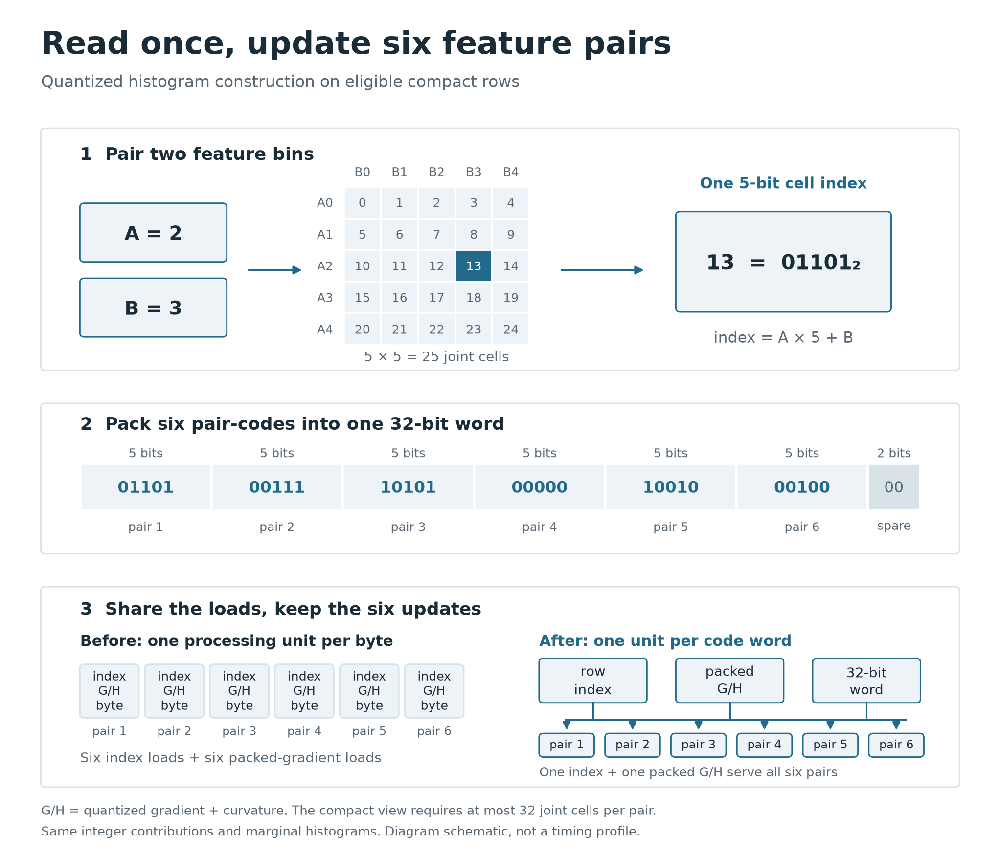
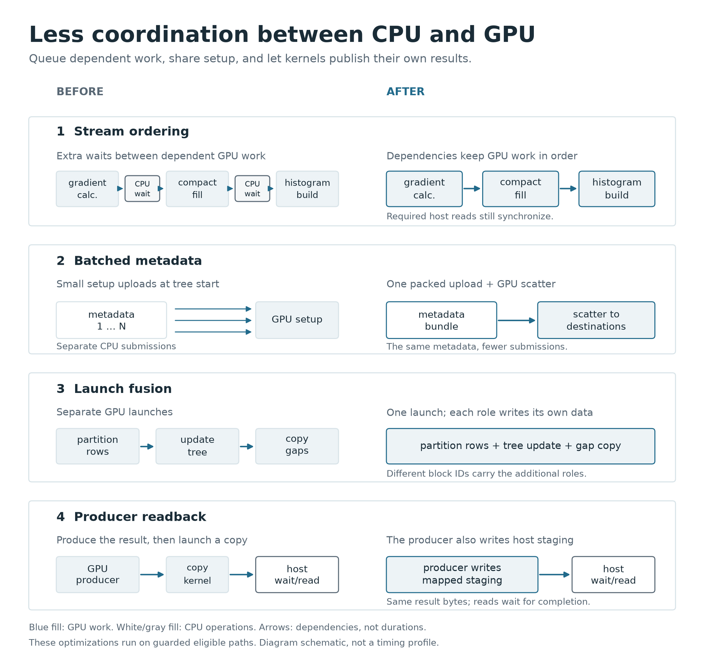

# Falcata 1.1: widening the gap

> **Release article draft, updated 21 October 2026.** Release candidate `49c5622a`.
> Its numbers were measured on master `1408ee79`, compared in one session with
> the 12 October master
> [`a65d34e8`](https://github.com/MechaFauna-ai/Falcata/commit/a65d34e80a7c337342fba6886d0a1cbd69eda079)
> (unreleased; after 1.0.5). The candidate adds only documentation (#141) and an
> `extra_trees` filter in the categorical kernel for more than 256 bins (#155), which
> no measured workload uses. The [checklist](NUMBERS.md) names the run behind every
> number; *interim* numbers come from `4641c9f0` (16 October) or a pull request's
> build and are not release-candidate results.

When we [introduced Falcata](https://www.mechafauna.ai/blog/falcata-gpu-gradient-boosting),
we showed what happens when gradient boosting gives the GPU a whole level of tree
work at a time. That architecture opened a substantial lead. Since then, we have
been working through the bottlenecks it exposed: redundant data movement, tiny
histogram tasks, repeated loads and conversations with the CPU.

**The 30,000-round Numerai-deep workload now trains in
1.8 minutes, versus 12.4 minutes in the launch
archive: 7.02× faster.** Against `a65d34e8`,
measured in the same session, the release candidate takes
105.82 s instead of 112.97 s
(1.068×). Numerai example takes
5.370 s (launch archive: 31.0 s); Epsilon deep
takes 9.822 s (launch archive: 39.3 s). Across the
article's fifteen workloads, quantized training is 1.189×
(stochastic) and 1.202× (fixed point) faster than `a65d34e8`
by geometric mean, with identical models in 28 of 30
quantized comparisons (the two exceptions, fixed-point fraud, are
[explained below](#models-that-change)).[^fixed-mean]

[^fixed-mean]: The fixed-point mean leaves out fraud deep, whose release-candidate
    model stops at 357 of 500 trees. All fifteen rows:
    1.216×; without both fixed-point fraud rows: 1.195×.

Speed is half of this release. Non-quantized CUDA training now produces the same
model on every run; random forests train on the device; bounded parts of a tree grow
without a host round trip; the JIT, the runtime tuner and an unsupported host
quantization path are gone. Several fixes change models: [see which](#models-that-change).
Configurations and full results are in the [benchmark companion](falcata-1.1/benchmarks.md).

## The gap, then and now

On the deep Numerai workload, the release candidate is about
**66.2× faster than the launch XGBoost time,
49.5× faster than CatBoost and
97.9× faster than LightGBM OpenCL**. The
launch ratios were roughly 9×, 7× and 14×. On Numerai example, the ratios are
53.3× (XGBoost) and
20.9× (CatBoost); on Epsilon deep,
5.3× and 10.3×.
Competitor times are the **August archive**, not rerun against current releases.
Quality differs (Epsilon AUC 0.9424 for the release
candidate, 0.9508 for launch CatBoost): these are training-budget comparisons, not
equal-quality claims. Times exclude construction and prediction, on one otherwise
idle RTX 5090. Release-candidate Numerai inputs are int8; the launch deep run used
float32, and the launch artifact predates the v1.0.0 tag. Only the `a65d34e8` →
release-candidate pairs are controlled.

Most of the speed comes from the quantized path. Three changes explain it best. The
per-change numbers below are dated experiments, each against its own baseline.
**Do not multiply them** into a release factor.

## 1. Give each tree the data it will actually use

Numerai is an unusually wide workload: 3,555 features, each with only a few values.
A tree that samples 10% of those features should not stream all 3,555 columns
through memory every time it builds a histogram.

Falcata already had a **compact view** at launch: a smaller matrix containing the
columns sampled by that tree. The newer work makes that view cheaper to obtain.
The GPU keeps one persistent **column-major** store, where values from one feature
sit together. A tiled gather fills the per-tree view from contiguous reads.

This removes a surprisingly expensive detour: keeping both full layouts, packing
the matrix on the CPU, uploading it, then transposing it. In the documented
6.79-million-row experiment at `feature_fraction=0.1`, steady peak device memory
above idle fell from **25.0 to 13.7 GiB**, and first-round setup fell from
**2.49 to 0.64 seconds**.

When almost every feature is sampled, a full-width view with a feature mask can
be cheaper than filling a compact copy. Until now a timed probe at the start of
training chose between them. 1.1 decides with a **static rule**
([#112](https://github.com/MechaFauna-ai/Falcata/pull/112),
[#114](https://github.com/MechaFauna-ai/Falcata/pull/114)): keep the compact view
where the pair-joint histogram kernel (section 2) can read it, which the rule
predicts from the partitions' column spans and the expected sampled share; use the
mask elsewhere. In its calibration sweep the compact view won by 30–50% where that
kernel served it and lost by 20–70% where it did not. The rule matched the probe's
choice at every measured point, without probe trees.

Making the intended fast paths eligible at the real wide shape mattered too.
Tiled fill and warp split search took the measured deep round from **29.6 to
18.3 ms**, and the example round from **17.0 to 9.0 ms**, with the same models.

The profiled fill, with sector-aligned columns and L2 prefetch, reached **83% of
peak DRAM bandwidth**.

Code: [direct layout](https://github.com/MechaFauna-ai/Falcata/commit/3d659149c3fd6744f415b0397d5f1d06f9755da5),
[tiled fill](https://github.com/MechaFauna-ai/Falcata/commit/be92c00500901b4ee63ee4a990142d87b83acd50),
[alignment and prefetch](https://github.com/MechaFauna-ai/Falcata/commit/06ef5a46e4107ebbc745acf48edf2609ce79e1eb),
[static view rule](https://github.com/MechaFauna-ai/Falcata/pull/112).

## 2. One load, six feature pairs

A tree chooses a threshold using **histograms**: sums of gradients and Hessians
for each feature bin. Gradients describe the direction a prediction should move;
Hessians describe the local curvature of the loss. Quantized training represents
these contributions with small integers, making accumulation cheaper and
independent of its execution order; `quant_mode="none"` keeps floating-point
histograms.

Low-cardinality features offer another opportunity. For two five-valued features,
there are only **25 joint states**. Instead of constructing two separate
histograms, we accumulate one joint table. Summing its rows or columns recovers
the two ordinary histograms exactly. One joint-cell update replaces two feature
updates; split search still sees the original features. In its same-build
ablation, turning joint construction OFF added **45.6% to round time**.

That joint-state index needs only **five bits**. Six indices fit in a 32-bit word,
with two spare bits. For the sampled Numerai view, sector-padded rows shrink from
**178 to 128 bytes**.

But compression alone was not the big win. An earlier experiment read 36% fewer
bytes and gained only 2–3%. The profiler showed a **load/store issue bottleneck**:
the GPU was busy issuing requests, not simply exhausting memory bandwidth.

The decisive change was assigning one thread a whole code word. One row-index
load and one packed gradient/Hessian load now serve **six feature pairs**. A warp,
the GPU's group of 32 threads, covers a compact row with **coalesced reads**.
The construct kernel issued **63% fewer load/store instructions** and fell from
**2.05 to 1.27 ms**; across 12 interleaved pairs the round fell from **4.67 to
3.84 ms (1.217×)**, with identical model fingerprints.

**Missing values as a sixth state.** When missing values get their own bin, a pair
of six-state features has 36 joint cells, more than five bits can index. On 10
October those trees lost the code-word path and trained at 193 instead of 266
trees/s. [#109](https://github.com/MechaFauna-ai/Falcata/pull/109) packs six joint
cells per word in **mixed radix** (three per 16-bit half, each in its own pair's cell
count), so 178 byte slots again fit 128-byte rows. The radix key alone measured
**1.172×** on the NaN-Numerai round (15 October, same build). From `a65d34e8`
to `4641c9f0` that cell went from **198.8 to 284.0 trees/s** with identical models
(*interim*, 16 October, two relaxed pairs).

On the release candidate, the paired six-state benchmark trains 30,000 trees at
**267.79 trees/s** with the missing state, versus
**285.05** with five numeric states
(1.064× training time, against 1.38× on
10 October); the six-state warmup took the code view in
200 of 200 trees. The 16,384-leaf FP32 recipe still
crosses a memory-admission threshold: its six-state arm falls back to the
full-width mask view and reaches **10.76**
versus **64.35 trees/s**
(5.983× training time;
[details](falcata-1.1/benchmarks.md#five-values-versus-five-values-plus-missing)).

Code: [joint histograms](https://github.com/MechaFauna-ai/Falcata/commit/4da13ec904d51eb851eba7ec5187ff69a78fd1c1),
[five-bit view](https://github.com/MechaFauna-ai/Falcata/commit/4767ce8bc1ee358d50e51fd5098db1b3e7005e27),
[one thread per word](https://github.com/MechaFauna-ai/Falcata/commit/f8417c77906b85ddd1dc8a3b17467c46eff353e5),
[mixed-radix view](https://github.com/MechaFauna-ai/Falcata/pull/109).

## 3. Keep useful work in flight

A fast histogram kernel can still spend much of its time waiting for scattered
memory reads. **Occupancy** describes how much thread work can remain resident on
a GPU multiprocessor. Enough independent work lets it execute another warp while
the first waits for data.

A spill-free 48-register pair construct, selected using CUDA's occupancy API,
kept **36 warps resident** where the 64-register version kept one block; a
40-register version spilled and lost. Roughly fourteen tiny metadata uploads became
one upload and a GPU scatter, compatible kernels share launches, and stream
dependencies order work without making the CPU wait at every step. One measured
package reduced a round from **5.82 to 5.09 ms** over 12 interleaved pairs, with
identical models.

**Fewer conversations with the host.** A level-batched tree still returned to the
CPU after every level, although nothing on the host needs deciding while the leaf
budget cannot bind. [#123](https://github.com/MechaFauna-ai/Falcata/pull/123)
enqueues the first `min(floor(log2(num_leaves)), max_depth - 1, 10)` levels of
eligible quantized trees without per-level readbacks: a device selector reproduces
the host's split order, and one readback at the prefix boundary restores host
bookkeeping. In a profiled covtype tree, host synchronization calls fell from 21
to 3. The end-to-end effect is modest and selective (*dated*, 17 October, relaxed
pairs on the PR build): 1.05× on covtype, 1.02× on Higgs, about 1.00× on Numerai,
and 0.98–0.99× on two hidden test shapes. If graph captures of the prefix keep
missing, later trees return to the host path.

[#130](https://github.com/MechaFauna-ai/Falcata/pull/130) adds an **opt-in** whole
bounded tree on the device (`cuda_plan="auto,device_levels:off,device_tree:on"`)
for scalar, numerical, single-GPU quantized trees with `max_depth <= 10` and
`2^max_depth <= num_leaves`. On the 30,000-round Numerai target it measured a median
1.0037× over 12 alternating pairs (18 October), so it stays off by default.
Automatic selection between these controllers is under validation and may land
separately.

Code: [resident work](https://github.com/MechaFauna-ai/Falcata/commit/be446048d326c0382ef067cca6c9bfe568f67d14),
[metadata batching](https://github.com/MechaFauna-ai/Falcata/commit/0199a6a30fb7aa70ec1b3d1fba7eb932332bc558),
[device prefix](https://github.com/MechaFauna-ai/Falcata/pull/123),
[device tree](https://github.com/MechaFauna-ai/Falcata/pull/130).

## Non-quantized training is deterministic by default

Quantized training was already run-to-run deterministic: integer sums do not
depend on the order in which GPU threads add them. Non-quantized training was not.
Its batched level construct added floats with atomics, so every depth-limited shape
we tried produced a different model on each run.

[#122](https://github.com/MechaFauna-ai/Falcata/pull/122) keeps that kernel's
structure and makes its arithmetic integer: per tree, the largest gradient and
Hessian set a scale, each value rounds once to a 64-bit fixed-point integer, and one
convert kernel per level turns the sums back into floating-point histograms.
Where the sums are exact, the histograms equal those of the slower ordered kernels.
The plan key is `nonquant_deterministic`; `:off` restores the float atomics.

On the article's thirteen non-quantized workloads the cost was 0.96–1.08× in
training time, geometric mean 1.010 (*interim*, 16 October, same binary, key off
versus on); Higgs deep is the costliest. On the release candidate, non-quantized
training runs at 1.006× the speed of `a65d34e8` by geometric mean,
with one model per shape in 13 of 13 workloads. Four of the six
deep shapes are slower (Higgs 0.889×, Epsilon
0.890×, Year 0.929×, Airline
0.944×); Higgs deep is outside #122's measured cost, and the
cause of the difference is not isolated. Linear
trees, ranking objectives, multi-GPU training and non-quantized vector leaves
remain nondeterministic.

## Random forests on the device

Random forests (`boosting=rf`) used to pay for constant gradient uploads and score
copies every tree, grew one tree at a time, and fell back to the slowest per-split
loop whenever features were sampled per node. Five changes address this:

- [#103](https://github.com/MechaFauna-ai/Falcata/pull/103) gives forests the CUDA
  objective and metrics and defers the training score until something reads it.
- [#113](https://github.com/MechaFauna-ai/Falcata/pull/113) brings per-node feature
  masks into the level-batched flows, each drawn from a generator keyed by seed,
  tree and node path.
- [#115](https://github.com/MechaFauna-ai/Falcata/pull/115) and
  [#116](https://github.com/MechaFauna-ai/Falcata/pull/116) grow a forest's trees
  together, one learner per tree in flight; the forest is the sequential forest,
  model for model.
- [#121](https://github.com/MechaFauna-ai/Falcata/pull/121) builds histograms from
  counts: a forest's gradients take few values per class tree, so one-byte row codes
  and integer counts reproduce the floating-point sums exactly.

Count histograms alone made the non-quantized forest test cells 2.6–10.4× faster
(*interim*, 16 October, against `4641c9f0`). In 100-tree benchmarks against cuML's
random forest at the same depth, Falcata's fit time went from up to 5.2× cuML's to
0.3–2.1× (*interim*, same day).

## Less machinery

Three mechanisms that 1.0 carried are gone, each after an audit showed it did not
pay for itself:

- **The NVRTC construct JIT** ([#110](https://github.com/MechaFauna-ai/Falcata/pull/110))
  never ran by default and was slower on every audited shape when forced. Removing
  it also drops the `libnvrtc` runtime dependency.
- **The runtime tuner** ([#114](https://github.com/MechaFauna-ai/Falcata/pull/114)):
  the knob bandit, the view probe and the wisdom file under `$HOME`. Its knobs are
  now static, and timing was within noise.
- **Host quantized training** ([#148](https://github.com/MechaFauna-ai/Falcata/pull/148)),
  which CPU and OpenCL already rejected: about 1,480 unreachable lines.

Plan strings naming removed keys log a warning and train the default plan.

## How we found the gains

We used **kernel evolution**. Early searches replayed real GPU launches, one kernel
at a time; later, Claude Code workers edited separate branches of the library, each
starting from a profiler observation, a hypothesis and a test that could refute it.
An operator measured candidates, checked model identity and requested independent
review. The code-word optimization's first hypothesis, fewer bytes, was refuted;
the second, shared loads, survived. The mixed-radix view came out of a later
search night the same way.

The [interactive explorer](falcata-1.1/lineage-explorer.html) is a frozen 9 October
export of **13 campaigns and 533 candidate/replay records**; later search nights
are not included. Speed, checks and parent-relative verdicts have separate filters.
Download the single HTML file and open it in a browser; the
[coverage notes](falcata-1.1/benchmarks.md#kernel-evolution-history) explain it.

## Beyond the quantized hot loop

- **Split search on broader data.** Warp-sized tasks and FP32 screening reduce
  exact work while preserving the winning split (40-bin synthetic shape: **1.459×**).
- **Sparse-ish data on the dense path** ([#101](https://github.com/MechaFauna-ai/Falcata/pull/101)):
  a few-bin test shape went from 12.3 to 1.46 ms per round (*interim*, `a65d34e8`
  versus `4641c9f0`).
- **Already in 1.0.5.** Vector leaves for up to 16 targets, ObliquePool sparse
  projections, random categorical subsets, chunked device input and packed storage
  ([release notes](https://github.com/MechaFauna-ai/Falcata/releases/tag/v1.0.5)).

## Stable classification on CPU and FP64 CUDA

Confident classification predictions can leave tiny Hessians and huge Newton
updates; on the older unbounded deep recipe, fraud probabilities saturated and
covtype quality collapsed, in FP64 too. [PR #91](https://github.com/MechaFauna-ai/Falcata/pull/91)
makes `max_delta_step=-1` automatic for non-quantized binary, softmax and one-vs-all
classification with GBDT, GOSS or DART: learned constant-leaf updates are limited to
one unit of the linked score. [PR #93](https://github.com/MechaFauna-ai/Falcata/pull/93)
fixes two CPU empty-child assertions by checking the actual row partition before
committing a split.

The coverage cohort spans fraud and covtype, 20 training seeds, five fresh splits
and eight stress profiles per dataset and backend. The CPU half (66 guarded
configurations plus eight tiny-leaf seed cases, 12 October) passed all 500 rounds,
and again on `1408ee79` (74 of 74).
The FP64 CUDA half was rerun on `1408ee79`, because #122 and #154 change
its models: **66 of 66** passed, and
2 of 2 uncapped controls reproduced
runaway margins. Tree fingerprints match October's in only
2 of 68 CUDA cases, as those fixes predict; the
claim is the gates, not bit identity. `0` restores unbounded updates; regression, custom objectives and
random forests are outside the automatic bound. The
[stability report](falcata-1.1/stability.md) has recipes, builds and quality ranges.

## Correctness fixes

- **`rank_xendcg` on queries of 65,536+ items** crashed CUDA training
  ([#131](https://github.com/MechaFauna-ai/Falcata/pull/131)).
- **Columns with more than 6,144 bins** overlapped the previous shared-memory
  partition under non-quantized CUDA training
  ([#132](https://github.com/MechaFauna-ai/Falcata/pull/132)).
- **Split-less roots of whole device trees** became stumps where the host kept
  growing ([#153](https://github.com/MechaFauna-ai/Falcata/pull/153)).
- **Column sampling on bundled data** built the wrong columns, consistently across
  every plan ([#154](https://github.com/MechaFauna-ai/Falcata/pull/154)).
- **Categorical `extra_trees`** drew its random threshold on every thread
  ([#135](https://github.com/MechaFauna-ai/Falcata/pull/135)), and **quantized root
  sums** lost low Hessian bits when their packed 64-bit total passed through a double
  ([#146](https://github.com/MechaFauna-ai/Falcata/pull/146)).

### Models that change

These fixes change some model outputs versus 1.0.5, on CUDA and, for #91, on CPU:

| Change | Affected inputs | Before |
| --- | --- | --- |
| #122 deterministic non-quantized construct | `quant_mode=none` with depth-limited trees, `feature_fraction < 1` or levels wider than the ordered kernels' buffer; `cuda_precision=fp32` | A different model per run |
| #146 integer root statistics | Fixed-point runs whose integer root gradient sum reaches 2^21 (strong class imbalance under the outlier-robust scale); of the 43 measured workloads, only the two fixed-point fraud shapes changed | Low Hessian bits of the packed root total lost |
| #91 automatic classification step limit | Non-quantized binary, softmax and one-vs-all classification with GBDT, GOSS or DART, on CPU and CUDA | Unbounded Newton steps (`max_delta_step=0` restores them) |
| #154 column sampling | Data with bundled features (for example one-hot blocks, as in covtype) and `feature_fraction < 1`, every plan | The wrong columns sampled |
| #154 root histogram clear | Quantized runs where a level-wise root finds no split | The classic root search counted the root twice and could still split |
| #135 categorical extra trees | `extra_trees=true` with more categories than `max_cat_to_onehot` | Run-to-run variation; now the most common former model |

Output also changes where it was wrong: quantized sparse rows wider than 504
elements ([#102](https://github.com/MechaFauna-ai/Falcata/pull/102)), quantized
`feature_fraction_bynode < 1` and interaction constraints
([#107](https://github.com/MechaFauna-ai/Falcata/pull/107); node samples come from
per-node generators since [#113](https://github.com/MechaFauna-ai/Falcata/pull/113)),
weighted L1/quantile initialization ([#124](https://github.com/MechaFauna-ai/Falcata/pull/124)),
non-quantized CUDA columns with more than 6,144 bins
([#132](https://github.com/MechaFauna-ai/Falcata/pull/132)),
and non-quantized forests deeper than 12 levels or with sampled features
([#121](https://github.com/MechaFauna-ai/Falcata/pull/121)). The Numerai benchmark's
quantized model is identical to `a65d34e8`'s.

In the release comparison every quantized classic and Numerai model is byte-identical
to `a65d34e8`'s except fraud shallow and deep in fixed-point mode. Bisected: the
shallow model changes with #146 alone; the deep model changes with #146 and again with
#154, whose root-histogram clear makes it stop at 357 of 500 trees
([mechanism](falcata-1.1/benchmarks.md#fixed-point-fraud)). Held-out AUC goes from 0.9780 to
0.9774 (deep) and from 0.9790 to
0.9808 (shallow); for scale, 20 training seeds of the
non-quantized FP64 CUDA stability recipe span 0.9697–0.9850.
Non-quantized models differ from `a65d34e8`'s on all thirteen workloads, because
`a65d34e8`'s differed from run to run (#122).

## Speed has to survive the checks

The release candidate's nightly gates passed: 4 canonical
model gates, 310 fuzz specifications without a failure and
the CUDA suite with 2,422 tests passed
(189 skipped). On `1408ee79`, the
verification lattice has 441 cells, and CI passed the CPU and
C API suite (1,396 tests), the C++ suite
(59) and all 20 checks. Mechanical optimizations
have identity checks; numerical changes need fresh quality evidence. Losing
experiments stay visible: forced quantized CUDA graphs remain opt-in, and the device
prefix's regressions stay in its record.

An earlier draft of this article reported an unmerged non-quantized prototype
([#71](https://github.com/MechaFauna-ai/Falcata/pull/71)). Its premise, unordered
floating-point histograms, is gone with #122, and it is not part of 1.1; its scan
speedups will be ported onto the deterministic construct later. The
[dead ends](../perf-dead-ends.md) record ideas that did not earn a place in the
defaults.

The familiar `falcata.train()` API remains. The largest gains came from asking
more useful questions of the same hardware: which bytes does this tree need,
which loads can its features share, and which waits does the algorithm require?

Falcata is MIT licensed and derives from LightGBM (Microsoft Corporation and the
LightGBM developers). [Code and contributions](https://github.com/MechaFauna-ai/Falcata).
