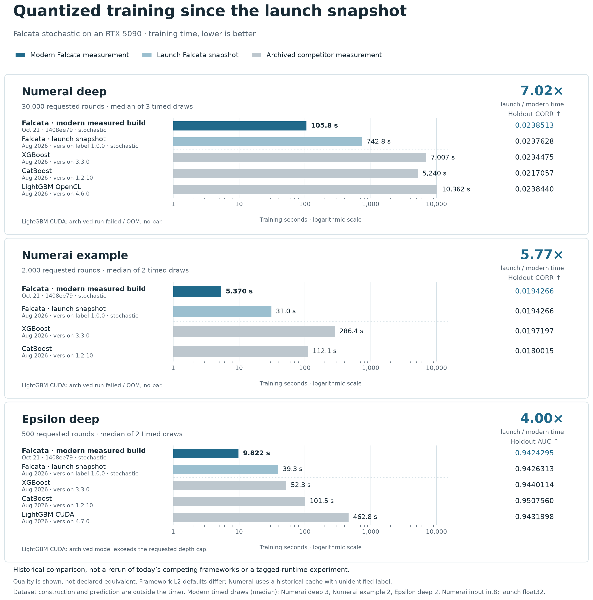
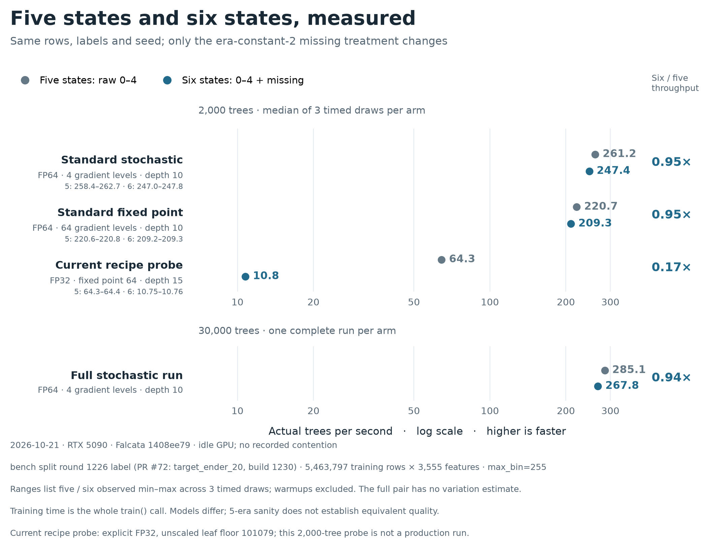

# Falcata 1.1 article: measurements and release scope

Editorial companion, updated 21 October 2026. The [article](../falcata-1.1.md) keeps the
main narrative short; this file keeps the comparisons and limits inspectable.
Version 1.1 is a release candidate, `49c5622a`, not yet published. Its numbers were
measured on master `1408ee79` on 21 October; the candidate adds only
documentation (#141) and an `extra_trees` filter in the categorical kernel for more
than 256 bins (#155), which no measured workload uses. The
[checklist](../NUMBERS.md) names the run behind each number. *Interim* numbers were
measured on `4641c9f0` (16 October) or on a pull request's own build. Dated numbers
keep their original build and date.

## Which comparisons the article makes

| Comparison | Before | After | Interpretation |
| --- | --- | --- | --- |
| Controlled release comparison | [`a65d34e8`](https://github.com/MechaFauna-ai/Falcata/commit/a65d34e80a7c337342fba6886d0a1cbd69eda079), 12 October master (unreleased, 217 commits after the v1.0.5 tag) | Release candidate, measured on `1408ee79` | Same machine and session, two interleaved fresh-process pairs per workload and mode; model MD5 per run |
| Headline Numerai deep | `a65d34e8` | Release candidate | Three strict draws per arm at 30,000 rounds |
| Launch → release candidate | August launch benchmark, labelled 1.0.0; covtype forensics identify the pre-tag artifact `724e9358` | Release candidate | Dated archive against a new measurement; not a controlled tagged-v1.0.0 → v1.1 experiment |
| Classification stability | Unbounded controls | CPU: per-case builds through PR #93 (`08c37d95`, merged as `a65d34e8`); FP64 CUDA: release candidate | Quality and stability evidence, no timing comparison |
| Mechanism experiments | Each documented preceding development build, or a same-binary key OFF | The corresponding key or package ON | Local effects with their own shapes and timing windows; **do not multiply them** into a release claim |
| Interim measurements | `a65d34e8`, or a key OFF | `4641c9f0`, or the key ON on a pull request's build | Context only; replaced by release-candidate numbers where a placeholder exists |
| Other frameworks | August benchmark versions and configurations | No new competitor measurement | **August archive**: reference bars, not claims about current engine releases |

Every chart measures training, excluding construction, prediction and evaluation.
The benchmark convention retains each engine's own default L2 penalty, so engines
also differ in regularization and model structure. Equal tree budgets do not
establish equal-quality training. All workloads use one RTX 5090.

The launch snapshot is recovered from
[the original committed raw file](https://github.com/MechaFauna-ai/Falcata/blob/8c28184f25564f786d9ef042a6af4acdd680bdc3/docs/perf-plots/data/runs.jsonl).
The currently checked-in performance snapshot replaces covtype's Falcata rows
after the Hessian-ridge correction; it must not be treated as an untouched launch
file. Individual appended launch records do not pin their binaries.

## Framework figure



The [compact chart data](framework-comparison-data.json) and
[generator](plot_framework_comparison.py) retain exact values and provenance.
The [complete matrix](benchmark-matrix.json) holds all fifteen workloads, three
Falcata modes, the archived competitors, raw endpoint identities, quality
intervals, failures and source hashes. The [mode table](appendix-table.md) lists
every Falcata workload and mode for `a65d34e8` and the release candidate; the
[framework table](framework-table.md) sets the release candidate beside the
August competitor archive.

**Numerai deep:** 5,463,797 training rows × 3,555 features (native int8); 30,000
requested rounds, learning rate 0.001, depth 10, 1,024 leaves, feature fraction 0.1,
`min_data_in_leaf=10000`, `max_bin=255`, seed 42 and 32 CPU threads. Stochastic
quantization resolves to four gradient bins. Release candidate:
105.82 s, median of three strict draws; `a65d34e8`:
112.97 s; holdout CORR 0.02385.
The launch archive's 742.8 s used float32 input. Interim: `4641c9f0` took 108.5 s
against 114.4 s for `a65d34e8` (two relaxed pairs, 16 October, identical models).

**Numerai example:** same training shape, 2,000 rounds, learning rate 0.01,
32 leaves, depth 5 and feature fraction 0.1. Release candidate
5.370 s against 5.620 s;
CORR 0.01943. Launch archive: 31.0 s (float32 input).

**Epsilon deep:** 400,000 training rows × 2,000 features, 500 rounds,
learning rate 0.1, 1,023 leaves and depth 10. Release candidate
9.822 s against 11.460 s;
AUC 0.9424. Launch archive: 39.3 s. Archived competitor AUCs
differ, particularly CatBoost's 0.9507561. Do not describe these bars as an
equal-quality result.

The release-candidate library SHA256 is `c1902dce58ac356c9964a708e700e438062c596104617f4d91d243bcce26839a`. Across all
quantized workloads and both quantized modes, 28 of 30
comparisons produced the same model on both builds; geometric-mean speedups are
1.189× (stochastic) and 1.202× (fixed point, without
fraud deep; all fifteen rows 1.216×, without both fixed-point fraud rows
1.195×).
The two exceptions are fraud shallow and deep in fixed-point mode (bisected below): the
shallow model changes with #146 alone, the deep model with #146 and then #154, which
stops it at 357 of 500 trees, so its 1.433× is not a like-for-like speedup. Held-out AUC:
0.9780 → 0.9774 (deep),
0.9790 → 0.9808 (shallow).
Interim, `a65d34e8` → `4641c9f0` on 16 October: 1.13× and 1.16×, ranging 1.01–1.37×
per workload, every quantized model identical.

### Fixed-point fraud

Each merge from `a65d34e8` to `1408ee79` was built and both fraud fixed-point shapes
rerun; the two endpoint builds reproduce the A/B models exactly.
[#146](https://github.com/MechaFauna-ai/Falcata/pull/146) changes both shapes and
gives shallow its final model.
[#154](https://github.com/MechaFauna-ai/Falcata/pull/154) changes deep a second time;
no other merge changes either model.

**#146.** The root reduction sums the packed 64-bit total (gradient sum shifted left
by 32, plus Hessian sum) exactly in integers, but stored it in a double before
converting it back. No root statistic comes near 2^53; the packed word does as soon as
the integer gradient sum reaches 2^21 (about 2.1 million), and from there the double
drops low Hessian bits. Fraud gets there because fixed-point mode's outlier-robust
scale maps the bulk of the gradients to +32 and clips the 394 positives at -32, so they
hardly cancel: about 7.27 million at the first iteration, an estimate by hand, not a
measurement. Stochastic quantization's values of at most ±2 keep fraud below 2^21, and
on balanced data the gradient sum cancels in both modes, which is why every other
quantized model is byte-identical. In the models, the first tree is identical, then
one leaf's Hessian sum differs in the seventh digit (second tree deep, third tree
shallow) and the models diverge.

**#154.** When the level-wise prefix found no split at the root, its root histogram
stayed in slot 0, and the leaf-wise tail's classic root search added onto it,
counting the root twice, and could still find a split. #154 clears the slot first, so
such a round ends in a single-leaf tree; deep fraud now stops after 357 trees (the
stop is read from the code and the commit, not traced).

Historical Numerai scores retain their original benchmark evaluation; the cache's
target label is unidentified, so these are reproduction metrics, not target
selection or a production release. Published evidence normalizes machine-specific
paths; original-source SHA256 values still identify the unmodified source bytes.

## Non-quantized training

Since [#122](https://github.com/MechaFauna-ai/Falcata/pull/122), non-quantized CUDA
training builds its level histograms with a 64-bit fixed-point accumulator and is
run-to-run deterministic by default (`nonquant_deterministic`). On the article's
thirteen non-quantized workloads, key off versus on on the same binary cost
0.957–1.084× in training time, geometric mean 1.010 (*interim*, 16 October; Higgs deep
1.084, covtype deep 0.957). Against `a65d34e8`, whose non-quantized models differed
from run to run, the release candidate measures 1.006× by
geometric mean and produced one model per workload in
13 of 13 workloads. Four of the six deep shapes are slower: Higgs
0.889×, Epsilon 0.890×, Year
0.929× and Airline 0.944× (speedup =
`a65d34e8` seconds / release-candidate seconds); Covtype deep (1.040×)
and Fraud deep (1.099×) are faster. Higgs deep is outside the range
#122 cost on its own, so the cause of the slowdown is not isolated. Fraud's non-quantized AUC is now
0.9771 (shallow) and 0.9695 (deep);
the October matrix recorded 0.515 and 0.739 there, before the automatic step limit
(#91). Numerai deep and leaf-limited are not run
in non-quantized mode (20–45 minutes per run).

The October non-quantized figures of the earlier draft came from the unmerged
[PR #71](https://github.com/MechaFauna-ai/Falcata/pull/71) prototype, before the
automatic classification limit and before #122. They are not part of 1.1 and are
removed from this companion; the
[immutable report](https://github.com/MechaFauna-ai/Falcata/blob/523ed775ad2eec9eeca147c4815c39a8f9400f70/docs/2026-10-09_noquant-timings.md)
keeps them. On the same shapes, `a65d34e8`'s non-quantized training was 1.04–2.1×
slower than those prototype bars (16 October). Porting the prototype's scan
speedups onto the deterministic construct is future work. The uncapped FP64 fraud
failures and the separately labelled `max_delta_step=1` follow-up stay in the
[dated diagnosis](https://github.com/MechaFauna-ai/Falcata/blob/523ed775ad2eec9eeca147c4815c39a8f9400f70/docs/2026-10-09_fraud-followup.md).

## Classification stability and split correctness

Merged [PR #91](https://github.com/MechaFauna-ai/Falcata/pull/91) adds the automatic
classification step policy; [PR #93](https://github.com/MechaFauna-ai/Falcata/pull/93)
fixes the separate empty-child partition failure exposed by broad coverage. The
[stability report](stability.md) and [portable evidence](stability-data.json) keep
the CPU half as measured on 12 October (66 guarded configurations plus eight extra
tiny-leaf seed runs, all 500 rounds; rerun on `1408ee79`:
74 of 74) and the FP64 CUDA half as rerun on
`1408ee79` (66 of 66), because #122 and
[#154](https://github.com/MechaFauna-ai/Falcata/pull/154) change non-quantized CUDA
models on these recipes.

[PR #90](https://github.com/MechaFauna-ai/Falcata/pull/90) separately corrects
benchmark accounting for stopped or saturated runs. Older harness records lacking
accepted-tree counts retain that limitation.

## Mechanism measurements

These have different local baselines. Profile timings describe kernels; ablations
describe a complete measured round. Leave-one-out effects interact. Rows below the
rule were measured after `a65d34e8`, each on its own pull request's build.

| Change | Recorded effect | Scope and limitation |
| --- | --- | --- |
| Direct column-major lifetime | 25.0 → 13.7 GiB above idle; first round 2.49 → 0.64 s | Full 6.79M-row, 3,555-feature shape, feature fraction 0.1 |
| Wide fast paths engaged | Deep 29.6 → 18.3 ms; example 17.0 → 9.0 ms | 300-round interleaved probes on the full 6.79M-row shape; identical models |
| Pair-joint histogram | Turning it OFF adds 3.85 ms/round, 45.6% | Same-build leave-one-out, four pairs; this does not mean 45.6% less elapsed time |
| Root histogram during compact fill | OFF adds 0.83 ms/round, 9.9% | Same branch/four pairs; interacts with pair-joint construction |
| Occupancy and tree scheduling package | 5.95 → 5.38 ms, 1.105× [1.099, 1.111] | Six interleaved pairs; 500 rounds timed from 200; identical models |
| Fill, level kernels and host scheduling | 5.82 → 5.09 ms, 1.143× [1.130, 1.156]; 163.3 → 185.6 trees/s at 30k | Twelve per-round pairs; full-run 2×ABBA; identical models |
| Five-bit code-word package | 4.67 → 3.84 ms, 1.217× [1.211, 1.223]; 202.1 → 246.4 trees/s at 30k | Twelve per-round pairs; full-run ABBA; only eligible sampled compact shapes |
| Code-word grid/readback/apply follow-on | 3.950 → 3.607 ms, 1.095× [1.053, 1.141] | Three interleaved pairs, rounds 200..30000; identical models |
| Experimental full-run follow-on | 246.2 → 268.2 trees/s | ABCCBA with `pair_code5_epilogue` ON; it later lost 0.5% in isolation and defaults OFF |
| Generic warp finder, covtype | 4.94 → 4.27 ms, 1.157× | Actual fixedpoint deep workload, 1,000 rounds, three pairs; same model |
| Generic warp finder, Higgs-like | 2.89 → 2.63 ms, 1.094× | Generated 4M×28 continuous shape; same model |
| Generic warp finder, Epsilon-like | 9.41 → 6.44 ms, 1.459× | Generated 388k×2,321, 40-bin shape; not real Epsilon |
| Generic warp finder, Year-like | 4.34 → 3.91 ms, 1.109× | Generated 3.4M×93 continuous shape; same model |
| Generic warp finder, Numerai | 3.964 → 3.976 ms, 0.997× | Narrow tasks do not take the changed generic finder |
| Native input representation | int8 3.89 s/32.3 GiB RSS versus float32 31.34 s/64.9 GiB | Fresh construction within one build; no held-out scoring and no causal before/after attribution |
| Forced quantized graphs | ON slower in all seven rerun cases | Same selected binary, matching timed fingerprints; remains opt-in |
| **Since `a65d34e8`** | | |
| Mixed-radix six-bit pair view (`pair_code_radix`, #109) | NaN-Numerai 4.23 → 3.61 ms/round, 1.172× | Same binary, key off/on, two pairs, 15 October; identical models; other cells do not take the view |
| Register-coefficient wide pack (`pair_code_wide_regs`, #109) | NaN-Numerai 1.059×; fill 1.462 → 1.224 ms per tree | Same binary, two pairs; Nsight fill time |
| Static view rule (`view_pair_rule`, #112/#114) | Compact view 30–50% faster where the pair-joint construct serves it, 20–70% slower where not | Calibration sweep, forced compact versus mask; the rule matched the removed probe at every measured point |
| Tuner removal (#114) | 0.998–1.002× on three cells | Default plan, three pairs; identical models |
| Dense row-wise bin for sparse-ish data (`dense_rowdata`, #101) | Few-bin hidden shape 12.32 → 1.46 ms/round | *Interim*: `a65d34e8` versus `4641c9f0`, two relaxed pairs; includes later changes |
| Deterministic non-quantized construct (#122) | Cost 0.957–1.084×, geometric mean 1.010 | Thirteen article shapes, same binary, key off/on |
| Device prefix (`device_levels`, #123) | 0.985–1.051× per cell; host sync calls 21 → 3 in one covtype tree | Two relaxed pairs, eight GBDT cells; forests use the host fallback |
| Whole device tree (`device_tree`, #130, opt-in) | Median 1.0037× [1.0027, 1.0053] | Numerai 30,000 rounds, 12 alternating pairs |
| Forest count histograms (`forest_count_hist`, #121) | Forest cells 2.59–10.35×; 100-tree non-quantized fits 2.0–15.3× | Non-quantized forests only; against `4641c9f0`; relaxed |
| Per-node masks in level flows (`level_bynode_masks`, #113) | Forest cells 3.6–18.7× | Against master `c8019697`, 15 October; per-node masks change models by design |
| Random forest on the device (#103) | Higgs rf 10.70 → 2.02 ms/round; covtype 13.92 → 4.16 | ABBA, two runs per arm; identical models |

The [performance notes](../../performance.md) contain the experiments and guards.
The [mechanism generator](plot_mechanisms.py) reproduces both diagrams. Their
arrows describe dependencies, not measured durations; required host reads still
synchronize.

## Other changes since the original release

Hybrid level batching, compact views, FIL, FALB, GPU-native ingestion and
level-batched NCCL were already present in v1.0.0; their original ablations should
not be marketed as newly added gains. The runtime construct JIT and the tuner/wisdom
stack were also present in v1.0.0 and are removed in 1.1
([#110](https://github.com/MechaFauna-ai/Falcata/pull/110),
[#114](https://github.com/MechaFauna-ai/Falcata/pull/114)).

| Family | Since-launch additions | Implementation |
| --- | --- | --- |
| Modeling | Vector-leaf multi-regression up to 16 targets; ObliquePool sparse projections; random categorical subsets | [Vector integration](https://github.com/MechaFauna-ai/Falcata/commit/428307adde2d9f74c272778d1d0d6823f049a3b1), [projections](https://github.com/MechaFauna-ai/Falcata/commit/5f91b4cf17a1f05c698869ab31dfbe22bd85ea83), [categories](https://github.com/MechaFauna-ai/Falcata/commit/ab8264b8139374a2df469e120c8a8536227479c9) |
| Data interfaces | Packed/chunked CUDA arrays, device dataset builder, integer/float16 missing sentinels | [Builder](https://github.com/MechaFauna-ai/Falcata/commit/929580a7a68d4596ab91adb4adc66dce7185d31c), [sentinel](https://github.com/MechaFauna-ai/Falcata/commit/570c1e80c07b22486a4b3d58877b5b4bf7c7eaf2) |
| Training controls | Evaluation frequency, evaluation-count early stopping, minimum iterations, callback state repair | [Frequency](https://github.com/MechaFauna-ai/Falcata/commit/57f714ceee62a09eaeab46703580a20a6841fcbb), [minimum iterations](https://github.com/MechaFauna-ai/Falcata/commit/89f7456dbb5b91f6ad5f93fb07b72e594f5d64cb) |
| Preparation | Pooled pinned buffers, chunk-copy/binning overlap, radix sorting, avoided initialization, early CUDA context creation, device categorical binning | [Overlap](https://github.com/MechaFauna-ai/Falcata/commit/566a0cff3743f1042b0724f3726a3395af5982da), [radix sorting](https://github.com/MechaFauna-ai/Falcata/commit/56cf5e8b103467af5098be73b2b2de35bc967a12) |
| Numerical contracts | Deterministic CPU-order histogram/split routes; error-feedback dither; Hessian-quantum ridge under bagging and variable Hessians | [Parity](https://github.com/MechaFauna-ai/Falcata/commit/d53aa45c4bc1d3e44959b47dfd625635699a3386), [dither](https://github.com/MechaFauna-ai/Falcata/commit/75a77dc08e25dfca03d46fa79f1e9611f4e7ea77), [ridge](https://github.com/MechaFauna-ai/Falcata/commit/ef8203fbf33eaee6b76a147e3b86f997c47882ab) |
| Lifecycle | Importer routing/order, constant trees, model round trips/statistics, transactional mode resets and cached-predictor invalidation | [Lifecycle](https://github.com/MechaFauna-ai/Falcata/commit/116f8b54d74f6c494cb05d47636df16e10fb24e2), [reset guard](https://github.com/MechaFauna-ai/Falcata/commit/dbcdab292ffe398e0bd248bd2a48f9a41647f2ba) |
| Prediction | FIL bounded slabs and large-input indexing repairs | [Slab scoring](https://github.com/MechaFauna-ai/Falcata/commit/f88b34ad996c2b1f9cf35cd7472909e5f766941a) |
| Distribution | Automatic CUDA selection, toolkit/wheel repairs, lazy CUDA-driver/NCCL loading, CUDA 13 support; 1.0.5 wheel 99.1 → 71.3 MB | [Lazy driver](https://github.com/MechaFauna-ai/Falcata/commit/ea8301a509cb45f87bdf45f8b28b9fa3589833df), [1.0.5 notes](https://github.com/MechaFauna-ai/Falcata/releases/tag/v1.0.5) |
| Random forests (1.1) | Device objective and lazy score, per-node masks in level flows, trees grown together, count histograms | [#103](https://github.com/MechaFauna-ai/Falcata/pull/103), [#113](https://github.com/MechaFauna-ai/Falcata/pull/113), [#115](https://github.com/MechaFauna-ai/Falcata/pull/115), [#116](https://github.com/MechaFauna-ai/Falcata/pull/116), [#121](https://github.com/MechaFauna-ai/Falcata/pull/121) |
| Determinism (1.1) | Non-quantized CUDA training deterministic by default | [#122](https://github.com/MechaFauna-ai/Falcata/pull/122) |
| Host round trips (1.1) | Device-driven level prefix; opt-in whole device tree | [#123](https://github.com/MechaFauna-ai/Falcata/pull/123), [#130](https://github.com/MechaFauna-ai/Falcata/pull/130) |
| Removals (1.1) | Construct JIT and `libnvrtc`; runtime tuner, view probe and wisdom file; host quantized training | [#110](https://github.com/MechaFauna-ai/Falcata/pull/110), [#114](https://github.com/MechaFauna-ai/Falcata/pull/114), [#148](https://github.com/MechaFauna-ai/Falcata/pull/148) |

## Five values versus five values plus missing

This paired comparison uses the Numerai pipeline's exact conversion: features
constant at 2 over a complete source era become native int8 -1 (missing), then real
NaN for CPU prediction. Ordinary twos and zeros stay numeric. On the release
candidate both arms use the Numerai benchmark split (round 1226, `target`, 5,463,797
training rows, 3,555 features, eras 1–1016); the 10 October run used frozen build 1230
(5,502,748 rows, Ender20 target), whose matrices are no longer on disk. The same rule
gives the same bin layout (1,583 five-bin, 1,942 six-bin and 30 constant features), so
five versus six compares, but absolute trees/s are not October's rows. These times
must not be compared as a release speedup against the old cache.

**Release candidate** (six-state driver, same recipes as on 10 October):

| Recipe | Trees per draw | Five-state trees/s | Six-state trees/s | Six/five training time |
| --- | ---: | ---: | ---: | ---: |
| Standard stochastic, FP64 | 2,000; median of 3 | 261.21 | 247.42 | 1.056 |
| Standard fixed point, FP64 | 2,000; median of 3 | 220.70 | 209.33 | 1.054 |
| 16,384-leaf recipe, fixed point, explicit FP32 | 2,000; median of 3 | 64.35 | 10.76 | 5.983 |
| Standard stochastic, FP64 | 30,000; one pair | 285.05 | 267.79 | 1.064 |



**Dated, 10 October, before #109:** 246.28 / 180.36, 211.77 / 174.99, 88.21 / 10.29
and 266.19 / 192.65 trees/s for the same four rows. Six-by-six pairs need 36 joint
cells, beyond the five-bit view's 32; the standard six-state warmups took the code
view in 0 of 200 trees, against 191 of 200 with five states. The 16,384-leaf recipe
additionally crossed a memory-admission threshold: its six-state compact view no
longer fit and the planner fell back to a full-width masked view with `row_batch`
histograms.

[#109](https://github.com/MechaFauna-ai/Falcata/pull/109) packs six joint cells per
32-bit word in mixed radix, so six-bin trees take a code view again. Interim, on the
benchmark cells' NaN-Numerai shape (Numerai 53 benchmark split, 500 rounds):
198.8 → 284.0 trees/s from `a65d34e8` to `4641c9f0`, identical models. On the
release candidate, the standard six-state warmups take the code view in
200 of 200 trees; the 16,384-leaf six-state arm takes
the full-width mask view (the planner logs that the compact regime does
not fit) with `row_batch` histograms. #109 does not change the memory-admission
rule, so the 16,384-leaf result is reported as measured, not as a fix. The 30,000-tree
pair's five-era holdout sanity (eras 1222–1226) has finite predictions and mean CORR
0.0348 (five) and
0.0352 (six); it does not establish
equivalent quality.

The [dated report](../../2026-10-10_numerai-six-state-throughput.md),
[endpoint evidence](six-state-data.json) and [chart generator](plot_six_state.py)
preserve every draw, bin count, parameter, fingerprint and the memory diagnosis.

## Kernel evolution history

This history is a frozen **9 October** export. Later search nights (open1–open3 and
the controller generations) and the pull requests from #94 on are not included;
regenerating it is optional for the release.

The [offline lineage explorer](lineage-explorer.html) is a reader view of the
search history behind the article. Download the HTML file and open it in a
browser; its data, styles and scripts are embedded, with no network requests or
live experiment controls. GitHub displays HTML source rather than running this
interface. The same artifact can be served alongside the article when it is
published later.

The page explains the evolutionary loop—inherit, vary, evaluate, select and
repeat—before opening its lineage. Early replay searches used parent and
inspiration sampling in OpenEvolve; later whole-library searches used a scripted
operator, isolated coding branches, written hypotheses and independent review.
The page focuses on how those searches developed; the article explains the
resulting CUDA optimizations. A combined-parent edge identifies a second branch
offered to the worker, without asserting that every change was incorporated.

The frozen export contains **532 archived records**: 141 whole-library search
records and 391 isolated replay evaluations. One started, interrupted worker
without a final archive brings the attempt-record count to **533**. These are
records, including duplicates, imported seeds and re-evaluations, rather than
533 unique implementations. Thirteen campaign baselines, fourteen documented
integration milestones and seven explicit references bring the graph to 567
nodes. The references cover three retained best-program metadata records, three
unavailable early parents and the missing predecessor named by the interrupted
worker. Seven smoke/development/dry archive records are excluded; unrelated
GEMM experiments and measurement-only folders are outside this Falcata scope.

The 264 edges distinguish recorded starting-state parents, combinations, idea
continuations, cross-branch reuse and documented integration. Twenty-three
integration edges connect public implementation commits to later campaign
baselines through verified Git ancestry. These establish code presence; they
do not assign a share of a performance gain. Original candidate hashes can be
local search objects, so only verified public hashes receive GitHub links.

Training timings, dataset construction, kernel replays and multi-shape split
search use separate metric labels. Outcomes such as improved or regressed compare
a candidate with its parent; displayed ratios compare it with the measurement
baseline. Imported `night3:c047`, `night5:c088` and `construct2:k007` retain earlier
measurements, explicitly scoped to their source campaigns. No cross-campaign
ratios are multiplied or ranked as release speedups.

The overview shows thirteen campaign cards rather than drawing every archive
node at once. Library campaigns expand only local ancestor context, with marked
boundary references for external code parents; the release-lineage view joins
the documented integration paths. Replay campaigns use source groups and
twelve-entry pages because their retained evaluations lack parent edges.
Grouping by exact source hash within a campaign and measurement protocol reduces
391 replay records to 319 entries, without merging distinct normalized sources.
All 533 attempt records remain available in 461 grouped entries. A group's ratio
range includes every scored original record, including any outside an active
filter; its member selector exposes the cached and failed records individually.
No best draw is selected or new aggregate speed statistic calculated.

The **Speed vs baseline** filter uses only scored ratios, separately from
**Checks / review** and the original archive outcome. There are 399 above-baseline
point estimates, of which 347 have no original `improved` label: 308 are valid or
reused replays, 25 parent-neutral, five parent-regressed and nine review-rejected.
389 above-baseline records passed the recorded checks; nine were review-rejected
and one later failed expanded coverage. Passing these recorded checks establishes
neither release integration nor a full-training speedup. Worker quick-check
proxies stay outside the primary speed filter. Among all attempts, 434 have
recorded passing checks, 54 have a failed gate or rejection, and 45 lack sufficient
check evidence. A stopped identity gate is labeled as not passed rather than
presented as a completed incorrect-model verdict.

Full hypothesis sets are retained. In `night4:c079`, the first hypothesis is
refuted and the second confirmed. A worker's archived summary claim, latest
written hypothesis verdict, measured outcome and reviewer decision are separate.
The original replay construct champion's later expanded-coverage failure remains
visible. Missing early evolution traces prevent a complete reconstruction of
their parents; evaluation chronology is never substituted for those edges.

[Public archive](lineage-data.json) and [source hash manifest](lineage-source-manifest.json)
preserve the coverage and logical evidence references. The public view omits
operational timestamps, worker budgets/costs, transcripts and local locations.
Device command-queue terminology is expanded for clarity; the manifest records
this wording change and retains the original source hashes.
It leaves the existing live dashboard and experiment records intact.
The [builder](build_lineage.py), [UI script](lineage-explorer.js),
[styles](lineage-explorer.css) and [template](lineage-template.html) reproduce the
single-file explorer from the frozen archive:

```bash
python docs/blog/falcata-1.1/build_lineage.py
```
