# What makes Falcata fast — and how we know

**Latest paired representation measurement, 2026-10-10:** on frozen Numerai
build 1230, the standard stochastic recipe trains 30,000 trees at **193 trees/s
with a distinct missing state**, versus **266 trees/s with five numeric states**
(155.721 vs 112.702 s). Standard six-state warmups retain compact views and
pair-joint histograms. The current 16,384-leaf FP32 recipe instead crosses a
memory-admission threshold and reaches **10.29 vs 88.21 trees/s** in 2,000-round
probes. All 27 records passed on an otherwise idle GPU, with no recorded contention. This is a paired
representation benchmark, separate from the historical launch snapshot below;
five-era sanity is not equal-quality or deployment evidence.
[Measured results and diagnosis](2026-10-10_numerai-six-state-throughput.md).
For accumulated improvements since launch, see the
[proposed 1.1 article](blog/falcata-1.1.md) and its
[complete benchmark companion](blog/falcata-1.1/benchmarks.md).

**2.4× faster than XGBoost. 14× faster than LightGBM. 4.7× faster than
CatBoost.** All libraries training on the same GPU via CUDA; geometric mean
over the seven deep workloads at matched-or-better held-out quality — and
falcata is the fastest library on every single one of them:

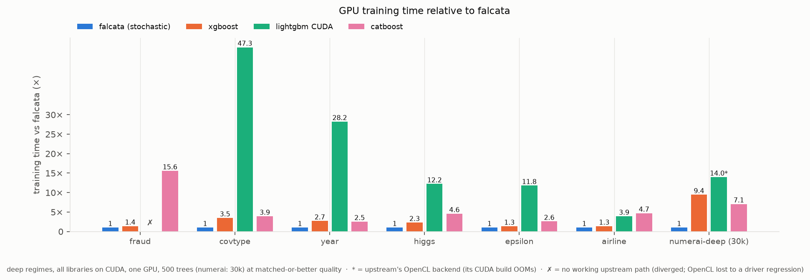

Falcata's `quant_mode` is a user-facing dial, so every comparison below quotes
the variant that matches or beats the competitor's quality — the speedup is
never bought with quality the user wouldn't accept. Method, regimes and
reproduction steps: [How this was measured](#how-this-was-measured).

**The flagship workload — numerai (6.8M×3555; regimes defined under
[How this was measured](#how-this-was-measured)):**

| regime | falcata (stoch) | XGBoost | CatBoost | upstream LightGBM |
|---|---|---|---|---|
| example | **31 s**, corr .0194 | 286 s (9.2×), .0197 | 112 s (3.6×), .0180 | CUDA OOM; OCL broken¹ |
| deep | **12.4 min**, corr .0238 | 1 h 57 m (9.4×), .0235 | 1 h 27 m² (7.1×), .0217 | CUDA OOM; OCL 2 h 53 m (14×), .0238 |
| leaf | **30 min**, corr .0201 | 2 h 48 m (5.6×), .0201 | CUDA-702² | CUDA OOM |

¹ a display-driver update broke upstream's OpenCL path on this dataset
shape (error −9999); its one working numerai-deep run is quoted where it
exists.
² CatBoost's 30k-round cells die to the desktop display watchdog (CUDA 702);
the deep number is a successful retry, the leaf retry died again.

**Classic gbm-bench datasets, deep regime** (best sane falcata mode vs each
competitor; quality in parentheses):

| dataset | falcata | vs XGBoost | vs upstream LightGBM (CUDA) | vs CatBoost |
|---|---|---|---|---|
| fraud (fixed) | 0.6 s, AUC .9846 | 1.2× (.9747) | diverged³ | 10.5× (.9785) |
| covtype (fixed) | 5.7 s, acc .969⁶ | 1.5× (.963) | 21× (acc .535³) | 1.7× (.918) |
| year (fixed) | 2.0 s, RMSE 8.97 | 2.9× (9.01) | 30× (9.03) | 2.7× (8.93⁴) |
| higgs (stoch) | 4.2 s, AUC .8489 | 2.3× (.8484) | 12× (.8505⁵) | 4.6× (.8373) |
| epsilon (fixed) | 39 s, AUC .9429 | 1.3× (.9440) | 12× (.9432) | 2.6× (.9507⁴) |
| airline (stoch) | 30 s, AUC .8640 | 1.3× (.8633) | 3.9× (.8782⁵) | 4.7× (.8223) |

³ upstream's CUDA learner produced diverged/garbage models on those cells.
⁶ covtype fixedpoint quality is the ridge build's (PR #68: a four-quanta
hessian ridge for fixedpoint training with per-row hessians). The sweep's
.971 came from a robust-scale guard that misfired on softmax and clipped the
rare-class gradients; without that accident the cell collapses to .88 (and
the full-precision CPU reference to .89), so .969 is the honest figure. The
timing column stays the sweep's; the ridge does not change speed.
⁴ CatBoost reaches slightly better endpoint quality on year and epsilon at
2.6–2.7× the time; falcata-noquant closes most of the year gap. On epsilon,
most of CatBoost's lead is default regularization, not the algorithm: the
regimes run each engine's default L2, and CatBoost ships `l2_leaf_reg=3`
where the LightGBM family ships 0. Sweeping L2 on epsilon-deep closes the
gap from .0079 to .0015 (falcata .9499 at `lambda_l2=300` in 42 s vs
CatBoost's plateau .9514 at 109 s; XGBoost tracks falcata within .0006 at
every L2). The residual .0015 is the oblivious-tree structure itself —
CatBoost gains almost nothing from extra L2 because its level-wide shared
splits already are the constraint. Reproduce with `bench.py --set l2=N`.
⁵ upstream's higher AUC here is its `max_depth` bug: its CUDA learner does
not enforce the depth cap (measured depth 14.7 avg / 20 max under
`max_depth=6`), so those cells train much bigger trees than configured. At
equal semantics falcata matches it to the 5th decimal (see ROADMAP,
upstream-bugs).

**Time-to-quality** — the whole quality-vs-time frontier, not just endpoints
(falcata reaches every intermediate quality level first on both):

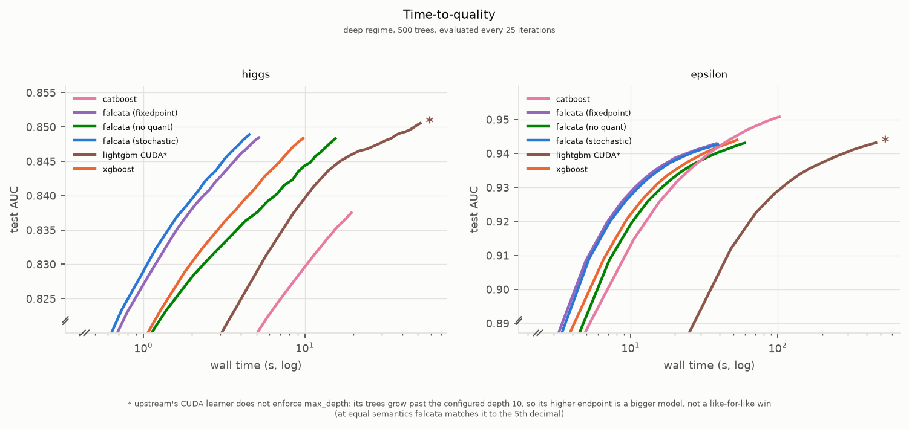

Two endpoints on this chart need reading carefully, and neither changes the
frontier claim above — reaching each quality level first is a separate
statement from where the curves stop.

*Upstream ends above falcata on higgs* (.8505 vs .8485). That is the
`max_depth` bug of footnote ⁵: the deep regime asks for 1023 leaves inside
depth 10, and upstream's CUDA learner places them wherever gain is best, so it
trains a deeper, more expressive model than the one configured — which is also
why its curve sits so far right. Given the same semantics (`max_depth=-1`)
falcata matches it to the 5th decimal at 1.7–3.7× the speed.

*XGBoost and CatBoost end above falcata on epsilon*, and that is real but
smaller than it looks: footnote ⁴ quantifies it with an L2 sweep — at matched
regularization the CatBoost lead shrinks from .0079 to .0015, the residual
being its oblivious-tree structure. It is a cross-family difference rather
than a falcata regression: `falcata-noquant` lands at .94307 against upstream
LightGBM's .94320, so the two implementations of the same algorithm agree to
1e-4, and quantization costs a further ~4e-4 (§5). The frontier claim is
about reaching each quality level first, which falcata does up to the point
where its curves end.

**Resources** — falcata's 4-bit rowdata + compact view keep it the smallest
or tied-smallest footprint of the CUDA libraries, where CatBoost
pre-allocates the whole card. (The asterisked OpenCL bar is smaller only
because that backend keeps the training data host-side — the same reason
it is 14× slower):

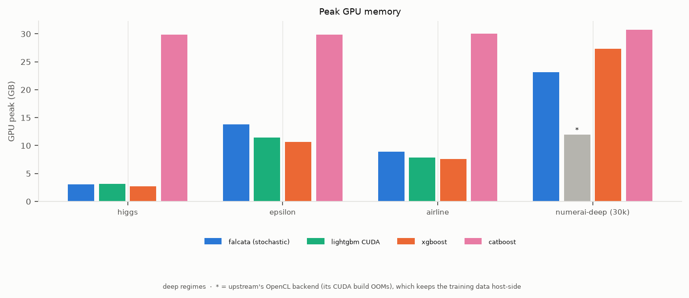

**Competitor failure ledger** (all recorded per-cell in the benchmark
report): upstream LightGBM 4.7.0's CUDA backend OOMs on every numerai
regime, diverges on fraud-deep, and produces a garbage covtype-deep model;
its quantized mode is 0-for-sweep (CUDA crashes on higgs/airline, invalid
models elsewhere); its OpenCL fallback lost most datasets to a
display-driver regression. CatBoost's 30k-round cells fight the display watchdog (CUDA
702). Falcata's own airline fixedpoint cells run at the auto-clamped 23
bins — the int32 histogram guard bounds the bin count on 92M rows (§5).

### Classification Newton-step stability

The historical unbounded, non-quantized deep recipe also collapses in Falcata
on CPU and FP64 CUDA, and in upstream LightGBM on CPU. Recomputing gradients
and Hessians from the actual rows of failing leaves reproduces the enormous
outputs: on fraud at iteration 2, `G=27.9989`, `H=0.00112228` gives the stored
update of approximately `-2494.82` after the `0.1` learning rate. The Newton
formula `-G / (H + lambda_l2)` becomes unsafe when confident classification
predictions have tiny curvature. Additional floating-point precision does not
make that step appropriate.

Falcata now defaults to `max_delta_step=-1` (automatic). For non-quantized binary, softmax
multiclass and one-vs-all classification with GBDT (including GOSS) or DART,
it bounds the learned score update in constant-leaf trees to one unit, scaled by `sigmoid` for binary
and OVA. The initial class-prior offset is excluded. Existing constrained
leaf-output and split-gain math applies the policy on CPU and CUDA; partial
learning-rate resets recompute the raw cap, and model serialization preserves
the automatic policy. Fitted linear leaf predictions are not bounded by this constant-output limit.
Quantized training, regression, custom objectives and random forests remain
unconstrained. Explicit `0` restores historical behavior; positive values keep
their existing manual raw-output-cap meaning.

Single-seed validation on the cached stratified splits, 500 rounds, learning
rate `0.1`, depth `10`, 1023 leaves, 255 bins, no sampling and zero L2:

| backend (non-quantized) | fraud raw-score AUC | covtype accuracy | covtype logloss |
|---|---:|---:|---:|
| CPU, automatic step limit | 0.97481 | 0.96991 | 0.08894 |
| FP64 CUDA, automatic step limit | 0.97560 | 0.96932 | 0.08943 |

These are stability checks, not a replacement for the repeated performance
sweep above. Large steps can be reduced and more rounds may be needed; this
bounded update does not guarantee monotonically decreasing loss. It changes
non-quantized classification models and can change split ties even when the cap is inactive.
Historical benchmark reproduction therefore requires explicit
`--set max_delta_step=0`; new benchmark runs must record their step policy.

---

## How this was measured

Two instruments, both shipped in this repository:

- **The cross-library sweep** ([`benchmarks/`](../benchmarks/README.md)) —
  falcata against upstream LightGBM, XGBoost and CatBoost on the gbm-bench
  datasets plus the real numerai workload: 603 recorded runs, medians of 3
  where affordable, every failure recorded rather than averaged away.
- **Leave-one-out ablation** (`benchmarks/ablation.py`) — train with the full
  auto plan, then turn each feature off one at a time. "+300%" below means
  *turning the feature off makes training 4× slower*, i.e. the feature is worth
  4×. Because every mechanical feature is required to produce bit-identical
  models, the ablation doubles as a correctness gate. Raw data: the newest
  `benchmarks/ablation_*.txt` battery.

Datasets: **covtype** (581k×54, 7-class), **year** (515k×90 regression),
**fraud** (285k×28, imbalanced binary), **higgs** (11M×28 binary), **epsilon**
(500k×2000 binary), **airline** (115M×13 binary), **numerai** (6.8M×3555 int8
regression, the production workload).

Every cell is one of five **regimes** — the exact training configuration behind
shorthand like "deep" or "30k trees":

| regime | trees | learning rate | leaves / depth | extras |
|---|---|---|---|---|
| shallow | 500 | 0.1 | 63 / 6 | gbm-bench convention, `max_bin` 255 |
| deep | 500 | 0.1 | 1023 / 10 | gbm-bench convention, `max_bin` 255 |
| numerai example | 2 000 | 0.01 | 32 / 5 | `colsample_bytree` 0.1 |
| numerai deep | 30 000 | 0.001 | 1024 / 10 | `colsample_bytree` 0.1, `min_data_in_leaf` 10k |
| numerai leaf | 30 000 | 0.001 | 1024 / unbounded | `colsample_bytree` 0.1, `min_data_in_leaf` 1k — leaf-wise growth where the 1024-leaf budget binds (maps to lossguide on XGBoost/CatBoost) |

The numerai regimes come from Numerai, not from us, so the configuration is
public and not tuned to favour any library here. *numerai deep* is their
published `deep_lgbm_params` — the parameters behind the v5 benchmark models —
from [the Numerai docs](https://docs.numer.ai/numerai-tournament/models#deep-lgbm-params).
*numerai example* is the model in their `hello_numerai` notebook. Numerai's
own two sources disagree by one leaf here: every parameter set on the docs page
uses `num_leaves = 2**max_depth` (64 at depth 6, 1024 at depth 10), while the
notebook writes `2**5-1` = 31. We use 32 at depth 5, following the docs. *numerai leaf* is ours — the
deep parameters with the depth cap lifted, so the leaf budget is what binds.
The two 30k-tree regimes are single timed runs (repeats are unaffordable at
2–3 h per competitor cell); everything else is a median of 3.

### Reproducing any number on this page

That harness is the only copy, and it is the one that produced these numbers.
It builds the four engines into their own environments, caches every dataset as
identical float32 bits, and runs each cell in an isolated subprocess:

```bash
export FALCATA_BENCH_ROOT=/big/disk/falcata-bench   # ~200GB when fully cached
./benchmarks/setup_envs.sh                          # build all four engines
$FALCATA_BENCH_ROOT/env-competitors/bin/python benchmarks/datasets.py all
python3 benchmarks/orchestrate.py                   # resumable; --only fraud,covtype for a quick pass
python3 docs/perf-plots/generate.py                 # re-render these plots
```

Two things to know before comparing your numbers to ours. Each engine is run
on **its own default L2 leaf penalty** (they differ: 0, 1 and 3), following the
gbm-bench convention rather than aligning them — `bench.py --align-l2` does
align them and will move the quality figures. And timings need a **quiet
machine**: host contention alone moved our medians by 18–55%, which is larger
than several of the effects discussed below.

The plots are rendered from those two measured sources by
[perf-plots/generate.py](perf-plots/generate.py). Failed ideas are deliberately
not here — they live in [perf-dead-ends.md](perf-dead-ends.md); open ideas in
[../ROADMAP.md](../ROADMAP.md).

---

The rest of this document explains where that speed comes from, one feature at
a time.

## 1. Hybrid level-batched growth — the biggest single win

**The problem.** A leaf-wise GBDT learner classically grows a tree one split
at a time: build histograms for one leaf, find its best split, tell the CPU,
apply the split, repeat. On a GPU each of those steps is a separate kernel
launch plus a CPU⇄GPU synchronization. The GPU spends most of its time
waiting for the next tiny instruction rather than computing — the loop is
*latency-bound*.

**The idea.** While the leaf budget cannot yet bind, every profitable leaf
will eventually be split anyway — so the ORDER of splits doesn't change the
final tree. Falcata therefore grows whole *levels* of sibling pairs at once:
one batched histogram pass, one batched split search, one batched apply per
level. Dozens of launches and syncs collapse into three. The resulting tree
is provably identical to the leaf-wise tree (and the ablation verifies the
models match).

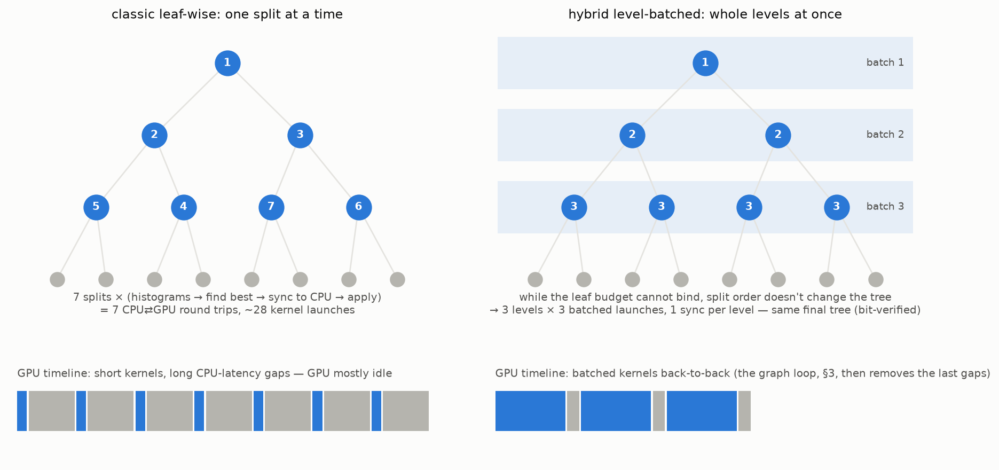

**Measured (leave-one-out ablation, "what turning it off costs"; values
within ±5% are run-to-run noise):**

| covtype-deep | fraud-deep | numerai-deep | covtype-shallow | numerai-example | year | higgs | epsilon |
|---|---|---|---|---|---|---|---|
| +1239% | +386% | +382% | +370% | +251% | +235% | +80% | +78% |

Deep trees benefit most (more levels, more launches saved); higgs least (its
huge rows make each kernel long enough that launch latency matters less).

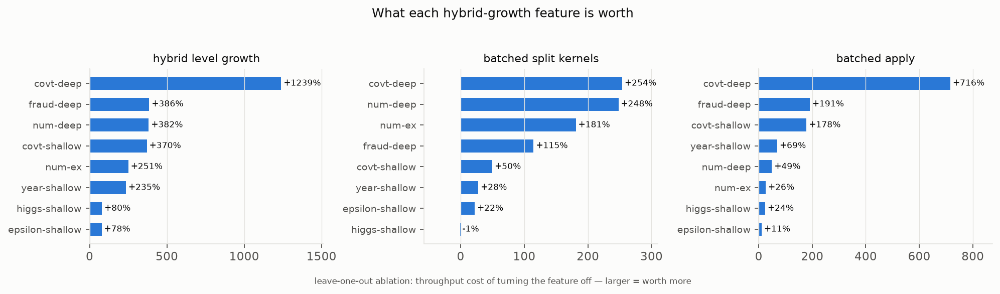

Two sub-features extend the same idea:

- **Batched split kernels (`batch_kernels`)** — one find/sync launch per
  level instead of per pair: +254% covtype-deep, +248% numerai-deep, +181%
  numerai-example, +115% fraud-deep, +28–50% year/covtype-shallow.
- **Batched apply (`batch_apply`)** — the split-application phase batched the
  same way: +716% covtype-deep, +178% covtype-shallow, +191% fraud-deep,
  +69% year, +49% numerai-deep. (The batched path numbers new leaves
  level-wise, the per-split fallback in split order — equivalent trees,
  verified prediction-bit-identical, but different file md5; the ablation
  classifies it as a renumber key.)
- **Selective grow-then-prune (`selective`)** and the **speculative one-sync
  pipeline (`one_sync`)** extend level batching to budget-limited and
  non-quantized configurations; on shapes where they don't apply they cost
  nothing (±2% noise in every cell), which is exactly why they can default on.

  Selective is what keeps the batching exact once the budget *can* bind — the
  case the diagram above explicitly sets aside. A whole level is grown
  speculatively, the candidates are ranked by gain (which is the order leaf-wise
  would have used), and everything past the budget is collapsed again, its leaf
  ids recycled. The `numerai-leaf` regime is exactly this
  shape: 1024 leaves, unbounded depth.

  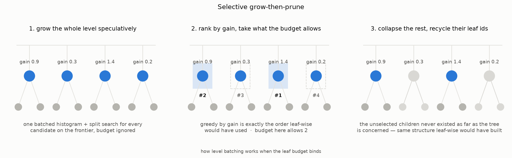

## 2. CUDA-graph level loops (`graph_loop`)

**The problem.** Even batched, each level's launch sequence is issued by the
CPU. For shallow trees the levels are so short that CPU launch overhead
returns.

**The idea.** CUDA lets you record a sequence of kernel launches once (a
"graph") and replay it from the device itself. Falcata captures the per-level
sequence and lets a device-side controller replay it, removing the CPU from
the inner loop entirely.

**Measured (leave-one-out ablation):** nothing clears the noise floor. The
largest readings are +9.3% on covtype-deep and +4.5% on both numerai cells,
against noise bands of 12% and 5% respectively (§7 methodology note) — every
other cell is inside ±2%. The direction is consistently positive on the big
cells, which is what you would expect from a real but small effect, but this
suite cannot resolve it, so no number here is quotable and the section carries
no plot.

The graph's job today is simply smaller than when it landed: the one-sync and
batched flows already removed most of the host round-trips it was built to
hide. It stays on because it is free where it doesn't help, and the planner
picks per shape.

## 3. Per-tree compact column view (`compact_quant`)

**The problem.** With `feature_fraction < 1`, each tree randomly samples a
subset of columns. But the bin matrix is row-major: even if a tree uses 10%
of the columns, reading a row drags the other 90% through the memory system,
because unused columns share the same cache lines.

**The idea.** Once per tree, gather ONLY the sampled columns into a dense
"compact" matrix. Histogram passes then read purely useful bytes. The gather
costs one pass; the histogram kernels run 11+ passes per tree over the
result.

**Measured (leave-one-out ablation):** +249% on numerai-deep, +177% on
numerai-example — the two feature-sampled workloads; neutral elsewhere (it
only activates when sampling is on). The win scales with the excluded
fraction: ~3.4× at `feature_fraction=0.1`, tapering to ~1.1× at 0.6.

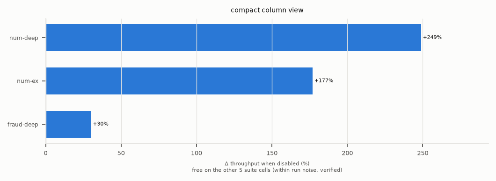

## 4. GPU-native ingestion (`gpu_construct`, `fast_rowdata`, `efb_precheck`, `rowdata_4bit`)

**The problem.** Before training starts, raw features must be binned and laid
out for the GPU. Upstream does this on the CPU, then uploads — minutes of
setup for large datasets (numerai Booster creation was 13.9s even after
earlier fixes; originally far worse).

**The ideas.**
- **`gpu_construct`**: dense binning runs on the device; CuPy /
  `__cuda_array_interface__` inputs never round-trip through host memory.
- **`fast_rowdata`**: build the row-major training matrix directly from
  column bins, skipping the CPU multi-value-bin machinery: +342% on
  numerai-example, +49% epsilon, +39% fraud-deep, +29% year, +24% higgs
  (throughput effect via construct-time inclusion).

  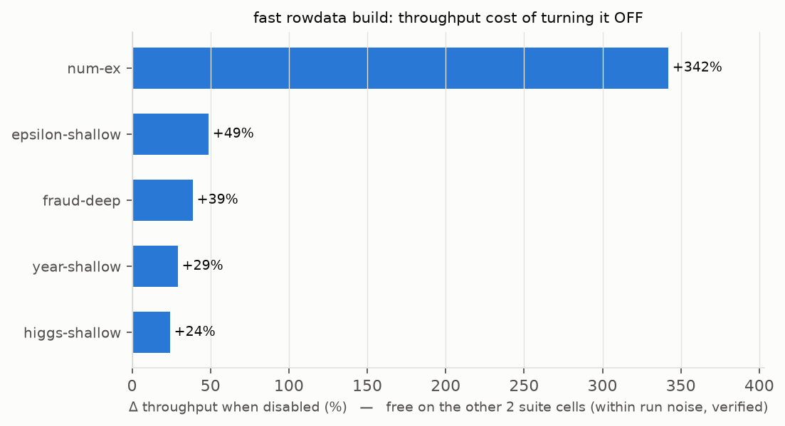
- **`efb_precheck`**: a cheap density check that skips Exclusive Feature
  Bundling's ~7.7s no-op search on provably-unbundlable dense data.
- **`rowdata_4bit`**: datasets whose features all fit 16 bins store two
  values per byte, halving the training matrix (numerai: 19GB → 9.5GB on the
  current cache) and the bytes every kernel reads.

What it buys on the workload ingestion was built for — the numerai matrix,
the largest in the suite (GPU ingestion is a bandwidth play, so this is
where the effect lives; on sub-GB datasets all libraries construct in
under a second and the comparison is noise):

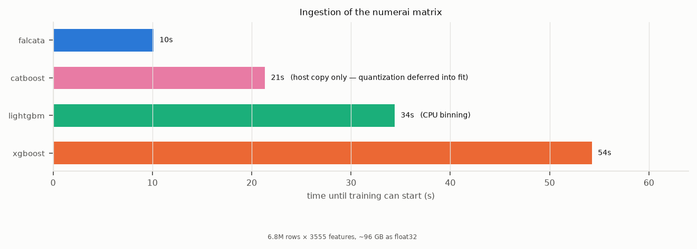

Upstream LightGBM's `Dataset` construction is CPU binning regardless of
training backend — 3.4× slower than our GPU-native construct. Catboost's
low bar is partly an accounting artifact — its Pool build is a host copy,
with quantization deferred into `fit()` where it lands in the train timer.

**Construction from host arrays: host memory, not binning (`pin_bins`, `construct_staging_pool`, `construct_h2d_overlap`).**
A construct of the Numerai benchmark split from its in-RAM int8 matrix (5.46M rows × 3,555 features, 3,525 feature
groups, 9.6 GB of 4-bit bins) took 5.6 s, with the GPU busy for 1.9 s of it (the binning kernel 1.04 s, uploads
0.84 s, downloads 0.37 s). Most of the rest was host memory management:
- **Page-locking the bins (`pin_bins`).** Every group's bin buffer came from `cudaHostAlloc`: 3,525 buffers, about
  2 s. Page-locked bins only speed up the device copies that read them. CUDAColumnData's per-column copies are skipped
  above `kCUDAPerColumnMaxBytes` (8 GB), which leaves the column-major store uploaded at the first `train()`.
  `pin_bins:auto` (the default) page-locks the bins only when groups × rows ≤ 8 GB; larger ones are pageable and
  aligned to the kernel's transparent huge page. The store upload then reads pageable memory: about +0.35 s at the
  first `train()` on Numerai. `pin_bins:always` page-locks at every size, as before.
- **A zero-filled buffer the GPU path never uses.** A 4-bit bin also allocated an odd-nibble buffer of its own size for
  the host binning path, and zero-filled it: another 9.6 GB of memset and page faults before the binner started. It is
  calloc'd now, so its zero pages arrive on first touch, and the GPU path touches none of them. The binary-file loader
  never frees it, so there it was 9.6 GB of resident zeros for the Dataset's lifetime: loading the Numerai binary
  now takes 4.4 s instead of 5.5 s and holds 11.2 GB resident instead of 18.3 GB.
- **The staging ring, page-locked per construct (`construct_staging_pool`).** The binner page-locked and freed its
  ring (2 × 512 MB in, 2 × 265 MB out) in every construct: 0.35 s. The blocks now stay in a process-wide pool (best
  fit) for the next construct, so the ring stays page-locked for the rest of the process.
- **One stream for upload and kernel (`construct_h2d_overlap`).** Each chunk's upload waited for the previous chunk's
  bin kernel. It now runs on its own stream.

| numerai53bench-construct (in-RAM int8, 5.46M × 3,555) | master | this | |
|---|---|---|---|
| construct, 2nd–4th in a process (6 interleaved pairs) | 5.72 s | 4.06 s | 1.41x [1.31, 1.52] |
| first construct in a process | 6.31 s | 4.84 s | 1.30x [1.15, 1.51] |
| construct + 500-round train (numerai53bench-deep-stoch params) | 8.49 s | 7.13 s | 1.19x [1.16, 1.22] |
| covtype-construct (581k × 54 float32), 2nd–6th / first construct | 0.135 / 0.206 s | 0.079 / 0.195 s | 1.70x / 1.06x |

Every construct saves the same binary and trains the same model as master's. Each key off restores master's handling
of that buffer. `pin_bins:always` alone keeps 1.11x and master's first `train()`. With all three keys off only the
calloc is left, and it measures 1.01x [0.95, 1.08]: the zero-fill costs construct time only once the bins are pageable
(presumably because page-locking kept the group-creation threads waiting anyway). The upload stream is worth 1.03x
[1.01, 1.04] on top of the rest.

**The int8 binning kernel's reads (`construct_tile_bin`, default on).** The bin kernel reads row-major input one
element per thread at a row stride (one thread per row pair and feature group), so on int8 input a warp fetched 32
sectors for 32 useful bytes: about 1.04 s of GPU time per Numerai construct for 19.4 GB of input. For row-major int8 /
uint8 input whose feature groups are one column each (the LUT encode), a block of 256 threads now stages 64 rows × 128
columns in shared memory with coalesced reads (a warp walks consecutive columns of one row), then encodes each
(column, row pair) from shared memory and writes the group's output exactly as the gather kernel does; other inputs keep
the gather kernel. Kernel 1.04 s → 0.04 s (the search's nsys). Same binary, key off against on, numerai53bench-construct
(in-RAM int8, 5.46M × 3,555; constructs 2-4 of each process timed, 3 interleaved pairs): 3.77 s → 3.63 s, 1.038x; the
saved binary and the 50-round model are md5-identical in every construct and to master's. Lattice: int8wide (400
columns: three full tiles and a partial one) with the key off. The tile's rows and the block's threads are keys,
`construct_tile_rows` (default 64, an even number up to 384: the tile is 128 × rows bytes of shared memory, within the
48 KB every device grants without opt-in) and `construct_tile_threads` (default 256, a power of two in [32, 1024]);
the 128 columns are not: one 128-byte line of an int8 input row, the unit the coalesced reads fetch. Every value bins
the same bytes (each (column, row pair) is encoded once, whatever the tile).

**Construction from host arrays: the host work around the binner.** A first construct in a process of epsilon
(400k × 2,000 float32, in the page cache) took 2.8-3.4 s, and the binner was 0.43 s of it: sampling took 0.9 s, bin
finding 1.1-1.5 s, and the first CUDA call, which creates the context, 0.13-0.2 s. A float matrix with a categorical
column (airline-cat, 92M × 13 float32, three categorical columns) never reached the binner at all.
- **Categorical columns of float matrices bin on the device.** The float/double kernel bins numerical columns only, so
  one categorical column sent the whole matrix to the host push loops: 2.9 s for airline-cat against 1.0 s for the
  same matrix without the categorical declaration. The kernel now looks categorical columns up in a per-column table
  holding the host `BinMapper::ValueToBin` of every category id up to the column's largest. NaN, values at or below -1,
  and ids past the table's end go to bin 0, and fractional values truncate toward zero, as on the host. Category ids
  that would need more than 2^24 table entries keep the host path.
- **Bin finding uses a radix sort.** `BinMapper::FindBin` stable-sorted each column's 200,000 sampled doubles. It
  drops NaN before the sort and the samplers leave zeros out. Without NaN and ±0, no two distinct bit patterns compare
  equal, so the ascending order is unique, and an LSD radix sort over the order-preserving 64-bit keys writes the same
  array. It skips the byte positions all keys share, which are most of them for float32-sourced and small-int data.
  If a zero does reach the sort, `std::stable_sort` runs as before. Epsilon's bin finding went from 1.1-1.5 s to
  0.6-0.7 s; Numerai's (four distinct non-zero values per column) from 0.55-0.7 s to 0.42-0.54 s.
- **The CUDA context is created while the construct samples.** The construct's first CUDA call (the page-locked bins,
  or the binner) created the context: 0.13 s on fraud, about 0.2 s on epsilon. A helper thread now creates it as the
  construct starts, overlapping sampling, bin finding and bundling. The first CUDA call of fraud's construct went from
  0.135 s to 0.068 s, epsilon's from 0.42 s to 0.19 s. Freeing epsilon's sample also became cheap (0.13-0.16 s before,
  0 after) once the context existed before the sample was allocated. The mechanism, glibc's raised mmap threshold
  after the driver's own allocations, is inferred and not measured.
- **The sampler's gathered rows are not zero-filled.** Both dense samplers copy the sampled rows into one block before
  their column passes. The block was a value-initialized `std::vector`, a single-threaded pass over n × ncol values
  that the copy then overwrote: 0.37 s for epsilon's 1.6 GB block, 0.7 s for the Numerai float32 split's 2.8 GB one.

| first construct in a process (5 interleaved pairs; numerai 3-4), exclusive GPU, inputs in the page cache | master | this | |
|---|---|---|---|
| fraud (228k × 29 float32) | 0.233 s | 0.171 s | 1.36x |
| covtype (465k × 54 float32) | 0.250 s | 0.189 s | 1.32x |
| year (464k × 90 float32) | 0.394 s | 0.265 s | 1.48x |
| higgs (10.5M × 28 float32) | 0.548 s | 0.461 s | 1.19x |
| epsilon (400k × 2,000 float32) | 2.800 s | 1.939 s | 1.44x |
| airline (92M × 13 float32) | 1.004 s | 0.887 s | 1.13x |
| airline-cat (same, 3 categorical columns) | 2.851 s | 0.890 s | 3.20x |
| numerai split, int8 (5.46M × 3,555) | 4.082 s | 3.678 s | 1.11x |
| numerai split, float32 | 8.091 s | 7.388 s | 1.10x |

These are medians. Every dataset saves the same binary as master's (saved-binary md5), the CUDA lattice passes under
`FALCATA_VERIFY=1` (which also byte-compares the device bins with the host path's), and the canonical locks hold. In
`bench.py` cells the train times did not move (epsilon 2.54-2.55 s, airline-cat 15.55-15.58 s), so no work moved into
`train()`.

What is left on the Numerai split is mostly memory traffic. The float32 binner copies 77.7 GB from the memmap into the
staging ring at about 19 GB/s (4.1 s). With the GPU's reads of the ring and the scatter of the 9.6 GB of bins
(1.1-1.4 s), that comes to an estimated 50-57 GB/s of host memory traffic, close to what this two-channel DDR5 host
sustains. The int8 twin moves a quarter of the bytes (copy 1.0 s). The other remaining items:
- creating the feature groups, most of it zero-filling the pageable bins the binner then overwrites: 0.65 s
  float32, 0.7-1.1 s int8;
- sampling's column passes: 0.7-1.0 s;
- page-locking the staging ring in a process's first construct: about 0.4 s.

A float32 memmap that does not fit in the page cache next to the process is a different regime. With 80-87% of the
train range resident, construct took 12-15 s; at 29%, 23.5 s.

## 5. Quantized training: `quant_mode` (the speed/quality dial)

**The problem.** Histogram accumulation is the hot loop, and accumulating
double-precision gradient/hessian pairs is memory-heavy.

**The idea.** Quantize gradients to small integers (a published technique —
see the NeurIPS'22 reference in the README) and accumulate integers instead.
Falcata ships two modes: `stochastic` (seeded stochastic rounding — the
aggressive end) and `fixedpoint` (deterministic rounding with an
outlier-robust gradient scale — the near-lossless end). Bin count is the
`quant_bins` dial for both modes (defaults: 4 stochastic, 64 fixedpoint;
any value in [2, 65534]). Both are
bit-reproducible — run to run, across GPU models, and across host
machines: stochastic rounding noise is Philox-generated in-kernel as a pure
function of (seed, tree, row) — an idea borrowed from XGBoost 3.3's Philox
sampling — so machine-independence holds by construction (no tables; also
freed 8 bytes/row of VRAM and their per-tree reads, worth ~+4% on
numerai-deep). Integer atomics make results order-invariant, which is what
lets the md5 regression gates exist and makes them portable to any machine
(cross-arch verified sm_89 vs sm_120 on the table-era build; Philox is pure
integer math and inherits the guarantee).

**Measured (cross-library sweep, numerai-deep regime):**

| mode | train | trees/s | holdout corr | sharpe |
|---|---|---|---|---|
| stochastic | 12.4 min | 40.4 | 0.0238 | 1.407 |
| fixedpoint | 12.7 min | 39.3 | 0.0237 | 1.405 |
| none | 26.1 min | 19.2 | 0.0238 | 1.402 |

2× the speed of full precision at equal quality. The outlier-robust scale is
what makes fixedpoint safe on imbalanced data: without it, fraud/deep AUC
drops 0.9825 → 0.8001. Across every deep cell of the sweep:

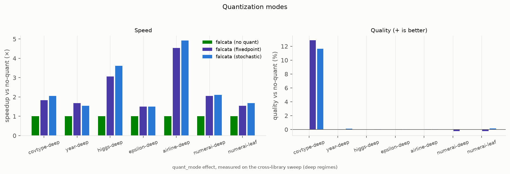

The covtype rows of this snapshot (all three Falcata modes, both regimes)
are re-measured on the ridge build 0b170e0a; every other row is the sweep's.

The suite exposed one real stochastic defect, since fixed: at a flat
4-bin auto default, big datasets driving many small leaves
(year/epsilon deep, ~400 rows/leaf) *declined* in test quality
mid-training — the trees were fitting rounding noise (year-deep peaked at
iteration 75, then lost +4.9 MSE). The rounding scheme was innocent
(stochastic@64 exactly matches fixedpoint@64); the resolution was simply
too coarse for small per-leaf sums. The stochastic auto
default therefore raises itself to 64 bins (constant-hessian) / 16 (others) when
`num_data ≥ 100k` and expected rows/leaf < 4096 — measured drift now +0.17
MSE / 0.0000 AUC, at fixedpoint's cost on those shapes and no change
anywhere else. Two deliberate exclusions, both measured: small datasets
keep 4 bins (there the rounding noise is regularization and finer bins
hurt), and ≥50:1-imbalanced binary keeps 4 bins (fraud-deep measured AUC
.956@4 → .870@16 — the no-robust-scale failure mode; use fixedpoint for
imbalanced data, its robust scale is built for exactly this).

Bin count is also bounded above by the int32 histogram guard
(`num_data × bins < 2^31`, the hessian lane is binding): the fixedpoint
*auto* default clamps itself to the dataset-safe ceiling
with a warning (airline's 92M rows → 23 bins) instead of refusing; an
explicitly-set unsafe `quant_bins` still fails loudly rather than silently
wrap.

## 6. Precision modes (`cuda_precision=fp32`)

For NON-quantized training, storing global histograms as float pairs instead
of double pairs halves their bandwidth. Measured per-tree wins at
equal-or-better quality: epsilon-deep −36% time, year −18%, covtype −16%,
fraud-deep −14%, higgs-deep −12%; numerai neutral (sampling-dominated).
Quality-gated rather than bit-identical, hence a config parameter and not a
plan key.

A second, separately-measured mechanism: on DEEP trees the
histogram pool halves from ~248MB (doesn't fit the 5090's 96MB L2) to
~124MB (mostly fits), so subtraction's parent-histogram re-reads start
hitting cache. Isolated on covtype non-quant: fp32 gains **+26% deep** vs
+1.7% shallow — the cache cliff, not bandwidth, dominates the deep win.
Practical guidance: on deep non-quantized configs, `cuda_precision=fp32` is
the single highest-leverage switch available. (Since `nonquant_deterministic`,
section 10v, the fp32 histogram layout and its atomics run only with
`cuda_plan=auto,nonquant_deterministic:off`; by default `fp32` keeps its fp32
gain math on deterministic fp64 histograms.)

## 7. Memory-layout micro-optimizations (each small, all free)

- **`gh_interleave`** — gradient and hessian interleaved as one float2 so a
  row costs one scattered 32-byte read instead of two: +21% numerai-deep.
- **`split_packed_read`** — split kernels read the 4-bit packed matrix
  directly instead of materializing a ~1.5GB per-tree column copy: +12%
  numerai-deep. Sparse-encoded columns are served per column from their own
  materialized buffer (their encoding spells the most-frequent bin as 0, which
  never matches the row matrix); a per-tree fallback here is a trap — with the
  sparse columns concentrated in one EFB bundle, `feature_fraction` 0.15
  samples the bundle on ~99% of trees, which silently un-ships the read
  (measured −27% trees/s on the numerai h60 shape). Guarded by the throughput
  ratio in `tests/gates/sparse_column_view.py`.
- **`batch_reghist`** — for ≤8-bin datasets, accumulate a thread's rows in
  registers and flush once instead of two shared-memory atomics per row.
- **`batch_wide`** — wide-shape batched search for many-column datasets
  (+9.9% on epsilon in the smoke ablation), plus wide leaf-splits init
  batching.
- **`small_leaf_construct`** — a cheaper construct body for very small
  leaves. Extended to quantized training: when a deep level's
  largest sibling pair is under 1024 rows, a dedicated kernel adds packed
  integer gradients straight to the global histogram — the shared-memory
  zero + sync + merge (whose cost is proportional to partition *bins*, not
  rows) is skipped entirely: **+11.2% covtype-deep**, neutral on numerai
  (its 10k-row min-leaf never triggers it). Bit-identical by integer
  order-invariance — unlike the float direct body, which remains permanently
  disabled. Kept as a separate kernel deliberately: an in-kernel branch
  version cost the never-taken numerai path measurable register pressure.

Four more (measured in a dedicated battery; all
bit-identical in every cell):

- **`wide_partitions`** — on datasets wider than 504 columns, each construct
  thread handles two columns, halving the partition count and its per-partition
  zero/merge overhead: **+8.8% numerai-deep**; mechanically inert on narrower
  data.
- **`l2_policy`** — pins the gradient/hessian and data-index buffers into a
  persisting L2 window so each level's bin-matrix stream stops evicting them
  (the construct kernel is latency-bound on exactly those scattered re-reads):
  +2.8% numerai-deep and covtype-deep at the original fixed 64MB carve-out,
  improved to **+5.3%** once the carve-out was sized to the buffer actually
  pinned (device-proportional sizing — a fixed carve
  stranded 42MB of L2 the streaming reads could have used); neutral on year
  at real run lengths. Its companion: bin-matrix loads are marked
  **evict-first** (`__ldcs`) since bin bytes have no intra-level reuse —
  deprioritizing them frees L2 for histogram-subtraction re-reads: +8%
  covtype-deep, +10% year via the dense-path loads, and **+9.7%
  numerai-deep** once extended to the compact-view pack-codec reads (the
  per-tree compact matrix re-reads 11+ passes/level against a 96MB L2 —
  streaming priority stops it evicting the pinned gradient window).
  (Prediction inverted by measurement: the win is largest on the "already
  L2-resident" shapes.)
- **`colmajor_fill`** — a one-time column-major copy of the packed bin matrix
  serves as the compact-fill gather source, so the per-tree fill reads
  contiguous columns instead of dragging ~10× its bytes through row-major
  cache lines: +2.2% numerai-deep. The per-cell fill kernel that reads it moves
  one byte per thread and runs at ~24% of DRAM bandwidth, latency-bound rather
  than bandwidth-bound; `tiled_fill` below is the kernel that uses the
  contiguous columns fully. The copy is as large as the 4-bit row data and
  optional, so it is decided late and against measured memory: before the
  second tree, when everything sized by the data already exists (row data,
  training and validation columns, scores and gradients for every class, the
  partition, the first tree's views and level buffers), it is made only if
  free memory then covers it plus what can still grow — the split finder's
  per-level buffers up to `num_leaves / 2 + 2` pairs, the bit-change scratch,
  the compact view's partition padding, and 256 MiB. Otherwise training keeps
  the row-major source with a warning (same model); `FALCATA_DEBUG=diag` logs
  an engagement. The first tree always fills from the row-major matrix. This
  decision is `colmajor_direct:off`'s (and that of data whose columns cannot
  be uploaded directly); by default there is no copy to decide on.
- **`colmajor_direct`** (with `view_mode`, `view_mask_ff`, `view_pair_rule`) — the column-major
  copy above holds, byte for byte, the Dataset's 4-bit columns laid end to
  end, so it is uploaded straight from them and the device keeps **one** copy
  of the bin matrix: no row-major matrix at Init, no host pack, no transpose,
  no memory rule. Which copy depends on the training regime, decided per
  `train()` from `feature_fraction` (again on `update(train_set=...)` and on a
  `feature_fraction` reset):
  - **compact** (`feature_fraction` < `view_mask_ff`, default 0.85; above it
    too wherever the pair-joint construct serves the compact view,
    `view_pair_rule`, below): the column-major store; every tree fills its
    compact view of the sampled columns from it (`tiled_fill` reads it).
  - **mask** (`feature_fraction` ≥ 0.85 where the pair-joint construct cannot
    serve the view, every column sampled, or `compact_quant:off`): one full
    view in the row-major layout, filled once from the columns through a
    256 MiB staging chunk (never the whole store next to it); no tree copies
    anything, and the kernels apply the per-tree sample through the column
    masks they already take (`is_feature_used_bytree`, `bin_used`).

  Against `colmajor_fill`'s decision (numerai53, RTX 5090): the first round
  of every `train()` is **1.85 s shorter** (2.49 → 0.64 s: no 11 GiB host
  pack, upload and transpose), steady state is unchanged (16.4 ms per round
  on numerai53-deep, 8.3 on the example config, identical models), and peak
  device memory drops by **11.3 GiB** at `feature_fraction` 0.1 and 1.0 and by
  10.2 GiB at 0.9 (table below).
  `view_mode:compact|mask` forces a regime; `colmajor_direct:off` restores the
  row-major matrix and `colmajor_fill`'s decision. The threshold is the
  measured crossover below (2026-10-03, before the pair-joint construct; the
  2026-10-15 calibration of `view_pair_rule` follows it); `feature_fraction_bynode` does not enter (the
  views hold the per-tree sample, the per-node draw happens in the split
  finder either way). Quantized training is bit-identical in every regime
  (the same bytes, and integer histograms for the masked kernels), so the
  regime may change between any two trees without changing the model —
  which is what makes the live choice below legal. Float histograms are not
  order-invariant (the full-matrix kernels group rows by the partition's
  column count), so non-quantized training takes the mask regime only when
  every tree samples every column, and otherwise stays compact, which never
  holds more than `colmajor_direct:off` did. Quantized training outside the
  hybrid level flow (per-node sampling, forced splits, two leaves, ...)
  takes the mask regime at any `feature_fraction`: its per-leaf construct
  reads every column of the row-major layout, so a compact view would serve
  nothing.

  **Live regime choice.** Rules on top of the threshold, all under
  `view_mode:auto`:
  - *memory:* the compact regime is taken only if its store, its compact view
    (sized from `feature_fraction` and the partitions' packed widths, the
    fill's own arithmetic), the one-byte split view of the sampled columns
    whenever the tree learner will build it (its own predicate: no packed
    split read, i.e. no hybrid flow, categorical features,
    `split_packed_read:off`, forced splits, the aggressive tail) and the
    reserve (the split finder's level output and bit-change
    scratch for `num_leaves / 2 + 2` pairs, the booster's per-row state,
    256 MiB) fit in free device memory at decision time; otherwise mask, with
    a diag line saying why. Deterministic: sizes against `cudaMemGetInfo`.
    Quantized training only (see above).
  - *pair rule* (`view_pair_rule`, default on): at or above the threshold
    the compact regime is kept where the pair-joint construct (`pair_hist`
    and the code views it reads) serves the compact view, since there it
    wins by a wide margin, and mask is taken where the trees would fall back
    to the per-column construct, which loses to the masked full matrix. The
    construct's own gate is a joint table of at most 48 KB of shared memory
    per partition (span(lo) × span(hi) cells per byte of two columns, odd
    strides padded) and a block within the kernel's thread limit; the rule
    predicts both before the first tree from each partition's sampled
    columns and the table every column would build, scaled to that share.
    The count is tested at its expectation plus two standard deviations
    (a tree's count in a partition is hypergeometric, and one partition past
    the bound sends the whole tree to the per-column construct), so a
    prediction of "served" means nearly every tree runs the pair-joint
    construct. Exact for uniform spans. Never served under a pack codec
    (`pack_bit3`, `pack_radix5`–`7`) or `graph_quant`, where the construct
    always declines. A training that samples every column builds no
    compact view and stays mask. Below the threshold, from 0.5, an unserved
    view takes mask where every partition has at most 504 columns
    (calibration below).
    Deterministic, no timing; `FALCATA_DEBUG=diag` logs the prediction
    (partitions, sampled columns, table KB, block threads). Calibration
    below.
  - *probe* (removed 2026-10-15 with the runtime tuner, below): the tuner
    used to time five trees in each regime for a `feature_fraction` in
    [0.5, 0.95] and cache the faster one in its wisdom file. At or above the
    threshold the pair rule picked what the probe measured on every shape of
    the calibration below; below it, see the low-`feature_fraction` rule in
    the calibration.
- **`tiled_fill`** — the 4-bit compact fill stages 128 rows of every byte slot
  in a shared-memory `[row][slot]` tile, reading each source column
  contiguously, then writes each partition's rows as one contiguous run with
  16-byte streaming stores: fill 2.01 → 0.52 ms on the 2.75M-row Numerai train
  set (ff 0.1, 132–133 byte slots), ~91% of DRAM bandwidth, **+10.2%
  numerai-deep**, +19.3% on the 32-leaf numerai example config. The
  host picks it when the source is column-major and at most 256 byte slots are
  sampled; row-major sources and wider samples keep the per-cell kernel.
  Bit-identical (the same bytes).
- **`warp_find`** — the quantized per-level split finder runs one warp per
  (feature, leaf) instead of a 256-thread block. The block kernel spent most
  of its time in block-wide scans, reductions and `__syncthreads` (about 36%
  of stall cycles at barriers), and on numerai every feature has 5 bins, so
  251 of 256 threads held nothing. Each lane now owns 8 scan positions: a
  register prefix sum plus a warp shuffle scan, and a shuffle reduction that
  keeps the lowest-position tie-break. On 255-bin features the remaining cost
  is the fp64 gain math, so an fp32 bound on each threshold's closed-form gain
  skips the fp64 evaluation of thresholds that cannot win or tie. **+6.3%
  numerai-deep, +22.7% year-deep, +18.8% epsilon-shallow** end to end.
  Scope: quantized levels launched from the host (not the CUDA-graph loop)
  with fp64 gains, and only when every task of the dataset is a numerical
  feature of at most 256 bins without zero-as-missing handling. NaN features
  are covered whether or not their most-frequent bin is stored; when bin 0 is
  not (non-negative data), the forward scan rebuilds it from the leaf total
  as the block kernel does. One ineligible feature keeps the whole dataset on
  the block kernel. CUDA only. Bit-identical. Two tiers by scan width, chosen
  per task with no key (§7c): tasks of at most 8 scan positions run eight per
  warp as 4-lane groups, wider tasks a warp each.
- **`row_batch`** — the batched quantized construct walks a leaf's rows
  through a dependent chain (row index, then the packed gradient and the bin
  byte at that index) and was latency-bound on it: ~92% occupancy but ~20% of
  issue slots busy and 77% of stall cycles waiting on those loads. With one
  column per thread, each thread now loads 8 rows' indices, then all 16
  gradient and bin loads, before their shared atomics, and prefetches the next
  8 indices meanwhile; the flush skips empty bins. **+46.1%
  numerai-deep, +16.9% higgs-deep** at 100 rounds; against the construct JIT
  (300 rounds; §7b, since removed) +26.1% numerai-deep, +7.7% higgs-deep. Wide
  partitions (two columns per thread) keep the unbatched loop. Bit-identical.
- **`tuner`** (removed 2026-10-15) — a per-tree timing bandit over two
  schedule-only knobs: the batched construct's saturation floor (candidates
  80–640 with an elastic bracket out to 10–5120) and the quantized
  small-leaf row threshold (0, 256, 1024, 4096). It took 130+ probe trees
  per training, re-probed every 3000 trees, cached its picks per (shape,
  device) in `~/.cache/falcata/wisdom.txt`, and from 2026-10-03 also timed
  the `colmajor_direct` view regime. Measured at introduction: +2.1%
  numerai-deep, +2.7% year. An audit on master 43a2e35c (RTX 5090, steady
  ms per round and total seconds, interleaved pairs, every arm
  md5-identical) found it within noise of the fixed defaults:

  | cell (rounds) | default (tuner on) | `tuner:off` | tuner on / off, total time |
  |---|---|---|---|
  | numerai53bench-deep-stoch (30000) | 108.85 s | 105.89 s | 1.028 (off faster) |
  | higgs-deep-stoch (30000) | 44.63 s | 44.52 s | 1.002 |
  | hidden nanbin 3.58M × 238 (30000) | 153.57 s | 159.32 s | 0.964 |
  | numerai53bench-deep-stoch (3000) | 10.76 s | 10.79 s | 0.997 |
  | hidden nanbin (3000) | 15.57 s | 15.65 s | 0.995 |
  | hidden fewbin 2.86M × 315 (3000) | 11.69 s | 11.98 s | 0.976 |
  | covtype-deep-fixed (1000) | 3.797 ms | — | 1.00 |

  The pair spreads were 2–7% (the nanbin cell ±5% by phase), and the tuner
  chose floors from 40 to 5120 and small-leaf thresholds from 0 to 4096 for
  the same cell from run to run: it was choosing among noise. Its view
  probe was the one real gain, and `view_pair_rule` replaced it. What
  stays is static: the floor 160, scaled by the device's SM count / 170
  (the 5090 it was tuned on) and clamped to [10, 5120], the tuner's old
  seed rule; small-leaf threshold 1024. Plan strings with `tuner:` or
  `view_probe_lo:` / `view_probe_hi:` log a warning and are ignored. (A
  histogram-pipeline-count knob was considered and rejected earlier: it
  only affects the per-pair fallback path.)

**Device memory model of the 4-bit bin matrix under `colmajor_direct`**
(Numerai v5.3, 6.79M rows × 3,555 features; the matrix is 11.24 GiB in
either layout):

| | layout | lifetime | ff 0.1 | ff 1 |
|---|---|---|---|---|
| store (compact regime) | the Dataset's 4-bit columns, column-major (column c from nibble c × rows, rows rounded up to even) | the training | 11.24 GiB | — |
| compact view (compact regime) | the tree's sampled columns, row-major | refilled from the store every tree | 1.13 GiB | — |
| full view (mask regime) | every column, row-major (the old row-major matrix's bytes and layout) | the training | — | 11.24 GiB |

Peak device memory over idle on numerai53-deep (30 rounds; nvidia-smi
`memory.used`, 500 ms sampling), against `colmajor_fill`'s decision:

| feature_fraction | 0.1 | 0.5 | 0.9 | 1.0 |
|---|---|---|---|---|
| `colmajor_direct:off` (master) | 25.0 GiB: matrix + copy + view | 18.2 GiB: matrix + view (copy declined) | 22.8 GiB: matrix + view (copy declined) | 24.0 GiB: matrix + copy no tree reads |
| `colmajor_direct` (auto) | **13.7 GiB**: store + view (compact) | 18.2 GiB: store + view (compact) | **12.6 GiB**: full view (mask) | **12.6 GiB**: full view (mask) |

A compact-regime reader that needs every column in the row-major layout (a
tree that happens to sample every column, the split view of a pack-codec
tree) gets the full view filled from the store, kept while consecutive trees
read it and released on the first that does not; that is the one case with
two copies, and the default regimes never reach it on numerical data.

**Where the regimes cross.** numerai53-deep, `view_mode:compact` against
`view_mode:mask`, 200 rounds, two interleaved fresh-process pairs per point;
identical model md5 at every `feature_fraction`:

| feature_fraction | 0.1 | 0.2 | 0.35 | 0.5 | 0.7 | 0.8 | 0.85 | 0.9 | 0.99 | 1.0 |
|---|---|---|---|---|---|---|---|---|---|---|
| compact, ms/round | **16.4** | **33.5** | **59.0** | **133.8** | **175.1** | **189.5** | 246.2 | 251.3 | 262.9 | 210.9 |
| mask, ms/round | 177.3 | 185.9 | 218.4 | 220.5 | 222.5 | 224.5 | **224.2** | **224.8** | **223.3** | **210.7** |
| compact, peak GiB over idle | 13.8 | 14.9 | 16.6 | 18.3 | 20.6 | 21.7 | 22.3 | 22.8 | 23.9 | 23.9 |
| mask, peak GiB over idle | 12.7 | 12.9 | 13.0 | 12.7 | 12.7 | 12.7 | 12.7 | 12.7 | 12.7 | 12.7 |

The masked full-matrix kernels read every column of every row, whatever the
sample, so their time barely moves with `feature_fraction`; the compact view
pays a per-tree fill but reads only the sampled bytes. They cross between
0.80 and 0.85, hence `view_mask_ff` 0.85. Under auto there is no step at
0.99 → 1.0 any more (mask 223 → 211 ms); before, 0.99 paid a per-tree copy
of 99% of the matrix that 1.0 did not (263 → 211 ms). At ff 1 the compact
column is the full view next to the store, the same kernels with twice the
memory.

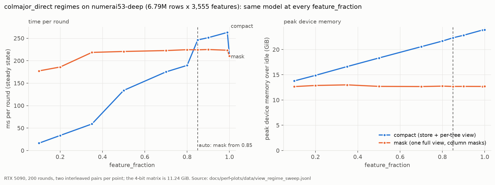

**The live choice on numerai53-deep** (2026-10-03; the probe was removed
2026-10-15; RTX 5090, `tuner:on`, 130 rounds, a
fresh wisdom file per run, two pairs; "static" is the same plan with the
probe band emptied, `view_probe_lo:2`; identical model md5 in every pair):

| feature_fraction | 0.1 | 0.8 | 0.85 | 0.9 | 1.0 |
|---|---|---|---|---|---|
| regime (probe medians, ms/tree) | compact (outside band) | **compact** (157–159 vs 183–184) | **mask** (205 vs 187–191) | **mask** (206–207 vs 187) | mask (outside band) |
| same as the static rule | yes | yes | yes | yes | yes |
| first 130 trees, static → probe | 2.72 → 2.72 s | 21.53 → 22.45 s | 25.30 → 26.16 s | 25.32 → 26.23 s | 23.94 → 23.94 s |
| peak device memory over idle, static / probe | 13.8 / 13.8 GiB | 21.8 / 21.6 GiB | 12.6 / 22.1 GiB | 12.6 / 22.7 GiB | 12.6 / 12.7 GiB |

The probe costs ~0.9 s once per (shape, device, `feature_fraction`): two
regime switches and five trees in the slower regime. A cached decision costs
nothing. On this shape it confirms the threshold. Its memory cost is the
probed regime's own footprint: above the threshold the five compact trees
hold the store plus an 85–90% view (22 GiB); the switch itself never holds
both layouts (a store plus a full view plus that view would not have fit at
all). After the first `train()`, wisdom skips the probe and the peak is the
mask regime's 12.6 GiB.

**`view_pair_rule` calibration** (2026-10-15, master 9cbbfd44, RTX 5090,
interleaved fresh-process pairs with an empty wisdom file, steady ms per round
over rounds 100 to R; model md5 identical across the arms of every row).
The probe it replaces always chose compact on numerai, but not on the NaN
cell or on a 15-bin shape; forced compact lost wherever the pair-joint
construct did not run (`FALCATA_DEBUG=diag` names the construct kernel):

| shape, `feature_fraction` | compact | mask | probe (default) | pair-joint | rule |
|---|---|---|---|---|---|
| numerai53bench 0.85 (500 r) | **76.8** | 125.3 | 71.5 (compact) | served | compact |
| numerai53bench 0.95 (500 r) | **89.1** | 125.1 | 89.2 (compact) | served | compact |
| numerai53bench 0.96 (300 r) | **81.2** | 119.4 | — (static mask) | both kernels (est. ~3/4 pair_hist) | mask (margin) |
| numerai53bench 0.965 (300 r) | 158.3 | **123.7** | — (static mask) | both kernels (est. mostly row_batch) | mask |
| numerai53bench 0.97 (300 r) | 157.1 | **119.1** | — (static mask) | not served | mask |
| numerai53bench 0.99 (500 r) | 165.9 | **121.1** | — (static mask) | not served | mask |
| numerai53bench 1.0 (500 r) | 118.9 | 119.6 | — (static mask) | no compact view | mask |
| numerai53bench-nan 0.85 (500 r) | 168.6 | **142.7** | 148.5 (mask) | not served | mask |
| numerai53bench-nan 0.95 (500 r) | 174.8 | **144.5** | 143.3 (mask) | not served | mask |
| numerai53bench-nan 0.99 (500 r) | 181.4 | **141.2** | 136.3 (static mask) | not served | mask |
| numerai53bench-nan 1.0 (500 r) | 129.5 | 131.9 | — (static mask) | no compact view | mask |
| 15-bin 1M × 1500 0.85 (300 r) | 9.52 | **6.16** | 6.18 (mask) | not served | mask |
| 15-bin 1M × 1500 0.95 (300 r) | 10.78 | **6.38** | 6.36 (mask) | not served | mask |

The numerai partitions hold up to 1008 five-bin columns, 25-cell joint
tables per byte: 958 expected sampled columns (ff 0.95) need 47.2 KB, 978
(0.97) 48.2 KB, past the 48 KB the construct allows. A tree's own count
varies by about 5 columns per partition, and one partition past the bound
sends the whole tree to the per-column construct, so the rule tests the
expected count plus two standard deviations (0.95: 970, 47.8 KB, served;
0.96: 979, 48.3 KB, not served). That gives up 0.96, where an estimated three
quarters of the trees still ran the pair-joint construct (compact 85.2 vs
mask 124.1 ms in a second run), to avoid 0.962 to 0.967, where most trees
decline (0.965: compact 158.3 vs mask 123.7). The NaN cell's 6-bin columns
need 37 cells per byte (odd-padded) and pass 48 KB from about 0.69.
Against the default plan before it (300 rounds, two pairs, same models): numerai ff 0.9 and
0.95 and NaN 0.9 and 0.95 run at the same steady speed, each `train()`
0.6–0.8 s shorter (no probe trees) and, on the NaN cell, 8.2 GiB lower in
peak device memory (the probe no longer builds the compact store to time
it); 0.1, 0.97 and 0.99 are unchanged. At ff 1.0 the compact regime is the
full view next to the store (twice the memory, the same kernels), so the
rule keeps mask. The epsilon-like 473,663 × 1843 shape (40 bins, 8-bit) has
no view regime. Non-quantized training keeps its own rule (compact unless
every column is sampled), which this does not touch.

**Below the threshold** (2026-10-15, with the tuner's removal: the probe
used to catch these). From `feature_fraction` 0.5 up, where the pair-joint
construct does not serve the view, both regimes run the per-column
construct, and what decides is whether the masked full matrix fits one
column per thread. If every partition has at most 504 columns, it does; the
compact view then only adds its per-tree fill, so the rule takes mask.
Wider partitions put two columns per thread on the full matrix, and the
compact view's narrower rows win, so compact as before. 1M × 1500 shapes
of one bin count each (the bin budget sets the partition width), master
36709f05, compact vs mask forced, 300 rounds, two pairs, steady ms per
round, md5-identical arms:

| values per column (partition columns) | ff 0.5 compact / mask | ff 0.7 compact / mask | rule |
|---|---|---|---|
| 8 (768) | **5.38** / 9.65 (partly served) | 10.98 / **10.25** (3 pairs) | compact |
| 10 (614) | **6.04** / 9.24 | **10.02** / 11.20 | compact |
| 12 (512) | **5.94** / 10.66 | **8.10** / 11.83 | compact |
| 13 (472) | 6.07 / **5.51** | 8.74 / **6.88** | mask |
| 14 (438) | 5.98 / **5.42** | 8.81 / **6.86** | mask |
| 15 (409) | 5.89 / **4.81** | 8.45 / **6.05** | mask |
| 16 (384) | 5.83 / **4.91** | 8.52 / **6.40** | mask |

On Numerai-shaped data compact stays right even where the view is not
served (1008-column partitions: numerai53bench with `pair_hist:off` at 0.5,
79.4 vs 118.8 ms; the NaN cell at 0.7, 114.6 vs 138.6). The one measured
miss is 8 values at 0.7 (compact 7% slower; both regimes there run two
columns per thread). Below 0.5 compact wins even on 15 values (0.3: 2.36
vs 4.56 ms; 0.4: 4.91 vs 4.63, about even), so the rule starts at 0.5, the
low edge of the band the probe measured.

Against master (300 rounds, default plan, a fresh wisdom file per run, three
pairs, identical models): at `feature_fraction` 0.1 steady state is
unchanged (16.40 vs 16.42 ms per round, n.s.); at 0.9 it is **5.7% faster**
(204.9 → 193.2 ms, CI [11.3, 12.2] ms saved), since master fills a 90%
compact view from its row-major matrix every tree. The first round is 1.8 s
shorter at both.

`wide_partitions`, `l2_policy`, `colmajor_fill` and `tuner` compose: **+10.5% on
numerai-deep combined**. A methodology note the
battery re-taught us: 100-round probe cells on fast datasets (year runs 0.4s)
sit inside clock/thermal noise — the year "regressions" the battery first
reported all vanished under interleaved A/B at 500 rounds.

The ablation shows each of these within noise on shapes they don't target —
the planner's "default on, individually ablatable" contract in action.

**On 6.8M rows the fill and finder paths were off.** `colmajor_fill`,
`tiled_fill` and `warp_find` were measured on smaller Numerai caches. On the
6.79M × 3555 v5.3 training set none of them engaged: the column-major
copy's old Init-time rule wanted 19.1 GiB free (copy + per-tree view +
max(2 GiB, copy / 2)) where a 32 GB card had 17.8 GiB, so every fill read the
row-major matrix with the per-cell kernel; and the warp finder skipped the
dataset because its NaN features (1,972 of 3,555, all non-negative) do not
store bin 0. With the copy decided before the second tree against measured
memory (it engages with 16.3 GiB free: an 11.2 GiB copy plus a 1.2 GiB
reserve, of which training then used 70 MiB) and the finder covering those
features, numerai-deep on that set drops from 29.6 to 18.3 ms per round
(**1.62x**) and numerai-example from 17.0 to 9.0 ms (**1.90x**), identical
models (interleaved fresh-process A/B, 300 rounds, RTX 5090).

## 7b. Runtime-JIT construct kernels (removed 2026-10-15)

From July to October 2026 an NVRTC JIT (`construct_jit`) compiled the quantized dense and compact construct at
runtime, self-tested it bit-identical against a synthetic reference and launched it in place of the AOT kernel. It
baked in only the shared-histogram size and the 4-/8-bit packing, which the AOT kernel already takes as template
parameters; its body was the unbatched row loop without the mask, graph and wide-partition branches. Once `row_batch`
(§7) beat it, `auto` resolved it off, and it ran only with `construct_jit:on` or with `row_batch:off` on quantized
runs of 300+ rounds. An audit (kernel-evo `runs/jit_audit/ANALYSIS.md`, RTX 5090, master 43a2e35c) found it
slower everywhere when forced: +0.17-0.19 s start-up and 11-270% slower per round, with no break-even round count.
Default T over forced-JIT T (500 / 1000 / 30000 rounds; models md5-identical in every arm):

| shape | default (first call s / steady ms per round) | JIT forced | ratio |
|---|---|---|---|
| higgs 255 leaves d8 | 0.149 / 1.474 | 0.332 / 2.095 | 0.64 / 0.67 / 0.70 |
| numerai53bench-deep-stoch | 0.404 / 3.507 | 0.590 / 13.013 | 0.30 / 0.29 / 0.27 |
| numerai53bench-nan-deep-stoch | 0.418 / 4.038 | 0.604 / 13.880 | 0.32 / 0.31 / 0.29 |
| covtype-deep-fixed | 0.118 / 3.797 | 0.291 / 4.228 | 0.84 / 0.87 / 0.90 |
| higgs-deep-stoch | 0.155 / 1.897 | 0.338 / 2.753 | 0.64 / 0.66 / 0.69 |
| hidden1 few-bin (2.86M x 315, 4 bins) | 0.165 / 3.851 | 0.347 / 6.834 | 0.56 / 0.56 / 0.56 |
| hidden2 NaN-bin (3.58M x 238, 6 bins) | 0.168 / 5.111 | 0.354 / 7.903 | 0.63 / 0.64 / 0.65 |

Against the unbatched loop it was written to beat (both `row_batch:off`) it still gained 0-19% on higgs-like and
few-bin dense shapes but lost 73-74% on Numerai (it displaced `pair_code5`). It was removed with the `CUDA::nvrtc`
link (lib_falcata.so no longer needs libnvrtc) and the `nvidia-cuda-nvrtc-cu12` dependency; a plan string with
`construct_jit:` logs a warning and is otherwise ignored. `row_batch:off` users on higgs-like and few-bin dense shapes
lose the 5-19% the JIT had over the unbatched loop there; `row_batch` (the default) is 31-44% faster than either.

## 7c. The warp split finder's two tiers, on mixed-bin and wide-bin data

`warp_find` (§7) splits a dataset's quantized levels with one 32-lane kernel family, `WarpFindBest`, in two tiers
picked per task by its scan width (positions 0 .. bins − stored-most-frequent-bin offset + NaN shift − 1), with no
`cuda_plan` key:

- **Few-position tier** (at most 8 positions: Numerai's 5- and 6-bin columns, 2-bin indicators): eight tasks per
  warp as 4-lane groups, 2 positions per lane, strided over the lanes (lane `l` holds `l` and `l + 4`), so a 5-bin
  task's candidates fill one fp64 slot and warps skip the other; the exact prune's unpack is reused by the gain loop;
  the selection is an exact first maximum in integer compares of the gain bits.
- **Wide tier** (more than 8 positions: covtype's 255-bin columns, higgs- and year-like floats, an epsilon-like 40-bin
  shape, a 12-bin column): one warp per task, `warp_find_mid_ppl`'s 2, 4 or 8 positions per lane, with the five
  keys below.
- A dataset that mixes both (covtype: 44 binary and 10 numeric columns) runs them in **one launch**: per tree the
  used tasks are ordered narrow first (eight per warp), then wide (a warp each); a dataset of one kind keeps its
  used-task list as is. The level kernel is instantiated twice (with and without wide units, so the few-position
  datasets do not carry the wide code's registers and shared memory), `WarpFindBest` 16 times (scan direction ×
  16/32-bit histograms × 4 tier/PPL shapes), down from 5 kernels and 44 `WarpFindBest` instances.
  `FALCATA_DEBUG=diag` names the tier: `split finder: warp kernel for this tree's quantized levels (tier: wide)`.

In the wide tier the cost was fp64 work per scan position, at 1/64 rate on the RTX 5090: covtype's find kernel was
41% of its round, higgs' 16% (nsys). An agentic search scored across eight datasets and training regimes (`jit1`: four
named, four drawn from a generator) added keys to that tier, all default on and bit-identical (identity keys in
`ablation.py`, flip cells in the lattice, flip tests in `test_warp_find.py`):

- **`warp_find_mid_ppl`:** a task runs 2 positions per lane up to 64 positions, 4 up to 128, else 8, instead of 8
  for every task. The search's ladder was ceil(positions / 32) (2 to 8); powers of two run fewer distinct bodies in a
  launch that mixes widths, which matters more than the slots saved. Same binary, power-of-two vs the full ladder,
  3 pairs: the lattice's mixwidth columns at scale 1.10x per round (find kernel 559 → 330 µs per round, CUPTI),
  covtype 1.009x (find 832 → 800 µs), uniform 70- and 150-value generator shapes 0.996x and 0.995x (find +1.5%,
  +4%); every other cell has one tier only.
- **`find_prune_fp32`:** the prune bounds come from the prefix's int32 halves in fp32; each lane offers one lower
  bound, verified exactly before it prunes; an exact-safe screen drops positions that fail a gate by a margin, an
  empty bin is skipped (it cannot beat its neighbour), and the exact fp64 gains run over a per-lane work list of
  the survivors.
- **`find_prune_sure`:** `find_prune_fp32`'s lower bound comes from every position whose fp32 sums pass the exact
  gates with a sure margin (2^-20 relative on the hessians and the rounded count, 2^-8 absolute on the count; the
  fp32 values are within 2^-22 of the exact doubles), instead of one position per lane verified with the exact fp64
  unpack: the prune issues no fp64 at all and its threshold is the largest valid bound of the warp. A position that
  is not sure sets no bound; the exact gain loop decides it as before. The sure test runs only when the float
  `min_sum_hessian_in_leaf` and the count factor are normal floats (≥ FLT_MIN), so the margin proof holds in the
  kernel itself; otherwise the per-lane verified bound is used.
- **`find_select_int`:** the cross-lane best-split reduction compares the gains' bit patterns as integers (keeping
  the fp64 tie-break's rule that an infinite gain never wins).
- **`find_compact_survivors`:** every lane's survivors go into one per-warp shared list (9 KB of static shared
  memory per 128-thread block) and the warp takes them 32 at a time: usually one round of the exact gain instead of
  as many as its busiest lane holds.

Both tiers share one body per piece: one exact gain-and-compare block, one cross-lane reduction (offsets G/2 .. 1,
integer or fp64 keys), one output record (the winner lane and its partner compute the two children side by side),
one load routine; the strided layout is a compile-time property of the 4-lane tier's scan and prune.

**Removed keys** (2026-10, `kevo/unify_find`; each removal measured on the build before it, same binary, key off vs
on, ratio = T(off) / T(on) at 30000 rounds, 2 pairs unless noted, models identical in every run). A `cuda_plan`
string that still names one of them (`warp_find_narrow`, `warp_find_spread`, `warp_find_strided`,
`find_loads_batched`, `find_pack_narrow`) now stops Dataset or Booster construction with the fatal error
`cuda_plan: unknown key "<key>"`; every value of these keys trained the same model, so such a plan can drop the entry.

| key | what it switched | decision | measurement |
|---|---|---|---|
| `warp_find_narrow` | 8-lane groups (one position per lane) for datasets whose tasks all have ≤ 8 bins | removed: the few-position tier covers them | reachable only with `warp_find_spread` off; that launch measured below |
| `warp_find_spread` | the 4-lane tier for ≤ 8 positions; one position per lane for ≤ 32 on the 32-lane kernel | the 4-lane tier is the tier choice; the one-per-lane wide tier is gone (2 per lane) | numerai-deep 1.012, numerai-nan 1.011 (vs the 8-lane launch); ≤ 32-position tasks, T(2 per lane) / T(1 per lane): covtype 1.006, mixwide 0.990, a 24-bin generator cell 1.000 |
| `warp_find_strided` | the 4-lane groups' positions strided instead of blocked | strided kept as the only layout | numerai-deep 1.007, numerai-nan 1.011 |
| `find_loads_batched` | the 4-lane tier's loads in dependency levels | removed: one load routine for both tiers | numerai-deep 0.9985, numerai-nan 0.9981 (neutral) |
| `find_pack_narrow` | (default off) a mixed dataset's ≤ 8-position tasks as 8-lane groups, four per warp | made the default with no key, as the 4-lane tier's groups (eight per warp) | key on vs off: mixwide 1.056, and 1.038 at 4 pairs (every on-run faster), covtype 1.006, a hidden#1-like 4-value shape with 10% float columns 0.999; the 4-lane version vs no packing: mixwide 1.033 (4 pairs) |

(mixwide: the lattice's `mixwidth` columns ×4, 1M rows, 1023 leaves; `runs/integrate_master/unify_find_cells.py`.)

| (default plan, tuner on, rounds 100.. timed; per round) | master (3d72b5c5) | this branch | |
|---|---|---|---|
| covtype deep (fixedpoint, 581k × 54, 1000 rounds, 3 pairs) | 4.94 ms | 4.27 ms | 1.157x |
| higgs-like deep (stochastic, 4M × 28) | 2.89 ms | 2.63 ms | 1.094x |
| epsilon-like (388k × 2,321, 40 values, 255 leaves) | 9.41 ms | 6.44 ms | 1.459x |
| year-like (fixedpoint, 3.4M × 93 floats) | 4.34 ms | 3.91 ms | 1.109x |
| numerai53 benchmark split (30000 rounds timed from 200, 4 pairs) | 3.964 ms | 3.976 ms | 0.997x |

- **The same model on every run**, with any one key off and with all of them off.
- **Per commit** (covtype, same job): `find_prune_fp32` is most of it (1.13x), the integer selection +1%, survivor
  compaction +2.4%. On the 40-bin shape the PPL tiers alone are 1.27x, but on top of the work list they add 0.6%.
- **`find_prune_sure`** (ported from the search's second split-finder lineage, `j007`, onto the four keys above;
  master `a65d34e8`): same binary, key off vs on, the epsilon-like 40-bin shape 6.475 → 6.280 ms per round
  (median of 4 pairs, 1.03x; the cells score vs master 1.030x [1.023, 1.036]); covtype, higgs-like, year-like and
  the Numerai shapes within ±0.7% (noise). The rest of that lineage was already here or did not gain on this
  code: its per-lane gain work list is `find_prune_fp32`'s, `find_compact_survivors` goes further; a tighter bound
  margin (2^-16 instead of 2e-4) was 1.000x on the 40-bin shape (5 pairs) and is not a key. (The lineage's sure
  prune on tasks of at most 32 positions, then one position per lane under `warp_find_spread`, measured 1.002x on
  covtype and was not adopted then. Since `kevo/unify_find` those tasks of 9 to 32 positions run 2 per lane, like
  every wide task of at most 64 positions (`warp_find_mid_ppl`), with `find_prune_fp32`, `find_prune_sure` and `find_compact_survivors` engaged. The winner is
  the same: the fp64 tie tolerance is 0 (`GainTieRelTol<double>()`), so every grouping of positions into lanes picks
  the exact (maximum gain, then lowest position) first maximum, and the prune drops only positions that cannot win
  or tie. covtype's binary columns, which that measurement cited, are in the few-position tier now.)
- **Datasets whose tasks all fit 8 positions** (Numerai, the 4- and 6-bin generator shapes) never reach the wide
  tier and run at master's speed. The guard workloads: year deep 1.32x, missing deep 1.23x, covtype 1.20x, higgs
  1.09x, numerai53-example 1.00x per round.

## 7d. The non-quantized finder and fix after CPU bit-parity

`quant_mode=none` finds splits with one 256-thread block per (feature, leaf) over fp64 histograms. The 1.0.4
CPU-bit-parity merge (`d53aa45c`) made two of its folds CPU-order sequential: the finder's gradient and hessian
threshold prefixes, and FixHistogram's sum of the non-most-frequent bins. Each is a dependent chain of up to 255
fp64 adds in one or two lanes while the rest of the block waits, and on the RTX 5090 fp64 runs at 1/64 of fp32 with
every warp instruction costing its issue slots however few lanes are active. The 2026-10-08 sweep had
`falcata-noquant` at 0.60–0.81× of 1.0.0 on the deep fraud, epsilon, year and covtype cells (the quantized arms
were unaffected), and all of it lands at the parity merge: year deep 3.41 → 4.64 s, epsilon deep 59.6 → 99.2 s.
nsys on year deep (100 rounds) has the level find kernel at 212 → 419 ms and the fused fix + subtract at
57 → 136 ms, with every other kernel unchanged.

Four changes, all bit-identical (the lattice's non-quant deterministic cells and the canonical locks pin them, and
a 30-round year model on the deterministic host loop keeps its md5), none a plan key:

- **One chain per lane.** The paired CPU-order folds (gradient and hessian prefixes, the NaN-missing head's
  subtraction chains, FixHistogram's two sums) run in lanes 0 and 1 of one warp instead of interleaved in thread
  0, so one warp instruction per fold step serves both chains.
- **Integer keys for the best-threshold reduction.** A found gain is positive, and with every found gain finite the
  fp64 tie-break's zero tolerance makes the block reduction the exact maximum of (gain, then lower thread): 64-bit
  keys of the gains' bit patterns give the same winner without the fp64 compares, fmax and tolerance multiply at
  every shuffle step (the counterpart of the quantized finder's `find_select_int`).
- **fp32 bounds before the fp64 gain.** Where the gain is sl_g² / (sl_h + λ) + sr_g² / (sr_h + λ) (no L1,
  smoothing, `max_delta_step`, monotone constraints or extra_trees), each candidate threshold first bounds its gain
  in fp32 inside a range where every intermediate is a normal fp32 value (worst observed error 2^-21.5 of the gain
  against a 2^-16 margin). A candidate whose upper bound lies below the block's best lower bound by more than 2^-20
  of it can neither win nor tie the winner, also after both subtract `min_gain_shift`, and skips the two fp64
  divisions (the counterpart of `find_prune_fp32`).
- **Eight need-fix features per fix block.** The fused small-leaf fix + subtract stages eight need-fix features 32
  bins at a time and folds their 16 sums in 16 lanes of one warp, instead of one feature per 512-thread block.

| (median of timed1-3, idle GPU, `train_s`) | 1.0.0 | master `b4da8135` | this | vs master | vs 1.0.0 |
|---|---|---|---|---|---|
| year deep, noquant | 3.60 s | 5.07 s | 3.85 s | 1.32x | 0.93x |
| epsilon deep, noquant | 60.2 s | 98.2 s | 58.7 s | 1.67x | 1.03x |
| year deep, stoch | 2.28 s | 1.44 s | 1.52 s | (spread 1.31-1.54 vs 1.44-1.57) | |
| epsilon deep, stoch | 37.6 s | 11.73 s | 11.76 s | 1.00x | |

The three builds ran interleaved per cell, on a host shared with a 22-core CPU job that inflates the short year
cells (stoch on master 1.31-1.54 s here, 1.00 s in the sweep); a quieter run had year deep noquant at 3.45 / 4.69 /
3.52 s. The quantized kernels are not touched. Quality is unchanged (epsilon AUC 0.94331 on master and here).

Cumulative, one relaxed-class run each (year deep / epsilon deep noquant `train_s`): master 4.69 / 97.3 s; one
chain per lane 4.32 / 77.2; + integer keys 4.06 / 68.9; + fp32 bounds 3.65 / 66.8; + eight features per fix block
3.52 / 57.9. On the 100-round year profile the find kernel drops back to 227 ms and the fix + subtract to 86 ms
before the last change.

Not taken: tree-shaped shuffle scans for the threshold prefixes on trees whose level construct is the
order-dependent atomic one (the default graph loop); see `perf-dead-ends.md`.

## 8. GPU inference via NVIDIA FIL

`Booster.predict()` on a CUDA-trained model routes through cuML's Forest
Inference Library when available: numerai predict 0.90s → **0.046s** (CuPy
in/out), higgs 0.37s → 0.004s. See the README for precision notes and the
opt-out.

## 8b. Model size: the FALB binary format

**The problem.** The upstream text model format is enormous — a 45k-tree
numerai production model is 471.6 MB of ASCII, and even gzip only takes it
to 148 MB, because numbers-as-text compress poorly and the leaf values are
f64 noise to an entropy coder.

**The idea.** A sectioned binary container: typed
arrays instead of text, zlib-6 per section, a byte-plane shuffle before
compression so the coder sees the near-constant high-order bytes first
(worth ~4 MB alone), and thresholds stored as per-feature dictionaries of
the distinct doubles. zlib over zstd deliberately: it links dynamically
everywhere including rentals, and zstd's ~5–10% edge isn't worth a build
dependency.

**Measured (real production artifact, 45k trees × 3555 features):**

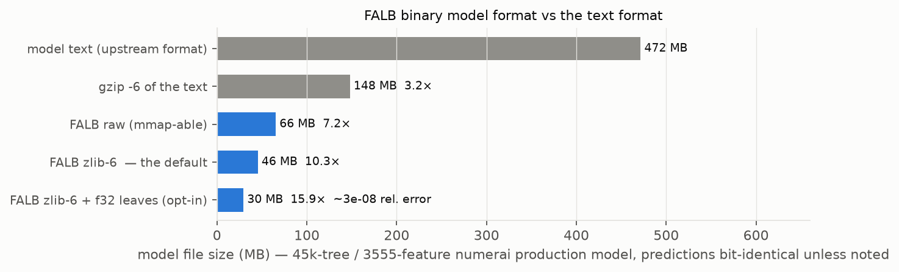

The default is **10.3×** smaller than the text format with **bit-identical
predictions** and a faster load (0.188 s → 0.160 s); gzip-of-text manages
only 3.2×. The remaining lever is the f64 leaf-value array (54.8% of the
raw file, incompressible at 1.15× even shuffled) — hence the opt-in f32
leaves at 15.9× for ~3e-08 relative error, the one knob that trades
exactness. The format reserves `leaf_dim` and dtype tags per array so
vector leaves (multi-target) and new precisions arrive without a v2.

## 9. Categorical features on the hybrid fast paths

Categorical datasets previously fell back to the classic one-split-at-a-time
loop for every hybrid stage, and quantized training refused them outright.
Four pieces lifted the whole class:

- **Batched apply** (1a): variable-length categorical bitsets travel through
  the fixed-size batched split inputs via a per-level side-band INNER-bitset
  arena in the data partition. The arena-build kernel constructs bitsets and
  patches most-frequent-bin default directions on device, removing the
  classic flow's three per-split D2H round trips. Tree recording interleaves
  per-split categorical recording with numerical SplitBatch chunks.
- **Selective (grow-then-prune) flow** (1b): applied-record snapshots of the
  inner threshold bins (the finder's per-leaf slab is recycled before
  finalize) plus a categorical replay branch in RebuildFromHostSplits with
  host-built bitsets. Selective vs classic produces identical structure and
  categorical bitsets (leaf-value fp noise only, same class as numerical).
- **Quantized training** (2a): the categorical search runs its per-bin math
  in double either way, so one reader-templatized body serves both
  pipelines; quantized readers unpack the packed int32/int64 integer bins
  per bin (exact) and the writers fill the packed int64 child totals the
  quantized pipeline seeds child leaves from. fixedpoint-vs-none rmse delta
  at 200k rows with card-3 + card-120 categoricals: 0.198356 vs 0.198346.
- **Batched level kernels** (2b): both level find kernels (non-quantized and
  discretized) run the categorical body per (task, pair, role) block; the
  per-slot categorical-threshold slabs grow with the level output buffer.

Measured (400k rows x (5 numeric + card-3 + card-150 categorical),
63 leaves, 200 rounds, identical rmse and categorical split counts across
all flows):

| flow | train time |
|---|---|
| classic loop | 1.76s |
| hybrid, per-pair fallback (after 1b) | 1.45s |
| hybrid, batched level kernels (after 2b) | **0.48s (3.7x)** |

Still excluded for categoricals: the one-sync speculative prefix and the
graph loop (two-sync batched carries the win); >256-category features use
the 255 most frequent categories per split on the shared-memory finder
(Init warns) because upstream never wrote a global-memory discretized
finder. Open items tracked on the ROADMAP.

---

## 10. Batched-apply partition overhaul: deferred leaf map + flat-grid kernels

Profiling the 92M-row airline-cat deep regime (1023 leaves, depth 10) showed
the level-batched apply's partition kernels at 77% of GPU time -- the
data-partition-memory-bound class first profiled on higgs. Two structural
fixes, both bit-parity (canonical md5 locks reproduce identically):

- **Deferred row->leaf map.** The gen-bit-vector kernel wrote
  `data_index_to_leaf_index` for every row at every level: a 4-byte random
  scatter, one full DRAM sector per row, ~55% of the kernel's traffic at deep
  levels. Every consumer of the map is a tree-end operation, so it is now
  written once per tree by `MaterializeLeafMapKernel` from the final leaf
  windows (the selective flow materializes from the final classic layout,
  replacing its remap).
- **Flat-grid apply kernels.** The 2D `(largest leaf's blocks x num_splits)`
  grid is mostly empty blocks at skewed deep levels (millions per launch).
  Host-launched levels now run a 1D grid-stride loop over the level's real
  chunk count with a binary-searched `(descriptor, local block)` mapping
  (`flat_block_start` prefix in the descriptor). The graph-captured device
  loop keeps the controller-resized 2D form.

Airline-cat, 500 rounds (xgboost native-categorical as reference):

| regime | falcata-noquant | falcata-stoch | xgboost |
|---|---|---|---|
| deep (1023 leaves) | 95.1s -> **47.0s** | 93.4s -> **41.7s** | 43.8s |
| shallow (63 leaves) | 28.7s -> **23.5s** | 26.8s -> **20.5s** | 22.8s |

Per-level partition cost fell from ~17.4ms to ~2.2ms. A second round
removed the next three bottlenecks: the interleaved categorical
recording ran ~6 launches + TWO blocking length readbacks per categorical
split (~432/deep tree -- also the source of +-2.3s run-to-run jitter), now
ONE batched bitset kernel + ONE readback per level; the known-final level
writes the row->leaf map inline in split-inner (with explicit leaf-cache
invalidation for its never-searched children -- the subtle correctness pair
the lattice fingerprints caught) and skips a wasted next-level search; and
the one-sync prefix admits categorical datasets. A third pass replaced the
gen/aggregate byte hand-off with packed ballot bits.

**Official numbers** (FAIR interleaved protocol: quiet
desktop, per regime one warmup round-robin then 3 timed rounds with the four
engines interleaved per round — earlier mixed-condition numbers had up to
+-10% desktop-GPU-contention noise, spreads now 0.0-0.5% shallow / 2.5-9.8%
deep; catboost from the prior pass, not re-run at 925.6s/1838.3s):

| regime | falcata-stoch | falcata-noquant | xgboost | lightgbm CUDA | margin vs best other |
|---|---|---|---|---|---|
| shallow | **18.8s** | 20.4s | 22.6s | 35.4s | **19.8% faster** |
| deep | **33.9s** | 36.7s | 44.8s | 144.6s | **31.9% faster** |

Time-to-quality (report/aircat_time_to_quality.png in the bench workspace;
curve cells + extended falcata runs): falcata-stoch rides the top envelope at
small budgets (shallow @10s: 0.8224 vs xgboost 0.8206 vs lightgbm 0.8072;
deep @33s: 0.8675 vs 0.8661 vs 0.8565) and at large budgets it passes every
competitor's TERMINAL quality -- deep 0.8852 @154s vs lightgbm's 0.8837
there, 0.8873 @210s beyond lightgbm's 0.8863 endpoint; shallow 0.8541 @72s
vs their 0.850/0.845 bests. In a narrow band around xgboost's own endpoint
it is tied-to-slightly-ahead (within ~0.004) before its curve stops. The
upstream-lightgbm AUC outlier at fixed rounds is
its CUDA deviating from its own CPU spec (inflated split gains, first-tree
divergence analysis; our engine matches lightgbm-CPU node for node) -- at
equal wall time the outlier disappears.

## 10b. The Numerai round after the pair-joint construct: occupancy, the tree boundary, level pruning

After the pair-joint construct and the fused root fill, a numerai53 benchmark-split round (5.46M rows, 3,555 4-bit
features, `feature_fraction` 0.1, 1024 leaves at depth 10, `min_data_in_leaf` 10k) was about 6.0 ms: the pair-joint
construct 2.5 ms (40%), the fused fill 1.5 ms (DRAM-bound at ~1.3 TB/s), the small level kernels ~1.3 ms, and
0.7-0.8 ms of GPU idle. A second overnight agentic search took about 9% off that round with eight `cuda_plan` keys,
all default on, each bit-identical (identity keys in `ablation.py`, flip cells in the lattice), none adding device
memory.

**Construct occupancy (`pair_block_rows`, `pair_capped_rows`).** The whole-row construct is latency-bound: 57% of
its stall samples wait on the index -> gradient / packed-byte gather. At 64 registers its block took the
per-partition kernel's 4 rows of the 178-byte interleaved row (712 threads, 23 warps), the only block on its SM.
- `pair_block_rows` sizes the whole-row block by resident warps at the kernel's register count: 5 rows, 28 warps
  (construct -5.6% in nsys).
- `pair_capped_rows` adds a `__maxnreg__(48)` build of the same body with 15 rows in flight (12 for the root's
  direct-read instantiation, both spill-free) and takes it, in 2-row blocks three per SM (36 warps, 34.5 measured),
  where the occupancy API says it keeps strictly more warps resident. Left alone, the driver gave those blocks the
  100 KB shared-memory carveout their tables could use, cutting the gathers' L1 to a quarter and making every
  variant slower; the carveout is now set to the resident blocks' tables (the 64 KB tier), and shapes that would need
  more than 64% of the SM's shared memory keep the default build. Construct -5.6% again. Needs CUDA 12.4.
- Measured and not kept: a 40-register cap (48 warps) spills; `__launch_bounds__(768, 2)` with an 8-row batch (92%
  occupancy) is 4% slower, the same loads in flight with less L1; 1-row blocks are capped at 30 warps by the tables.

**The tree boundary (`async_tree_start`).** About 0.2 ms of the idle sat at the tree start and end: ~13 synchronous
pageable `cudaMemcpy` of KB-scale fill metadata before the fill, a `cudaStreamSynchronize` on the 1.5 ms fill before
the root level was prepared, device syncs between the gradient discretizer's default-stream kernels, the quantized
root-sum readback in `InitValues`, and host waits after the leaf-map pass and the score update. None of these waits
was needed where it stood: the uploads became `cudaMemcpyAsync` on the same legacy default stream (GPU order
unchanged), the fill's readers are ordered by the stream or by the legacy stream's implicit synchronization, the root
sums are read where the level prefix first needs them, and the tree's host copy is read before the leaf-map pass.
Function-local upload sources are copied and kept until the tree end (the CUDA documentation promises a staged
pageable source on return only for `cudaMemcpy`). nsys: GPU idle 715 -> 545 us per round. Off with
`compact_prefill`.

**Level pruning (`skip_unsplittable`, `skip_empty_tail`).** With `min_data_in_leaf` 10k, deep levels hold many leaves
whose `n` rows cannot give both children `min_data_in_leaf` rows; every split-finder count gate needs both, so their
histograms and split searches have no reader. They are no longer constructed or searched (4% of the construct's rows,
16% at depth 9; construct -4.3%). And when the level prefix ends on a complete final level, the leaf-wise tail's
best-of-all-leaves search can only report no split, so it does not run.

**Level apply bookkeeping (`gap_copy_once`, `early_leaf_map`, `leaf_map_small_blocks`).** Leaves that stop early
become terminal index ranges. The batched apply swaps its two index buffers every level, so a range copied into the
out buffer at level k-1 is still in what is the out buffer again at level k: each terminal range is now copied once
(gap copy 64 -> 22 us per round). The residual-leaf map pass goes out with the final level's apply instead of after
the tree end's readbacks, and the map and gap kernels use 256-thread blocks (most of a 1024-thread block had no row).

| step (cumulative) | numerai53 benchmark split, 30k trees | peak device memory |
|---|---|---|
| master (4befcfb2) | 160.2 trees/s | 11,422 MiB |
| + `pair_block_rows` | 166.0 | 11,422 MiB |
| + `pair_capped_rows` | 170.0 | 11,422 MiB |
| + `async_tree_start` | 169.5 | 11,422 MiB |
| + `skip_unsplittable` | 174.6 | 11,422 MiB |
| + `skip_empty_tail`, `gap_copy_once`, `early_leaf_map`, `leaf_map_small_blocks` | 175.6 (1.096x) | 11,422 MiB |

Single 30k-tree runs of the search's candidates (master itself spanned 157-163 trees/s over the session; the
`async_tree_start` step is inside that noise there and measured 1.028x in a same-binary A/B); every run trained the
identical model (holdout corr 0.0239, sharpe 1.40). With the tuner on, 500 rounds timed from round 200 and 6
interleaved fresh-process pairs, the merged keys take a numerai53 benchmark-split round from 5.95 to 5.38 ms
(1.105x [1.099, 1.111]); switching any one key off, or all eight, trains the same model. Of the eight, `async_tree_start`
(+2.7% when off), `pair_capped_rows` (+2.3%) and `skip_unsplittable` (+2.0%) carry most of it; `pair_block_rows`
is inert where the capped build is taken and remains the fallback where it is not. The benchmark's other cells
(`falcata-stoch`, 500 rounds) gain 1.01-1.07x with identical models: covtype 1.05x deep / 1.07x shallow, year
1.04x / 1.04x, fraud 1.05x / 1.06x, higgs 1.02x / 1.01x, epsilon 1.02x / 1.01x.

## 10c. The Numerai round after #56: the fill engages, the level kernels shrink, the host round trips go

After §10b a numerai53 benchmark-split round was about 5.5 ms on the GPU timeline, of which:
- the pair-joint construct 2.1 ms (40%) and the fused root fill 1.5 ms (27%), both near their DRAM ceilings;
- the small level kernels (split finder, level sync, fix/subtract, the apply chain) about 0.9 ms;
- 0.5 ms of GPU idle, mostly the host round trips of every level and of the tree boundary.

A third overnight agentic search took about 12% off that round with nineteen `cuda_plan` keys and one number. All are default on and bit-identical: identity keys in `ablation.py`, flip cells in the lattice. None adds device memory beyond a few KB of staging.

**The fill engages its fast path (`colmajor_align`, `root_hist_l2_prefetch`, `root_hist_short_blocks`, `root_hist_block_rounds`).**
- `root_hist_prefetch`'s word staging needs every column of the column-major store to start on a 4-byte word. With an odd half row count (Numerai's 5,463,797 rows) the store's pitch was odd, so the fill silently ran its byte path.
- Columns now start on 32-byte sectors (at most 31 pad bytes each), and a block prefetches the tile after its next one into L2.
- Blocks take the tiles over 48 rounds of the resident blocks (3 tiles here) instead of always 16, which shortens the kernel's tail.
- Fill 1.50 → 1.33 ms per round, at 83% of DRAM: the rate a plain device-to-device copy of the same bytes reaches.

**Level split search (`warp_find_strided`, `find_loads_batched`, `sync_copy_batched`).**
- The 4-lane quantized finder holds positions `l` and `l + 4` per lane, so a 5-bin task's candidates fill one fp64 slot and warps skip the other; it reuses the prune's unpack and splits the child outputs over two lanes. Find 161 → 94 µs per round. (Both finder keys are gone since: the strided layout is the few-position tier itself, and the batched loads measured neutral per round; §7c.)
- The level sync, a single block's latency chain, loads its winner whole before storing it. When every gain is finite, it reduces on integer keys in the fp64 tie-break's order (the tie tolerance is 0). Sync 82 → 28 µs per round.

**Fewer level kernels (`fix_subtract_fused`, `apply_struct_fused`, `gap_copy_fused`).**
- Under feature sampling one kernel (a thread per sampled feature) fixes, subtracts and copies the changed-bit histograms. The old kernels launched mostly empty blocks for the unsampled features: 88 → 35 µs per round.
- The batched apply's tree-structure update and gap copy run as extra flat ids of the partition kernel: two launches fewer per level, −55 µs per round.
- `fix_subtract_masked` (2026-10-14): where `fix_subtract_fused` does not run (no feature sampling, or sampled columns wider than 8 bins) and some feature needs its most-frequent bin fixed, the quantized fix and subtract are one launch. Its subtract blocks skip the need-fix features' most-frequent bins (the `fix_mfb_mask` the non-quantized small-leaf kernel already uses), and the fix block of each such feature subtracts the fixed value at that bin, so both kernels' reads of the same histograms happen in one launch. It serves the host-launched level path, the captured graph level loop and the classic per-leaf loop (sparse columns, no depth limit). Same integer expressions per bin in the same bit-width cases: bit-identical (`tests/python_package_test/test_fix_subtract_masked.py`). Same-binary A/B, key off vs on, 3 pairs: covtype deep 1.024 (4.28 → 4.18 ms per round, 70 levels per round), higgs deep 1.005; against master: covtype 1.031, higgs 1.009, the numerai cells unchanged (they take `fix_subtract_fused`). With bagging (`bagging_fraction` 0.7, `bagging_freq` 1, tuner off, 2 pairs): covtype 4.85/4.96 → 4.81/4.86 ms per round, higgs 2.454/2.462 → 2.421/2.416, same models. A synthetic sparse, leaf-wise binary training (500k rows, 255 leaves) was 0.5–1% faster per run. Its block size is the widest need-fix feature's power-of-two bin count within [128, 512] threads (the fix loop strides over wider features): against fixed 512-thread blocks, higgs 1.006 (3 of 3 pairs), covtype 1.001. A variant that also did the bit-change copy in the last-arriving block of each pair (per-pair arrival counter) measured neutral (covtype 0.9996) and was dropped; so were a variant whose fix block subtracts all of its feature's bins (the smaller histogram read once instead of twice: higgs 0.997, the second read hits cache) and a warp per need-fix feature instead of a block (higgs 1.003, covtype 1.002: within noise, and slower in principle on very wide columns).

**Host round trips (`readback_kernel`, `level_apply_first`, `invalidate_async`, `gradients_no_sync`, `tree_meta_batch`, `tree_end_prealloc`).**
- Each level's two synchronous readbacks are copied by a small default-stream kernel into mapped pinned memory, so the copy starts as the producing kernel ends.
- The partition's apply chain is issued before the tree's short split record.
- No host waits remain on the final level's invalidation or on the CUDA objective's gradients.
- The tree start's ~14 metadata uploads become one copy and one scatter.
- A pooled tree's retained leaf values are preallocated while the GPU applies the final level.
- In the search's profiles, steady GPU idle went 476 → 336 µs per round from the level round trips and 362 → 298 µs from the tree boundary.

**Construct launch and the final level (`pair_block_map`, `final_map_only`, `final_readback_first`, `shape_memo`).**
- A multi-pair level's pair-joint construct launches only the blocks that hold rows (85% of the deep levels' blocks had none): construct −3.8%.
- A tree-completing final level writes only the row → leaf map, with no partition, gap copy or buffer swap.
- The tree end issues its readbacks ahead of the residual map pass.
- The capped construct's block height is memoised per launch shape.
- Tree end 67 → 41 µs.

| | master (f00d9b1a) | this branch | |
|---|---|---|---|
| ms per round (numerai53 benchmark split, tuner on, 500 rounds timed from 200, 12 interleaved pairs) | 5.82 | 5.09 | 1.143x [1.130, 1.156] |
| trees/s at 30k trees (`bench.py` numerai-deep cell, 2 × ABBA) | 163.3 | 185.6 | 1.137x |
| peak device memory (per process) | 11,348 MiB | 11,348 MiB | |

- **Same model, every run:** tree md5 `1c68bf82…` at 30k trees, holdout corr 0.0239, sharpe 1.40; switching any one key off, or all twenty, trains the same model.
- **The 30k number is noisier than the per-round one.** The runtime tuner's saturation floor varied between 80 and 2560 across runs, moving a 30k run by ±5%.
- **Guard workloads:** the evaluator's five guard workloads gain 1.08-1.28x per round (covtype deep 1.28x, missing deep 1.23x, year deep 1.12x, higgs deep 1.10x, numerai53-example 1.08x), all with identical models.
- **The search's lineage:** c053 (fill) 1.141x against the previous master 4befcfb2, c056 + c058 (finder, sync) 1.163x, c060 + c062 (fused level kernels) 1.196x, c059 + c061 (round trips) 1.207x, and c066 (merged, with `pair_block_map` and the final-level keys) 1.281x. #56's own keys are 1.105x of that.

## 10d. The Numerai round after #58: a 5-bit pair-code view of the compact rows

After §10c a numerai53 benchmark-split round was about 4.7 ms on the GPU timeline, of which the whole-row pair-joint
construct took 2.0 ms (43%) and the fused root fill 1.3 ms (28%).
- The construct gathers each leaf's rows of the per-tree compact view, 178 bytes per row on Numerai (two 4-bit columns per byte, ~6.6 32-byte sectors), and adds each row's packed gradient to the joint-table cell lo × span(hi) + hi of every byte.
- It looked DRAM-bound (70% of DRAM in ncu), but reading 36% fewer bytes made it only 2-3% faster: it was bound by load/store issue (77% of the LSU pipe), six warps per row each issuing an index, a gradient and a data load.

A fourth overnight agentic search took about 18% off that round with four `cuda_plan` keys, all default on and bit-identical (identity keys in `ablation.py`, flip cells in the lattice), and one keyless change to the fill. None adds device memory beyond a few KB.

**The code view (`pair_code5`).**
- Where every byte's joint table has at most 32 cells (Numerai's 5-value columns: 25), the fused fill writes each byte's cell index as a 5-bit code, six to a 32-bit word, rows padded to whole 32-byte sectors: 128 bytes per row instead of 178, written into the same buffer instead of the nibble view (28% fewer bytes written).
- The whole-row construct reads the word holding a byte and shifts its code out: the same cell gets the same gradient.
- Any other reader of the nibble view (the other construct kernels, the row → column gathers) first rewrites the nibble view over it, from the fill's own copy of its tables. The view is off where the split path reads the nibble view anyway, and with `compact_prefill` or `graph_quant`.

**One thread per code word (`pair_code5_words`).** A thread takes one code word (six bytes) of a row instead of one byte, so one warp covers a row of up to 32 words and issues one index, one gradient and one coalesced 128-byte load per row, where six warps issued one of each: 63% fewer load/store instructions. Same rows, same cells, same flush; 4 rows in flight at 48 registers, block rows by the occupancy API. Construct 2.05 → 1.27 ms per round.

**The fill (`pair_code5_pack2`, `pair_code5_l2_store`, the slot loop).** With the view the fill had become issue-limited. A thread now packs two code words with four aligned shared loads and one 8-byte store; the code words are written with plain stores, so the last rows stay in L2 for the first construct; and the slot-major root histogram's loop is unrolled whole over hoisted cell pointers (−15% fill instructions). Fill 1.33 → 1.12 ms per round, about 82% of the RTX 5090's DRAM peak.

| | master (0e1a0277) | this branch | |
|---|---|---|---|
| ms per round (numerai53 benchmark split, tuner on, 500 rounds timed from 200, 12 interleaved pairs) | 4.67 | 3.84 | 1.217x [1.211, 1.223] |
| trees/s at 30k trees (`bench.py` numerai-deep cell, ABBA) | 202.1 | 246.4 | 1.219x |
| peak device memory (per process) | 11,348 MiB | 11,348 MiB | |

- **Same model, every run:** tree md5 `1c68bf82…` at 30k trees, holdout corr 0.0239, sharpe 1.40; switching any one key off, or all four, trains the same model.
- **Only Numerai-shaped data takes the view:** a 4-bit compact view under feature sampling with at most 32 cells per byte pair. Of the evaluator's five guard workloads, covtype, year, higgs and missing build no compact view and numerai53-example's trees decline the view; all five run at master's speed (0.994-1.003x per round, 3 pairs each; covtype's 0.996x came from the two arms' different tuner picks: 0.999x with the tuner off in both).
- **The search's lineage:** c079 (the view and the code-word construct) 1.194x against master cf10b79a, c077 (an independent implementation of the view on master) 1.058x, c088 (c077's fill pack, stores and gate ported into c079, the fill's slot loop) 1.224x; at 30k trees c079 238.8 and c088 251.4 trees/s against master's 202.2 in the search's single runs.

## 10e. The Numerai round after #61: the code-word construct's grid, adds and flush, the level readbacks, the tree start and the level apply's row builds

After §10d a numerai53 benchmark-split round was about 3.8 ms on the GPU timeline (the sixth search's nsys profile of master):
- the code-word construct (`pair_code5_words`) 1.27 ms (33%) and the code-view fill 1.11 ms (29%);
- the batched apply's gen-bit kernel 0.35 ms and its fused partition kernel 0.18 ms;
- the small level kernels, the level readbacks and the tree start.

A sixth overnight agentic search took about 8% off that round with nine `cuda_plan` keys, all default on and bit-identical, and a tenth that is off by default (identity keys in `ablation.py`, flip cells in the lattice). None adds device memory.

**The code-word construct (`pair_code5_flat`, `pair_code5_slots`, `pair_code5_tall`, `pair_code5_epilogue`).**
- Branch-free adds: a slot without columns adds into 32 dummy cells past the joint tables, which are never zeroed or flushed (128 bytes of shared memory, taken where the block still fits the device's default), and cells are byte offsets. The kernel needs 40 registers instead of 48; 5 rows are in flight per thread, a thread's last rows added as one batch with zero gradients at the unused positions.
- The level grid sized to the kernel's resident block slots: one rows-per-thread for all of a level's pairs, the smallest whose blocks fit the occupancy API's blocks per SM times the SM count; each block the tallest the kernel can launch (32 × 32 threads, one per SM).
- The flush (`pair_code5_epilogue`, **off by default**): every (slot, marginal) item of a thread's six byte slots on one flat `threadIdx.y`-strided index, instead of six serial passes in which most of the block's 32 y-warps had no marginal to add. The search measured it only together with the slot grid and tall blocks; switched on alone against off in this build it made a round 0.5% slower (0.995x [0.994, 0.996], 8 of 8 pairs), so it stays a key for other block shapes and GPUs.
- Construct 1.25 → 1.12 ms per round with the slot grid and tall blocks on the branch-free kernel (nsys, same binary).

**The level readbacks (`readback_fused`).** In the host-launched level loop (single GPU, scalar leaves), the level sync kernel copies each leaf entry it writes into the best-split readback's mapped pinned staging, and the split tree-structure body copies its split's 18 ints into the split-info staging. The default-stream copy kernels after them and their waits go; the host waits with one device synchronize and reads the staging as before.

**The tree start (`const_hess_reads`, `dirty_final_slots`, `hist_zero_quant_half`).**
- With a constant hessian (the objective's `IsConstantHessian`, no GOSS, no weights) the discretizer's min/max and discretize kernels take row 0's hessian instead of reading the hessian array (5.5M floats, twice per tree on Numerai).
- After a tree whose level prefix ended on a complete final level, the next tree zeroes only the histogram slots of the leaves that existed before that level.
- Quantized single-plane training zeroes only the half of each slot that quantized kernels write.

**The level apply's row builds (`apply_inner_rows`, `apply_genbit_rows`).** The batched apply's fused partition and gen-bit kernels (4 rows per thread in 256-thread blocks, compiled under a 1024-thread launch bound at 64 and 40 registers) get second builds at 8 rows per thread in 128-thread blocks, with the block size a compile-time constant: 56 and 34 registers, 9 and 12 blocks per SM, 2.25x and 2x the rows in flight. The host takes them only where the occupancy API gives strictly more rows in flight per SM. Split-inner 0.176 → 0.118 ms per round, gen-bit 0.347 → 0.336 ms (nsys).

| | master (3d72b5c5) | this branch | |
|---|---|---|---|
| ms per round (numerai53 benchmark split, tuner on, 30000 rounds timed from 200, 3 interleaved pairs) | 3.950 | 3.607 | 1.095x [1.053, 1.141] |
| trees/s at 30k trees (`bench.py` numerai-deep cell, ABCCBA; with `pair_code5_epilogue` on) | 246.2 | 268.2 | 1.090x |
| peak device memory (per process) | 11,348 MiB | 11,348 MiB | |

- **The same model on every run:** tree md5 `1c68bf82…` at 30k trees, holdout corr 0.0239, sharpe 1.40. Switching any one key, any group, or all ten trains the same model.
- **What each key is worth**, switched off alone in this branch's build (same binary, 3000 rounds timed from 200, 3 pairs; measured while `pair_code5_epilogue` was still on): `pair_code5_slots` (and with it `pair_code5_tall`) 1.042x, `apply_inner_rows` 1.019x, `pair_code5_flat` (and with it the epilogue) 1.017x, `readback_fused` 1.017x, the three tree-start keys together 1.011x, `pair_code5_tall` 1.008x, `apply_genbit_rows` 1.006x.
- **Reach:** the four construct keys run only on the code view (§10d: a 4-bit compact view under feature sampling with at most 32 joint cells per byte pair). The other six run on every hybrid level-batched training: the evaluator's five guard workloads, none of which takes the code view, were 1.02-1.07x faster per round (3 pairs each).

## 10f. The level apply's aggregate and split-info readback (`aggregate_load_first`, `split_counts_early`)

Two keys from the sixth search's partition candidates, ported onto the master after §10e and kept because a same-binary key-off A/B gains beyond the noise band on at least one shape without losing on any other. Both are default on and bit-identical (lattice flip cells: each key off and both off, on full trees, a binding leaf budget and the bagged multiclass categorical cell). Neither adds device memory.

**The per-split aggregate (`aggregate_load_first`).** The host-launched batched level apply's block-offset prefix (`HybridAggregateBlockOffsetBatchKernel`: one 1024-thread block per split whose local prefix and offset add are global load → add → store chains: the left and right buffers are separate allocations, but the compiler cannot batch loads past stores through the kernel's unqualified pointers) gets a load-first build: each thread loads its run of at most 3 (or 6) chunk counts into registers before any store, sums them there, one block scan of the per-thread (left, right) totals packed in 64 bits gives each run its offsets, and every entry is stored once. The block is sized to the level's largest split (32-1024 threads), so a deep level's few-chunk splits do not run a full-width scan. Splits of more than 6143 chunks and the graph-captured aggregate keep the original kernel. Same integer prefix sums and child metadata.

**The level's split-info readback (`split_counts_early`).** With `readback_fused`, on a non-final level of the classic level loop (single GPU, scalar leaves), the split's 18 ints for the host (child leaf indices, counts and starts, the four sums, smaller/larger by count) are written into the mapped staging by the aggregate kernel, which produces the counts, instead of by the tree-structure body after the partition; the host waits on an event after the aggregate instead of a device synchronize, so its bookkeeping, the next level's descriptor upload and the construct launch overlap the partition kernel. The two orderings the device synchronize gave are kept with events: the histogram stream waits for the partition's completion event before the next level's construct, and the best-split finder's stream waits for an event recorded on the tree stream after the level's tree record (the record reads the cached split infos that the next level's sync kernel overwrites). Final levels keep the full synchronize.

What each key is worth, switched off against on in the same build (500 rounds, 1000 for covtype; T = first call + steady ms × 29999; 2 interleaved pairs, 3 for the later figures; the first figures were measured on a build that also held the two dropped keys below, on in both arms):

| cell | `aggregate_load_first` | `split_counts_early` |
|---|---|---|
| numerai53 benchmark split, deep, stochastic | 1.001 | 1.013 (3 pairs) |
| numerai53 with NaNs | 0.999 | 1.013 |
| covtype, deep, fixedpoint | 1.023, 1.015, 1.020 (3 pairs) | 1.008, 1.044 (3 pairs) |
| higgs, deep, stochastic | 1.002 | 1.015 |
| few-bin 2M × 450 regression | 1.000 | 0.994 |
| NaN-bin 3.5M × 210 binary | 1.008, 1.006 (3 pairs) | 1.009 |
| epsilon-like 388k × 2321 binary | 1.000 | 1.010 |
| year-like 3.4M × 93 regression | 1.002 | 1.017, 1.017 (3 pairs) |

Together against master (a65d34e8; the same 8 cells, 2 pairs + 1 re-timed pair each): 1.013x over the cells, covtype 1.044x, higgs 1.016x, Numerai 1.014x, no cell below its band; the models are md5-identical on every run.

Dropped in the same port (neutral or worse in the same-binary A/B): `root_apply_direct` (the root level's apply computes rows instead of loading the identity index array: 0.993-1.009 on every cell) and `apply_evict_first` (the level apply's split-column loads at evict-first L2 priority: up to 1.025 on deep trees over large data, but 0.98 and 0.91 on covtype, whose data fits in L2 and is reused across levels).

## 10g. The pair-code view at 6 bits (`pair_code_wide`, `pair_code_radix`, `pair_code_wide_regs`)

The code view of §10d (and the code-word construct of §10e over it) is taken only where every byte's joint table has at most 32 cells. A 6-bin column (5 values and a missing-value bin, as in Numerai's data with NaNs) paired with another gives 36 cells, and such a tree used to fall back to the nibble view and the per-byte construct.

**The 6-bit view (`pair_code_wide`, default on, bit-identical).** Where the largest joint table of the tree's sampled columns has at most 64 cells and the 5-bit view does not apply, the fused fill writes each byte's cell index as a 6-bit code, five to a word, through its generic scalar pack (the dp4a packs stay 5-bit). It is taken only where the padded 6-bit row is still smaller than the nibble row: 32 * ceil(B / 40) < B for a row of B byte slots (five codes per word, rows padded to 32-byte units), i.e. every row of 129 bytes or more, and below that only rows of 33-40, 65-80 and 97-120 bytes (at 121-128 bytes, e.g. sampledwide at feature fraction 0.2, the padding makes it larger). The code-word construct, its branch-free adds (the dummy cells past the joint tables are sized to the width) and its flat flush are compiled for both widths; the per-byte code gather stays 5-bit only (a 6-bit tree reads the nibble view there). Same cell per byte, same gradient, same marginal rule. Lattice: sampledwide and sampledwide-mixbins at feature fraction 0.3 (every tree takes the 6-bit view), fingerprints recorded with master's nibble-view build, with the key off, the branchy adds and the per-slot flush.

Switched off against on in the same build (T = first call + steady ms × 29999; 2 interleaved pairs, 3 for the second figures):

| cell | `pair_code_wide` |
|---|---|
| numerai53 with NaNs, deep, stochastic | 1.106, 1.157 (3 pairs; 4.99 → 4.49 ms per round) |
| numerai53 example, stochastic (shallow, with NaNs; 300 rounds timed from 100) | 1.065 (3 pairs) |
| numerai53 benchmark split, covtype, higgs, few-bin, NaN-bin, epsilon-like | 0.998-1.002 (not engaged) |

Against master (a65d34e8; 8 cells, 2 pairs + 1 re-timed pair each): 1.010x over the cells, numerai53 with NaNs 1.103x, no cell below its band; the models are md5-identical on every run.

**Six cells per word in mixed radix (`pair_code_radix`, default on, bit-identical).** A 6-bit row is not only 25% more
bytes than a 5-bit row of the same slots: at 160 bytes (178 byte slots, 40 words: the NaN-Numerai cell at feature
fraction 0.1) every row reaches into a second 128-byte line, and the code-word construct ran at twice the 5-bit
cell's time per round (1.80 vs 0.94 ms; the same NaN data at feature fraction 0.08, 32-word 6-bit rows: 1.14 ms). A
6 x 7 = 42-cell table (int8nan columns with 6 values plus the missing bin) rules out a fixed radix (40^6 is the most
six codes can span in 32 bits), so the word holds three digits per 16-bit half in the slots' own radices:
c0 + n0 (c1 + n1 c2) | (c3 + n3 (c4 + n4 c5)) << 16, with n the slot's joint cell count (lo span x hi span; 1 past
the row). The fill packs it from 16-bit code table entries (the slot's code byte and its cell count); the construct takes the
same counts from the column spans it already reads and decodes a half with two exact quotients
`__umulhi(h << 10, ceil(2^22 / n))` (exact for h < 2^16, n <= 64). It is taken where the 6-bit view is (the padded
6-bit row smaller than the nibble row), every half's three cell counts multiply to at most 2^16 (e.g. 6 x 6 and
6 x 7 tables, not three 42-cell slots in a half), and the radix row is shorter: ceil(B / 6) against ceil(B / 5)
words, padded to 8 (B = 178: 32 against 40 words). The branch-free construct needs 48 registers (40 at 6 bits),
still one 32-warp block per SM. Same cell per slot, same gradients, same flush: bit-identical. Not extended (yet) to
trees whose 6-bit row is larger than the nibble row but whose radix row is not (sampledwide at 121 slots: the lattice
cell asserting which trees decline the view would change).

| cell | `pair_code_radix` off → on |
|---|---|
| NaN-Numerai, deep, stochastic (same binary, 3 pairs) | 1.137 (4.38 → 3.85 ms per round; same-arm spread 0.5%) |
| NaN-Numerai, nsys, 60 rounds, per round | construct 1.73 → 1.22 ms (55 of 60 trees radix, 32 x 32 blocks; 5 keep 6 bits) |
| NaN-Numerai, nsys, fill per tree (median) | 6 bits 1.48-1.50 ms; radix with the cell counts as a second byte table 1.53 ms, as 16-bit (code, count) entries 1.46 ms |
| numerai53 benchmark split, covtype, higgs | not engaged (5-bit view, or no code view) |

Cells harness against master 06bb754b (2 pairs; with the search parent's `level_regions_presort`, not kept):
numerai53bench 1.001, NaN-Numerai 1.116 (4.386 → 3.928 ms per round), covtype 1.008, higgs 1.004; md5-identical on every
run; lattice 443/443 (sampledwide and sampledwide-mixbins at feature fraction 0.3 now take the radix view on every
180/181-slot tree and match master's fingerprints, with the branchy adds and the per-slot flush);
`tests/python_package_test/test_cuda_pair_code_radix.py` trains five shapes (6 x 6, 6 x 7 and mixed 3-8 value tables,
bagged, both quantization modes) with the key on and off.

**The wide codes packed by register coefficients (`pair_code_wide_regs`, default on, bit-identical).** With the radix
row as short as the 5-bit row (32 words), NaN-Numerai's code-word construct costs what numerai53's does (~1.15 ms per
tree), but its fused fill did not: 1.46 ms per tree against the 5-bit fill's 1.18 ms. The 6-bit and radix views were
packed by the generic scalar loop (per word: six shared byte loads, six code-table loads and a division by the row
words), the 5-bit view by a word-per-thread pack with its multipliers in registers. Both wide words are linear in their
slots' nibbles: w = sum_j lo_j LM_j + hi_j HM_j, LM_j = span(hi) x place_j, HM_j = has_hi x place_j, with place 2^6j (6
bits) or 1, n0, n0 n1, 2^16, 2^16 n3, 2^16 n3 n4 (mixed radix). Every cell is below its slot's count and every radix
half below 2^16, so no term carries into another and the sum is the generic pack's word. The fill now keeps each thread
on fixed words of its rows, takes their coefficients from the code table once, reads the bytes as funnel-shifted aligned
shared words (the 5-bit pack's 16 bytes of shared slack; where they do not fit, the generic pack runs) and sums two
slots per `__dp2a` (16-bit coefficient pairs against the nibble words' byte lanes, grouped so a group never crosses a
radix half or a 12-bit 6-bit group: 6-bit (0, 1) (2, 3) 4 at bits 0, 12, 24; radix (0, 1) 2 | 3 (4, 5) at bits 0 and
16). A radix low-nibble coefficient is at most 2^16, equal only where span(lo) is 1 (its low nibble always 0), so it is
kept mod 2^16 exactly. A thread packs two words (twelve or ten slots, four shared loads, one 8-byte store) like the
5-bit pack under `pair_code5_pack2` (off: the generic pack); a 6-bit word starting on an odd byte groups its slots 0 |
(1, 2) | (3, 4) at bits 0, 6, 18. Rows of any even word count up to twice the block's threads are served (40-word rows:
25 rows per pass). The one-word-per-thread variants below were measured on the way and removed. The slot-major radix and
6-bit fills' stack frames went from 24 bytes to 0.

| NaN-Numerai radix fill per tree (nsys, 40 rounds, mean) | ms |
|---|---|
| generic scalar pack (parent) | 1.462 |
| one word per thread, scalar multiply-adds | 1.313 |
| one word per thread, dp2a | 1.271 |
| two words per thread, dp2a (default) | 1.224 (5-bit fill on numerai53: 1.178) |

| NaN-Numerai with `pair_code_radix` off: 6-bit fill per tree, 40-word rows (nsys, 30 rounds) | ms |
|---|---|
| generic scalar pack (key off) | 1.479 |
| two words per thread, dp2a (key on) | 1.280 |

Cells harness against master 06bb754b (2 pairs, with the parents' keys, `level_regions_presort` included), final build:
numerai53bench 0.999, NaN-Numerai 1.218 (4.399 → 3.608 ms per round; the parent measured 1.116-1.134), covtype 1.004,
higgs 1.011, md5-identical on every run; lattice 443/443. Same binary, key off → on, NaN-Numerai (2 pairs each): first
variant 1.043; final 1.060 (3.848, 3.841 → 3.631, 3.619 ms per round); with `pair_code_radix` off in both arms (every
tree on the 6-bit view) 1.041 (4.394, 4.371 → 4.227, 4.195 ms); bagged (`bagging_fraction` 0.5, 200 rounds, final build)
3.586, 3.583 → 3.362, 3.364 ms per round (1.066). Not engaged on numerai53bench (5-bit), covtype and higgs (no code
view). `tests/python_package_test/test_cuda_pair_code_wide_regs.py` trains the radix test's five shapes with the key on
and off under the default plan, with `pair_code5_pack2` off (the generic pack in both arms), with `pair_code_radix` off
(6-bit trees of 32 and 40 words per row), and with both off.

---

## 10h. Bagged training (`bagged_code_view`, `oob_node_table`, `bagging_fused_scan`)

The first profile of a bagged CUDA training (`bagging_fraction` < 1, `bagging_freq: 1`; the visible cells' data with
the two bagging parameters added) found two costs that only bagging pays.

**The code view under bagging (`bagged_code_view`).** The pair-joint code view (§10d, `pair_code5`, `pair_code_wide`)
is written by the fused root-histogram fill only, and that fill was requested only when the root leaf is every row,
i.e. never under bagging. A bagged tree's fill therefore wrote the nibble view, and every level ran the capped
nibble pair-joint kernel (`CUDAConstructDiscretizedHistogramPairJointCappedKernel`): on the 5-value Numerai data at
`bagging_fraction` 0.5, 2.98 ms per round of construct against 0.78 ms with the code-word kernel. With the key the
bagged tree still runs the fused fill for the code view it writes; the histogram of every row it accumulates is
discarded (the root is the bag, built by the root level's gathering construct like any later level). The fused fill
runs only where the code view is taken (the `pair_code5` predicate, decided at the fill before the launch); a bagged
tree whose columns decline the view (joint tables over 64 cells, a code row no smaller than the nibble row, ...) takes
the plain tiled fill, as without the key, and pays no discarded histogram (`FALCATA_DEBUG=diag`: "bagged tree without
the code view: plain tiled fill"). Same rows, same integer sums per histogram: md5-identical (the lattice's bagged
cells, and key on/off on every shape below).

**The out-of-bag pass (`oob_node_table`).** `GBDT::UpdateScore` scores the out-of-bag rows by walking the tree, after
`ToHost` has freed the tree's device arrays; the walk re-uploaded the five structure arrays (five allocations,
five synchronous copies, five frees: 3-4 us of host gap each) and chased split feature -> column -> per-feature tables
per level. The key packs each node's routing values (column, bin range and offset, most-frequent bin, missing bin,
threshold, children, default direction) on the host into one 48-byte record, uploads the table with one copy into a
buffer the dataset keeps, and reads one record per level (28 registers instead of 48, so twice the resident threads
of the 1024-thread blocks). Scalar-leaf trees without categorical splits, on the per-column view and the packed view.

**The bagging sample (`bagging_fused_scan`).** The device bag (`cuda_bagging.cu`) was a flag pass, a three-kernel
global prefix sum over the flags and a scatter (~60 us per round at 4M rows, five launches and ~32 bytes of traffic
per row). With the key it is three kernels and no flag array: per-block kept counts (`__syncthreads_count`), one
block's scan of the block counts (which also holds the bag count the host reads), and a scatter that recomputes each
row's Philox draw (a pure function of seed, iteration and row) and ranks it in its block by warp ballots: ~38 us at
4M rows. The same draws and the same [in-bag ascending | out-of-bag from the tail] layout. CUDA builds only (32-lane
ballots); ROCm keeps the global scan. higgs, bagging 0.5, 63 leaves depth 6 (3 pairs): 1.148 -> 1.125 ms per round
(1.020, spread 0.002); at 1023 leaves (2 pairs): 2.061 -> 2.045 (1.008).

Same-binary A/B, key off vs on (steady ms per round, median of rounds 150..300 (400 for higgs), tuner on, one
`$HOME` per run, 2 interleaved pairs; md5-identical in every pair):

| data (bagging_fraction) | `bagged_code_view` off -> on | `oob_node_table` off -> on |
|---|---|---|
| numerai53 benchmark split, deep, stochastic (0.5) | 5.576 -> 3.182 (1.75x) | 5.619 -> 5.573 (1.008) |
| numerai53 with NaNs (0.7, 1 pair) | 5.069 -> 4.558 (1.11x) | |
| covtype, deep, fixedpoint (0.7) | (not 4-bit) | 4.891 -> 4.751 (1.029) |
| higgs, deep, stochastic (0.5) | (not 4-bit) | 2.073 -> 2.035 (1.019) |
| higgs, deep, stochastic (0.3) | (not 4-bit) | 1.815 -> 1.759 (1.032) |

Measured neutral and dropped (no code left): skipping the discarded all-rows histogram in the code-only fill (fill
1158 -> 1164 us: the fill is bound by its gather and stores); two rows per thread in the node-table walk (215 -> 214
us on the packed view, 124.5 -> 123.7 on the per-column view: the walk is bound by its scattered bin reads, not by
the dependent chain); `final_map_only` under bagging (the in-bag score's restore copy dropping the pending partition:
3.134 vs 3.143 and 1.2436 vs 1.2418 ms per round).

Unbagged training takes none of these paths (cells quick check: 0.998-1.001 on the four visible cells, md5-identical).

## 10i. Objective gradients (`gradient_fp64_lean`, `softmax_registers`)

The objective's gradient kernel runs once per round over every row (once per class for multiclass), in double
precision, and stores only the float casts of the gradient and hessian. On consumer GPUs the FP64 pipe runs at 1/64 of
the FP32 rate, so these kernels are FP64-bound, not memory-bound: higgs (4M rows, binary) spent 173 us per round in
`GetGradientsKernel_BinaryLogloss` (~50 FP64 instructions per row: libdevice exp, a correctly rounded division),
covtype (581k rows x 7 classes) 223 us in `GetGradientsKernel_MulticlassSoftmax` (178 DFMA + 48 DADD + 36 DMUL per row).

**`gradient_fp64_lean` (binary logloss, with or without sample and label weights).** The response -s/(1 + e^x) (x = label *
sigmoid * score) and the hessian |r| (s - |r|) are evaluated with ~16 FP64 operations per row: e^x = 2^m 2^(j/64) e^r
(a 64-entry table, Cody-Waite reduction with ln2/64 split in two doubles, |r| <= 0.0054), e^r's head in double Horner
and its r^3 tail in fp32, the quotient from an fp32 reciprocal (`__frcp_rn`, correctly rounded whatever the
build's division flags: the bound assumes it) refined by one double Newton step. The derivation in
`cuda_binary_objective.cu` bounds the response's error by 2^-44.2 (the original's double is within 2^-50 of the true
value); the hessian's bound is that times s / (s - |r|) (the cancellation in s - |r|). Only the floats are stored, and
round-to-nearest is monotone: if the approximation's distance to the nearest float rounding midpoint (its low 29
mantissa bits against 2^28) exceeds the bound (margin 2^-42: 2^11 double ulps), every double within the bound, the
original's included, rounds to the same float, which is then produced by integer rounding. Otherwise (|x| > 80, float
subnormal or overflow results, s - |r| below about 2^-16 s, a near-midpoint value) the row runs the original double expression.
Sample and label weights multiply both arms' values in the original's order (each rounded product adds 2^-52 to
the bound; intermediate products must stay in double's normal range). Fallback share: ~0.002% of rows for |x| <= 5; the hessian check sends rows with x < -10 (confidently wrong) to the
original path. Random (score, label, sigmoid) triples rarely land near a rounding midpoint, so they understate the
error; inputs aimed at midpoints (the response, the hessian or the weighted product 2^-36 to 2^-56 from one, with label
and sample weights), run against copies of the kernel with a smaller margin, mismatch at 128 ulps (2^-46) and not at
256 (2^-45): the worst disagreement is about 2^-45, inside the 2^-44.2 bound and 8-16x below the 2^-42 margin. Under
`SCORE_T_USE_DOUBLE` (meta.h) the original stores the unrounded double, so the key is compiled out there.

**`softmax_registers` (multiclass softmax, at most 32 classes).** The kernel staged each row's class scores in a
row-major global double scratch (num_class doubles per thread, uncoalesced, six passes) for `SoftmaxCUDA`; with the key
they stay in registers (capacity 8, 16 or 32, the runtime class count guarding every unrolled step: 44 / 60 / 64
registers, `__launch_bounds__(1024)`; at 32 part of the array spills to thread-interleaved local memory, 120 bytes,
which stays coalesced), with the same operations in the same order. More classes keep the scratch kernel. 24 classes,
1M rows (nsys, 30 rounds): the kernel 1645 -> 1063 us per round, md5-identical.
A lean softmax was examined and not built: the hessian factor p (1 - p) and the label's p - 1 cancel when p -> 1, and
on covtype 59% of warps hold such a row (1 - p_max < 3e-5) by round 300, 100% by round 600, so the fallback would run
in nearly every warp.

Same-binary A/B (key off vs on, the cells protocol, 3 interleaved pairs, tuner on, md5-identical in every run):

| cell | key | kernel us/round off -> on (nsys) | steady ms/round off -> on | 30000-round ratio |
|---|---|---|---|---|
| higgs-deep-stoch (binary) | `gradient_fp64_lean` | 173 -> 92 | 2.483 -> 2.380 | 1.059 |
| covtype-deep-fixed (7 classes) | `softmax_registers` | 223 -> 191 | 4.285 -> 4.167 | 1.025 |
| higgs-deep-stoch, `bagging_fraction` 0.5 (2 pairs in one process, rounds 150..400) | `gradient_fp64_lean` | | 2.027 -> 1.951 | 1.039 |

covtype's gain exceeds the kernel's own 32 us: the 32 MB scratch no longer passes through L2 every round. Regression
objectives (the Numerai cells) take neither path.

---

## 10j. The per-column quantized construct on deep levels (`dense_level_row_blocks`, `dense_block_map`)

Where the pair-joint construct does not run (8-bit columns, i.e. more than 16 bins, and 4-bit data outside `pair_hist`), a quantized level's histograms come from the per-column dense batched kernel. Its grid is sized for the level's largest smaller leaf, and every leaf used to spread its rows over all of that grid's block rows (ceil(rows / grid rows) per thread). On a deep level with hundreds of pairs each block then zeroed and flushed a whole partition table for a few dozen rows, and most launched blocks of the small leaves had nothing to do: on higgs (4M x 28, 255 bins, 1023 leaves, depth 10) the construct cost grew with depth, from 160 us at the root to 324 us at level 9 (2 x 98 x 246 blocks) for at most half the rows.

**`dense_level_row_blocks` (default on, bit-identical).** As `level_row_blocks` for the pair-joint kernel: on a level with several pairs a thin leaf takes the largest leaf's rows per thread of the launched grid, capped at the grid formula's own target (`batch_construct_min_rows_per_thread`, 64), so a small leaf fills a few whole blocks and its other block rows exit before zeroing their table. The cap keeps the spread of the large leaves of a shallow level: uncapped, the second leaf of a two-pair level lost half its blocks (higgs level 2: 78 -> 87 us; 4M x 28, 31 leaves, depth 5: 0.989x). No block holds more rows than the largest leaf's blocks, which the grid's packed 16+16-bit overflow guard already bounds (`DenseLevelRowsPerThreadFloor`). The host passes the value; the graph flow (`graph_quant`) derives it on the device from the level's sizes.

**`dense_block_map` (default on, bit-identical).** As `pair_block_map`: a host-launched level with several pairs launches only the block rows with rows, counted on the host per pair by the kernel's own row grouping from the host copy of the leaf counts, and each block finds its pair and block row in the pairs' first-block prefix (`BlockPrefix`, shared with the pair-joint kernel; 256 pairs here, so that the launch-bound rounds of small shapes do not carry a 2 KB parameter per launch). On higgs level 9 goes from 48k launched blocks to 1.7k.

A level with more pairs than the prefix holds (more than 256: trees deeper than 10 levels with more than 512 leaves) launches one block-mapped grid per 256 pairs, each reading its pairs' descriptors from an offset into the level's descriptor array (the kernel is unchanged). Before, such levels took the plain grid: every pair times the largest leaf's block rows. 4M x 28 continuous, binary, 4095 leaves, depth 12 (steady ms per round, 300 rounds, 2 runs each, same binary): map only up to 256 pairs 2.863 / 2.833 -> chunked 2.568 / 2.551 (1.11x; master 3.217 / 3.226, `dense_block_map` off 3.029 / 3.074). 1M x 50, 2047 leaves, depth 11, bagging 0.8: 1.393 / 1.390 -> 1.395 / 1.381 (neutral: its deep levels hold few rows). Models md5-identical; the visible cells never exceed 256 pairs (unchanged). 60k x 20, 4095 leaves (launch-bound): 0.951 / 0.940 -> 0.938 / 0.945; 400k x 40, 4095 leaves, fixedpoint, bagging 0.6: 1.188 / 1.188 -> 1.192 / 1.184 (neutral).

Measured (cells harness, T = first call + steady ms x 29999, 2 interleaved pairs). Both keys off against on in the same build: higgs 1.210, 1.203 (2.49 -> 2.06 ms per round; the construct 1.37 -> 0.96 ms per round, level 9 324 -> 104 us, 48k -> 1.7k launched blocks), covtype 1.013, 1.018 (the construct 570 -> 442 us per round); `dense_block_map` off against on: higgs 1.093, covtype 1.023. Earlier steps against master: the uncapped floor alone higgs 1.094, covtype 1.000. Against master (2330477a), quick checks: numerai53bench 0.998-1.004, numerai53bench with NaNs 0.997-1.003 (pair-joint construct: not engaged), covtype 1.005-1.014, higgs 1.192-1.199. Steady ms per round, master -> this (2 runs each, 400 rounds): 4M x 28 continuous, binary, 31 leaves, depth 5: 0.968 -> 0.962; 3M x 60 64-value columns with NaNs, regression, 63 leaves, fixedpoint, bagging 0.7: 2.455 -> 2.419; 1.5M x 100 continuous, 15 leaves: 0.537 -> 0.526; 1M x 120 16-value columns with NaNs, 255 leaves, fixedpoint, bagging 0.8: 1.564 -> 1.522; 300k x 40 continuous, 5-class, 63 leaves: 1.851 -> 1.833; 100k x 500 continuous, feature fraction 0.3, 255 leaves: 0.997 -> 0.963; 50k x 20, 127 leaves, fixedpoint: 0.399 -> 0.399; 2M x 200 32-value columns with NaNs, 3-class, 511 leaves, bagging 0.5: 11.70 -> 10.99; 2M x 300 3-value columns (pair-joint): unchanged; bagged higgs and covtype (fraction 0.6): 2.223 -> 1.957 and 4.842 -> 4.784. A floor of 2x or 4x the largest leaf's rows per thread was slower on higgs (2.19, 2.21 vs 2.15 ms). Models md5-identical everywhere; lattice green. Non-quantized training keeps its grouping (float partial sums depend on it).

Together with §10i (`gradient_fp64_lean`, `softmax_registers`; different kernels, the gains add), against master (2330477a), two quick checks of 2 pairs per cell: numerai53bench 1.000 / 1.003, numerai53bench with NaNs 1.000 / 0.997, covtype 1.040 / 1.037, higgs 1.246 / 1.250 (2.46 -> 1.97 ms per round); bagged (fraction 0.6, 400 rounds, 2 pairs): higgs 2.197 -> 1.823 ms per round, covtype 4.868 -> 4.485. md5-identical everywhere; lattice 341/341.

With `fix_subtract_masked` (§10c, quantized fix + subtract in one launch; again a different kernel) and the chunked `dense_block_map` for levels of more than 256 pairs (the visible cells never reach it), against master (2330477a), two quick checks of 2 pairs per cell: numerai53bench 1.005 / 1.000, numerai53bench with NaNs 1.000 / 0.995, covtype 1.065 / 1.071 (4.25 -> 3.99 ms per round), higgs 1.266 / 1.264 (2.47 -> 1.95); bagged (fraction 0.6, 400 rounds, 2 pairs): higgs 2.200 -> 1.781 ms per round, covtype 4.820 -> 4.392; the higgs cell at 4095 leaves, depth 12 (levels over 256 pairs, 300 rounds, 2 pairs): 5.260 / 5.114 -> 3.110 / 3.076. `fix_subtract_masked` off against on in this build (2 pairs): covtype 1.027 (4.115 -> 4.006 ms per round), higgs 1.018 (1.985 -> 1.949; 1.005 on master, whose round is longer). md5-identical everywhere, also with every key of the combination off against on at 20 rounds on small shapes (64 rows and 3 leaves; 1023 leaves on 5000 rows; 4095 leaves depth 12 bagged; 2047 leaves with feature sampling and NaNs; leaf-wise 3-class); lattice 341/341.

Measured and dropped (no code left): balancing the row data's column partitions for quantized training (`partition_balance`: the greedy division fills every partition but the last, so on 4M x 28 255-bin columns it is 24 + 4 and the 24-wide blocks of the second partition run 4 active columns through the whole row gather; re-divided to ceil(columns / partitions) = 14 + 14). Same-binary A/B, 2 pairs, md5-identical: higgs 1.010 (1.949 -> 1.929 ms per round; the construct 955 -> 951 us: the root level 157 -> 120 us, level 1-2 -6 us, but levels 4-9 +4..11 us each, their block rows now 36 x 64 rows instead of 21 x 64), numerai53bench 1.005, numerai53bench with NaNs 0.994, covtype 1.002 (one partition, unchanged). Keeping the old block rows (narrower 14 x 21 blocks): higgs 0.990. A lower rows-per-thread floor with the balanced blocks was not monotone (40: 1.018, 32: 0.94).

---

## 10k. The level sync of narrow data (`sync_used_narrow`)

`readback_fused` makes the used-task level sync kernel (`SyncBestSplitForLevelUsedTasksKernel`) mirror each leaf entry it writes into the host's mapped staging, so that the level's separate copy kernel and its cross-stream hand-off go. That kernel was chosen only for a feature-sampled tree or a task list wider than one sync block (1024 tasks): on narrow data (higgs 28 features, covtype 54) the level still ran `SyncBestSplitForLevelKernel` (no mirror) followed by `CopyToMappedHostKernel` on another stream, about 5 us of GPU idle per level (one event hand-off plus the copy), 10 levels per tree.

**`sync_used_narrow` (default on, bit-identical).** A task list that fits one sync block takes the used-task kernel as well (one block per leaf role and pair over every task; the kernel documents why any fold order returns the original's unique winner and replays the original on a non-finite gain), so the mirror engages on these shapes. Shapes with more than one sync block, or with feature sampling, already ran it and are unchanged.

Measured (cells harness, same binary, key off against on, T = first call + steady ms x 29999, interleaved pairs): higgs 1.022 (3 pairs, 2.397 -> 2.344 ms per round), covtype 1.055 (4 pairs, 4.18 -> 3.95 ms per round, every pair 5-6%). Models md5-identical; `tests/python_package_test/test_sync_used_narrow.py` (one feature to 1200 features, multiclass, bagged, feature sampled, non-quantized).

Launch-bound levels (covtype: 70 levels per round, kernels of 1-4 us, about 45 us of host API calls per level) are where this pays most: the level's chain from the sync kernel to the next gen-bit launch is the host's, and the mirror takes the copy kernel and an event hand-off out of it. Full quick check against master (with the parent's gradient keys): covtype 1.078, higgs 1.050, the numerai cells 1.003 and 1.001 (they already ran the used-task kernel), lattice 341/341, guards md5-identical.

Measured and dropped on the same profile (same-binary A/Bs, md5-identical, no key kept):
- **Aggregate folded into the gen-bit kernel** (a ticket per split, the block finishing a split's last chunk runs the aggregate body, one launch less per level): covtype 0.985 and, with the kernel capped to 40 registers, 0.961; higgs 0.997 / 0.994. The fused kernel needs 48-56 registers against 34 (occupancy of the bandwidth-bound gen-bit kernel) and the last block's scan runs at the gen-bit block size; the saved launch does not pay it back.
- **The tree-structure splits of a small level as a kernel argument** (no host-to-device copy on the tree stream): covtype 1.000 (4 pairs): that copy is not on the level's critical path.
- **Two rows per thread and occupancy-sized blocks in the out-of-bag score traversal** (bagged higgs, 95 us of a 2.3 ms round): 94 us, 0%: the pass is bound by its gathers, not by the dependent-load chain.
- **The level sync run by the warp finder** (`find_sync_fused`, measured after the merge with §10j and `fix_subtract_masked`): each (pair, leaf role) counted its finished find warps (release fence + atomic), and the warp completing the leaf reduced the leaf's task slots (read through L2) into its best-split entry and the readback mirror, so the sync launch went. md5-identical, the sync kernel gone (covtype -150 us per round), but the finder grew by 220 us per round (96 -> 118 registers inlined; with the body out of line the registers stayed at 96 and it was slower still): same-binary covtype 0.994 / 0.987, higgs 1.000 / 0.994. The sync costs one in-stream launch gap (0.7 us) plus a ~2 us kernel per level; the fusion puts a release fence, an atomic round trip and a one-warp fold of the leaf's slots on each leaf's critical path, which costs as much or more.
- **The used-task sync block sized by the task count** (whole warps for about two tasks per thread, 32-256 threads, instead of 256 at any count): the kernel did not get shorter on covtype (2.14 -> 2.26 us per launch; it waits on its dependent descriptor, leaf-struct and slot loads, not on the block reduction): covtype 0.994, higgs 1.004.
- **Device-scope atomics for the quantized per-column construct's global flush** (`ATOM.E.ADD.STRONG.GPU` instead of `.SYS`): higgs 0.992, covtype 0.999, md5-identical: the flush is not bound by the atomics' scope.
- **`graph_quant:on`** (the captured graph level loop for quantized training, opt-in) on the same build: covtype 3.76 -> 11.69 ms per round, higgs 1.90 -> 13.07 (md5-identical): the graph body has none of the host-launched level's fast kernels; not a candidate for a default.

Merged with §10j's construct keys and `fix_subtract_masked` (against master 2330477a, the cells harness, 2 pairs per cell): numerai53bench 1.000, numerai53bench with NaNs 1.001, covtype 1.138 (4.28 -> 3.76 ms per round), higgs 1.297 (2.47 -> 1.90); md5-identical, lattice 341/341, guards md5-identical. Bagged (fraction 0.6, 400 rounds, rounds 150.., 2 pairs, own `$HOME` per run): higgs 2.20 -> 1.755 ms per round, covtype 4.83 -> 4.14 (4.39 without `sync_used_narrow`), same models. Synthetic shapes, master -> this (300 rounds, median of rounds 150.., 2 runs each, md5-identical): 50k x 20 continuous, binary, 127 leaves, fixedpoint 0.389 / 0.395 -> 0.352 / 0.351 ms per round; 1M x 120 16-value columns with 10% NaNs, regression, 255 leaves, bagging 0.8 1.193 / 1.196 -> 1.037 / 1.040; 300k x 40 continuous, 5 classes, 63 leaves 1.844 / 1.838 -> 1.639 / 1.655; 100k x 500 continuous, feature fraction 0.3, 255 leaves 0.978 / 0.980 -> 0.897 / 0.891.

---

## 10l. Quantized sparse-ish data on the dense row-wise bin (`dense_rowdata`)

The host builds the row-wise bin as a sparse multi-value bin when the features' average sparse rate (the share of each feature's rows in its zero bin) is at least 0.25, LightGBM's CPU heuristic. That is not only zero-heavy data: a uniform 4-value integer column alone sits at 0.25. On the CUDA learner the sparse bin routes the whole training off the batched level kernels (`SupportsBatchedLevel` needs the dense bin): every leaf gets its own sparse construct, fix, subtract, finder and sync launches (11,894 sync launches for 100 rounds of a 127-leaf tree), so a round of 800k x 200 with half the columns 90% zero cost 3.1 ms.

**`dense_rowdata` (default on, bit-identical).** For quantized training (`quant_mode` stochastic or fixedpoint) on the CUDA learner, `Dataset::RowWiseSparseThreshold` returns +infinity (always dense) when the dense bin (rows x columns at the widest column's width: 1, 2 or 4 bytes) needs at most a quarter of the total memory of the Dataset's device (`kDenseRowDataMaxDeviceShare`; the device is the Dataset's `gpu_device_id_`, set from the config the Dataset is constructed with, not the Booster's `gpu_device_id`: a Dataset constructed for one card and trained on another reads the first card's memory, which can only change speed or cause an allocation failure, never the model), and the host's 0.25 otherwise. `GetShareStates` computes it once and hands the same value to the row-wise offsets, the host bin and the host-bin skip, so the layout and the fill always agree. It applies to the row-wise bin only: the feature groups keep their layout, and datasets below 0.25 already took the dense bin.

- Quantized only: integer histograms sum to the same values whichever kernel and row grouping builds them, so the model is the same on either layout. Non-quantized training keeps the sparse bin, whose construct is the deterministic float kernel (`CUDAConstructHistogramSparseDeterministicKernel`): the dense batched flow's default plan kept the atomic float construct, which was not run-to-run deterministic (the lattice's `dense/nonquant` and `graph/nonquant` cells were unfingerprinted for that reason; since `nonquant_deterministic`, section 10v, those levels accumulate in 64-bit fixed point and the cells are fingerprinted), and the deterministic dense kernels group the float sums differently from the sparse one where the sums are not exact.
- The size rule reads the device's total memory, never the free memory: the layout is a function of the data, the config and the device, not of what else runs on the GPU. A dataset above the share keeps the sparse bin, which trains the same model on the per-leaf kernels; a dense bin within the share that does not fit next to another process's allocations fails its allocation like any other device buffer, it does not switch layout.
- Multi-GPU (`num_gpu` > 1): the ranks must lay out the same row-wise bin, since the histogram all-reduce exchanges `num_total_bin_` values per rank and the dense layout runs the batched level flow, the sparse one the per-leaf flow (different collectives; on master and with the key off, quantized multi-GPU on the sparse bin stops with the Fatal "multi-GPU + quantized gradients requires the hybrid level flow"). Each rank trains its own Dataset (`CopySubrowToDevice`: its row share, its card), so the rule is not evaluated per rank: `NCCLGBDT::Init` decides it once, the largest rank's row count (ceil(rows / devices), all rows for feature-parallel) against the smallest total memory over the ranks' devices (and over the machines), and hands the outcome to every rank's Dataset (`Dataset::SetDenseRowDataFits`). Dense on one rank means dense on all. The one-GPU path computes it from the Dataset itself, unchanged. Checked on this one-GPU box through a single NCCL rank (`num_gpu=2` clamps to one device; `test_dense_rowdata_multi_gpu_decided_once`); two ranks not run.
- Host memory and construct time: very sparse data is where the key gains most, and there the host still builds the row-wise bin (`CanSkipHostMultiValBinForCUDA` is false with a multi-val group or any sparse column bin), now the full dense one, rows x columns bytes and up to a quarter of the device's memory (8 GB on a 32 GB card), where the key off builds a sparse bin of a few MB; the device holds the same dense bin. Measured (same binary, key off vs on, 4 runs each, `runs/e006h/construct_sparse.sh`): `Dataset.construct` is unchanged (the layout is chosen at learner init): 300k x 1000 at 99% zeros 0.59 vs 0.59 s, 300k x 3000 at 99.8% zeros 0.98 vs 1.00 s; the first training round (learner init, host bin, device copy, one tree) is shorter with the key, 0.38 -> 0.21 s and 0.61 -> 0.38 s; the host RSS peak during it (above the RSS after construct, CUDA context included) 683 -> 649 MB and 791 -> 1135 MB, i.e. +0.34 GB host on the 900 MB dense bin of the wider shape.

Measured (same binary, key off against on, median ms per round over rounds 40..200, every model md5-identical to master's and between the arms; key off reproduces master's times): 800k x 200 with zeros and NaNs, feature fraction 0.5, 127 leaves 3.12 -> 1.92; 200k x 200, the same columns 2.32 -> 0.74; 300k x 200 binary at 30% / 60% / 90% / 97% zeros 2.86 -> 0.63, 2.36 -> 0.60, 1.61 -> 0.54, 1.28 -> 0.51; 300k x 1000 at 99% zeros 3.65 -> 1.30; 300k x 3000 at 99.8% zeros 4.91 -> 1.39; 400k x 120 10-value columns, 4-class, bagging 0.7 4.38 -> 1.66; 300k x 300 3-value columns, fixedpoint, feature fraction 0.3, 255 leaves 3.34 -> 0.47; 200k x 50 with zeros and NaNs, bagging 0.5, 31 leaves 0.65 -> 0.30. Five dense shapes (rates below 0.25, bagged or not): unchanged (0.99-1.01). Of the cells only `hidden#1` (2M x 450 4-value columns, a fifth of them 63% zero: average rate 0.35) is sparse without the key; the others, bagged higgs and covtype and the Numerai cells are dense either way. Cells harness against master (d919b841, strict timing, 3 pairs, T = first call + steady ms x 29999): `hidden#1` 7.21 (13.28 -> 1.84 ms per round, first call 1.20 -> 0.16 s), the other seven 0.998-1.001; score 1.2803 [1.2783, 1.2822], md5-identical everywhere. Same binary, key off against on: `hidden#1` 7.21, higgs 1.000, `hidden#2` 0.998.

---

## 10m. Random forest on the device (`rf_device_objective`, `rf_lazy_train_score`)

`boosting=rf` on the CUDA device took the host objective (`ObjectiveFunction::CreateObjectiveFunction` excluded rf
from the CUDA objectives), so `boosting_on_gpu_` was false and the forest paid for it on every tree: the constant
gradients and hessians went host-to-device synchronously (`CUDASingleGPUTreeLearner::BeforeTrain`, 2 x 16 MB on
4M rows), and the score updater kept a host mirror, copying the whole score column back after each of the four score
operations a forest runs per tree (rescale to the sum, in-bag add, out-of-bag add, rescale to the average: 4 x 32 MB
of pageable copies on 4M rows). On higgs (4M x 28, 1023 leaves, depth 10, bagging 0.632, stochastic) that was 8.4 of
10.8 ms per round; the kernels themselves took as long as gbdt's.

**`rf_device_objective` (default on).** rf takes the CUDA objective like gbdt. `RF::Boosting` (once, at `Init`) hands
the objective's kernel a device column of the init score, and the gradients and hessians it writes stay in the device
buffers for every tree; the train and validation score updaters keep no host mirror; the metrics take the CUDA metric
path (`Metric::CreateMetric` now gives rf the CUDA metrics too; metrics without a CUDA kernel read one host copy of
the score per evaluation, as for gbdt). Leaf renewal (L1, quantile) renews against the init score, not the train
score: the device path hands `RenewTreeOutputCUDA` a device column holding the init score (kept only for the
objectives that renew). Objectives without a CUDA kernel, and GOSS, keep the host objective and the host metrics as
before: the objective and metric factories decide by one predicate, `ObjectiveFunction::RFBoostsOnDevice` (a CUDA
metric converts the score only through a CUDA objective, so a CUDA metric beside a host objective would evaluate raw
scores). gbdt follows the same rule: the metric factory gives the CUDA metrics only when
`ObjectiveFunction::BoostsOnDevice` (no GOSS, an objective with a CUDA kernel), so gbdt with GOSS, with cross_entropy,
tweedie, gamma, mape or a custom objective evaluates on the host (before, its CUDA metrics read the raw scores there,
e.g. GOSS binary_logloss 0.999 for 0.324). A `reset_parameter` that changes the objective (or `update(fobj=...)`,
which resets it to `none`) rebuilds the objective and the train and valid metrics together, and switches the score
updaters and gradient buffers when boosting moves between the device and the host. The key is read where the
objective and the metrics are created, before the learner's `Init` resolves the plan (`FalcataPlan::FromConfig`
parses a plan without installing it). The init score and the gradients come out the same
as the host objective's on the shapes below (binary: an exact label count; multiclass: exact class counts;
regression: labels whose sum is exact, e.g. Numerai's multiples of 0.25). With continuous regression labels the host
objective's init score is an OpenMP reduction, so the host path itself changes from run to run in the last bits
(regression and huber, 200k rows: two to four model md5s in four runs); the CUDA objective adds its block sums in
block order and gives one.

**`rf_lazy_train_score` (default on).** A forest's gradients never read the train score; only training metrics,
predictions on the training data (`GetPredictAt(0)`, e.g. a custom `feval` on the training set), rollback, refit and a
reset of the training data do. So the train score is not updated per tree: the tree is queued, the validation scores
are updated as before, and on the first read the queued trees are replayed in order (rescale to the sum, every row
walked through the tree, rescale to the average). The in-bag rows reach the same leaf by the walk as by the learner's
partition (both route on the same bins), so the same values are added in the same order. From the first read on the
trees are added per tree again. The in-bag update also put the bag's rows back in bag order, and the next tree of
the same bag (the other classes of a round, `bagging_freq` > 1) starts its partition from that order: that copy still
runs per tree (`TreeLearner::RestoreBagOrder`; without it a root's floating-point sums moved in the last bit).
Not deferred: stumps, multi-GPU, linear trees, and data whose per-column view was not kept (the replay of an older
tree needs it).

Same-binary A/B (`runs/rfdev/rf_ab.py`, ABBA, 2 runs per arm, steady ms per round, `feature_fraction_bynode` 1,
bagging 0.632, std = 1023 leaves depth 10 `min_data_in_leaf` 5, deep = 4095 leaves; model and prediction md5
identical in every run):

| shape | off (host objective) | `rf_lazy_train_score` off | on | gbdt (lr 0.1) |
|---|---|---|---|---|
| higgs (4M x 28, binary) std, stochastic | 10.70 | 2.21 | 2.02 | 1.92 |
| covtype (581k x 54, 7 classes) std, fixedpoint | 13.92 | 4.45 | 4.16 | 4.35 |
| higgs deep, stochastic (30 rounds) | 19.21 | 10.66 | 10.81 (10.24, 11.37) | 18.17 |
| Numerai 500k x 3555, regression, std with `min_data_in_leaf` 10000, stochastic | 6.57 | 5.37 | 5.32 | 5.19 |

nsys, higgs std stochastic, steady rounds 11-100 (`runs/rfdev/nsys/`): off 10.90 ms per round with 4 x 32 MB
device-to-host (7.46 ms) and 2 x 16 MB host-to-device (0.86 ms) per round; on 2.06 ms per round, no copy of the score
or the gradients (device-to-host 0 MB, host-to-device 0.2 MB of tree metadata, device-to-device 2 x 10.1 MB: the bag
indices set and restored), kernels 1.77 ms against 1.92.

The device objective removes the copies; the deferred train score removes the score kernels (the in-bag add, the
out-of-bag walk and the two rescales: 0.19 ms per round on higgs, 0.29 on covtype's 7 trees). Under `quant_mode`
none the same models train (with `graph_loop:off`, the deterministic level loop) and the round drops by the copies
(higgs std 74.4 -> 65.6 ms, covtype std 39.8 -> 30.3, Numerai 478 -> 477; under the default plan the graph level loop
is not run-to-run deterministic, with the host objective as with the device one). Covered by `tests/python_package_test/test_cuda_rf_device.py` (binary, multiclass, L2, L1, quantile, with
and without `boost_from_average`, a metric with a validation set, training metrics, train scores read in a callback
and after a rollback, one bag for several trees) and the lattice's rf cells with both keys flipped.

Not done: the per-tree gradient discretization re-derives the same scale from the constant gradients (ReduceMinMax,
~20-45 us per round), but its range is taken over the tree's bag; the constant hessian of the binary and softmax
forests (every row the same p) still takes the per-row hessian path.

---

## 10n. Per-node feature sampling (`feature_fraction_bynode`, `interaction_constraints`; `level_bynode_masks`)

**History.** Per-node feature masks (`feature_fraction_bynode < 1`, `interaction_constraints`) used to be drawn on the
host by the column sampler (`ColSampler::GetByNode`, the CPU learner's shared RNG stream, one draw per searched leaf,
smaller leaf first) and uploaded per leaf pair (`CUDASingleGPUTreeLearner::SelectFeatureByNode`). Only the per-split
loop drew them, so `select_features_by_node_` gated off every level-batched flow (hybrid prefix, selective
grow-then-prune, one-sync, graph loop) and such configurations cost 5-40x per round on deep trees
(`runs/forest/REPORT_rf_smoke.md`): every random-forest benchmark row with the default sqrt(F) per node ran that loop.
Before PR #107 the quantized (discretized) leaf finder also read the per-tree mask for both leaves, so under
`quant_mode=stochastic` or `fixedpoint` a `feature_fraction_bynode < 1` model was bit-identical to the `= 1` model, and
interaction constraints were refused with a `Log::Fatal` under quantized gradients; #107 made the discretized launcher
select each leaf's own mask and lifted the Fatal.

**Now (cuda_plan key `level_bynode_masks`, default on).** With `feature_fraction_bynode < 1` and no interaction
constraints the level flows run with per-node masks:
- *Draw.* A node's mask is `ColSampler::GetByNodeKeyed(key)`: the same sample as `GetByNode` (round(fraction x the
  candidates), out of the tree's `feature_fraction` sample or every valid feature) from a `Random` of its own, seeded by
  splitmix64 of (`feature_fraction_seed`, key). The key is the node's: the root's names the tree (the learner's tree
  count), a child's is the parent's mixed with its side (left keeps the parent's leaf index, right takes the new one).
  So a mask is a function of (seed, tree, path from the root) only: not of the flow, of the order of the draws, of how
  many leaves a level holds, or of the speculative leaves selective growth searches and prunes (they draw from their
  own keys and consume nothing shared). The shared stream is untouched (the per-tree draws keep their sequence).
- *Upload.* Each level draws one row per searched leaf (the host-valid roles of the level's pairs; both children of
  every applied split in the one-sync flows, whose roles are decided on the device) into a pinned staging buffer and
  uploads, on the level's histogram stream ahead of its construct, the rows with a per-leaf row-pointer table and
  per-leaf task lists (the finder tasks of the node's sampled features, ascending), two copies per level.
- *Find and sync.* The non-quantized and the quantized block level finders launch, per leaf, its own task list (grid
  x = the level's longest list) instead of the tree's task grid; the quantized warp finder keeps its launch order and
  writes a masked task not-found. The level syncs fold over the leaf's list (its exact-replay fallback masks with the
  leaf's row). Without the lists numerai (3555 features, 60 per node) spent 58 ms of a ~140 ms tree in finder blocks
  that only read the mask and exited (`runs/forest/stage1/nsys`); with them the level find is 3.8 ms per tree.
- *Per-split loop.* Where it still runs (the leaf-wise tail after a prefix, configurations the batched kernels do not
  support), it draws the same keyed masks (`SelectFeatureByNode` takes the pair's leaf indices). Under quantized
  gradients the per-split loop (`hybrid:off`) and the level flows grow the same trees with them
  (`test_masks_do_not_depend_on_the_flow`).
- *What stays on the per-split loop:* interaction constraints (their masks depend on the branch's features; shared
  stream as before), vector leaves, multi-GPU and feature-parallel (single-GPU level flows only), and the graph loop
  is not used with per-node masks (its device controller assigns the leaves; the host-driven loops run instead).
- *Models.* bynode < 1 models differ from the shared-stream draws (key off) and from the CPU learner: same sample size
  per node, other masks; holdout metrics agree within noise (`test_key_on_and_off_same_metric_other_model`, the forest
  benchmark rows in `runs/forest/REPORT_stage1.md`). They are run-to-run md5-stable under quantized gradients. bynode = 1
  draws and uploads nothing and the finders get null tables: md5-identical (lattice, guards).
- `level_bynode_masks:off` restores the per-split loop with the shared stream exactly.

Measured (relaxed gpuq jobs, one RTX 5090, 2 pairs per cell, `runs/forest/REPORT_stage1.md`): the forest cells,
master c8019697 -> this key, ms per round (T ratio): covtype-rf-deep 2252 -> 119 (18.7x), higgs-rf-deep 543 -> 67
(7.9x), numerai-rf-deep 461 -> 100 (4.5x), covtype-rf-std 78 -> 21 (3.6x); the same binary with the key off gives the
master md5 on all four and the same ratios (18.9x, 8.0x, 4.8x, 3.3x). The forest benchmark rows (100 trees, medians of
3) drop 7-17x on covtype (sqrt(F) forest 185.6 -> 15.2 s), 1.8-26x on higgs (depth 12: 53.3 -> 6.8 s) and 1.4-4.5x
on numerai (depth 12: 46.1 -> 10.3 s), the 511-leaf rows least; holdout metrics move by at most 0.004 (other masks). The gbdt cells (bynode = 1)
are md5-identical with ratios 0.999-1.001.

`FALCATA_DEBUG=bynode` prints, per split (the per-split loop's, and every split the level flows apply, selective
splits pruned later included), the split leaf, its inner feature and the mask the leaf was searched with;
`FALCATA_DEBUG=diag` prints once `[bynode-diag] masks=keyed|shared-stream flow=...` (`test_cuda_bynode_level.py`,
`test_cuda_bynode_quant.py` read both).

## 10o. A 2x shared table for the quantized dense construct (`dense_wide_hist`)

The quantized dense construct kernels (`CUDAConstructDiscretizedHistogramDense*`: 8/16-bit row data and the compact
view of it) accumulate a packed int32 (grad << 16 | hess) table in shared memory of SHARED_HIST_SIZE / 2 = 6144 bins
(24 KB). `DivideCUDAFeatureGroups` splits the columns into feature partitions against that cap, and every partition is a
block column of the launch: each partition's blocks gather every row's index, gradient (a random 4-byte load, one
sector) and the row's bytes of their own columns. On higgs-deep-stoch (28 columns x 256 bins = 7168 bins) that gave a
24-column partition (6144 bins exactly) and a 4-column one: the second partition's blocks are as many as the first's,
run 4 of 24 lanes, and re-read every index and gradient. The kernel was 48% of the cell's kernel time (95.7 us per
launch, 10 per round).

**`dense_wide_hist`** (default on): under quantized training, on dense row data whose widest column has more than 16
bins (not 4-bit packable), when the standard division gives more than one partition, the columns are divided again
against a 2x table (12288 bins; 48 KB static shared, the portable static limit) with at most 504 columns per partition
(see below for the row-lane rule) (one column per construct thread); if that gives fewer partitions it is kept and
`CUDARowData::quant_hist_slots()` reports 2 x `shared_hist_size()`; otherwise the standard division and table. Every
quantized dense launch (the per-leaf and the batched kernels, row data and compact view, raw 8-bit and the 4-bit codecs,
the small-leaf kernels are table-free) is instantiated for `quant_hist_slots()` through one generic lambda per launch
site (one body, two instantiations: 56 registers, no spills, 49 KB vs 25 KB static shared; 504-thread blocks stay at 2
per SM on a 128 KB SM). The non-quantized branches CHECK the table is not wide (the gate requires quantized training).
(The search build also made the since-removed construct JIT decline a wide table; that code went with #110.) The
histogram's global layout (`column_hist_offsets_full`), the bins and the wrapping integer sums are unchanged:
bit-identical.

Engages on 8/16-bit data with 6144 < total bins and a partition count the 2x table lowers: 25..48 columns at 255 bins in
one partition instead of two, 49..96 in two instead of three, 97..192 columns at 63 bins (quantized training on CUDA
rejects columns of more than 256 bins, so a large-bin partition never exists under the gate). Declines on covtype (10 x
256 + 44 x 2..3 bins: one partition), on numerai (4-bit pair-joint path) and on any data with <= 6144 bins, which keep
the 24 KB table. It also declines where the wide division's construct block (504 / columns row lanes of the widest
partition's columns) has fewer than two row lanes or fewer threads than the standard division's: the removed partition's
per-row chain does not pay for the lost lanes. Same binary off vs on, 2 pairs: 500k x 300 columns at 31 bins, 255 leaves
(198 x 2 -> 300 x 1 threads) 0.8917, declined 0.9997; 1M x 150 columns at 63 bins, bagged 0.6 (97 x 5 -> 150 x 3)
0.9766, declined 1.0006; engaging: higgs (24 x 21 -> 28 x 18, 504 threads both), 2M x 100 at 63 bins (97 x 5 -> 100 x 5)
1.0293, 240 columns at 31 bins (198 x 2 -> 240 x 2) 1.0292 (bagged 0.5 1.0283). The thread rule also declines 40..60
columns at 255 bins (24 x 21 -> 40 x 12 or 48 x 10 = 480 threads), which gained 1.5..2.2% in the measurements above (the
1.0225, 1.0156 and 1.0178 shapes), and the 500-column feature_fraction 0.1 shape (1.0398): kept out, because 0.93 of the
threads already lost. Final build (both rules) vs master, cells harness, 2 pairs, md5 identical, no JIT: numerai53bench
1.0056, NaN-Numerai 0.9976, covtype 1.0213, higgs 1.0965 (1.914 -> 1.745 ms), score 1.0295.

| | master | dense_wide_hist |
|---|---|---|
| higgs construct kernel, avg per launch (nsys, 60 rounds) | 95.7 us (`<uchar, 12288, PackRaw8>`, grid 2 x Y, block 24 x 21) | 75.6 us (`<uchar, 24576, PackRaw8>`, grid 1 x Y, block 28 x 18) |
| higgs round under nsys | 2.158 ms | 1.943 ms |
| higgs steady ms/round, cells harness (2 pairs) | 1.874 | 1.728 |

Cells harness vs master 06bb754b, 2 pairs, md5 identical everywhere: numerai53bench 1.0033, NaN-Numerai 1.0022,
covtype 1.0069, **higgs 1.0840**; score 1.0235. Same binary, key off vs on, higgs: 1.869 / 1.869 -> 1.724 / 1.722 ms
(1.084). `tests/python_package_test/test_cuda_dense_wide_hist.py` trains seven shapes (engaging and declining, feature
sampling, bagging, multiclass, both quantized modes) with the key on and off.

On the search branch, on top of `partition_row_lanes` (which re-spread the thin partition's threads but kept its per-row
chain; not kept, see below) and the search's finder, gen-bit and boundary keys (of those only `find_split_small`, 10p,
is kept) (nsys, higgs, 60 rounds, construct per level L0..L9 in us): with the
4-column partition's blocks skipped (a measurement-only build, wrong model) the construct went 897 -> 668 us per round
(L0 120 -> 107, L9 112 -> 75): the second partition's re-gather of every row's index and gradient was a quarter of the
kernel at every level but the root. Cells harness vs master 06bb754b, 2 pairs, md5 identical: numerai53bench 0.9992,
NaN-Numerai 0.9969, covtype 1.0215, higgs 1.0927 (1.9065 -> 1.7446 ms), score 1.0269 (the parent without the key:
1.0106; numerai, NaN-Numerai and covtype keep one partition or the pair-joint path, so the key does not engage there).
Same binary, key off vs on, higgs, 3 pairs, tuner on: 1.0438 (steady 1.838 / 1.818 / 1.818 -> 1.755 / 1.745 / 1.745 ms;
less than the 1.084 measured on master because `partition_row_lanes` already recovered part of the thin partition).
Same binary, key off vs on, 400 or 300 rounds, median ms per round over rounds 100.., 2 pairs, synthetic standard-normal
columns, binary 1023 leaves depth 10 unless said: 200k x 28 (255 bins) 0.9957 (launch-bound, 0.567 vs 0.570 ms);
1M x 40 bagged 0.5 1.0225; 100k x 100 at 63 bins 1.0075; 2M x 100 at 63 bins 1.0306; 1M x 60 feature_fraction 0.5
1.0156; 500k x 30 multiclass (4 classes, 255 leaves, depth 8) 1.0099; 1M x 32 with 10% missing, bagged 0.7, 63 leaves
depth 6 1.0250; leaf-wise 1M x 40 255 leaves 1.0077, 2M x 28 511 leaves depth 14 1.0211, 300k x 28 regression 63
leaves leaf-wise 1.0011. md5 identical in every pair; the guards year-deep-fixed, missing-deep-stoch and
numerai53-example-stoch md5-identical with master; lattice 443/443. Bagged 4M x 28 (higgs-like, bagging_fraction 0.5,
binary 1023 leaves): 1.0356. With the row-lane gate, final build vs master (2 pairs): numerai53bench 1.0022, NaN-Numerai
0.9886 then 1.0019 (replicate; same binary off vs on 1.0019: the key does not engage there), covtype 1.0229, higgs
1.0937; nsys higgs construct per round 897 -> 774 us (L9 112 -> 84 us; the root 120 -> 125 us, where the thin
partition's rows were contiguous and cheap).

On master 43a2e35c with `find_split_small` and `find_group_direction` (this build), same binary, key off vs on, tuner
off, 4 pairs, median steady ms per round: higgs 1.049 (1.795 / 1.809 / 1.799 / 1.804 -> 1.716 / 1.721 / 1.710 / 1.722),
covtype 0.997 (one partition: not engaged); tuner on, 4 pairs: covtype 1.000, hidden fewbin and nanbin shapes 1.002 /
1.002 (not engaged); md5 identical. `partition_row_lanes` (the search's trailing-partition row lanes) measured on the
same build: higgs 0.999, the fewbin shape 1.000, numerai53bench 0.998 (4 pairs): the 2x table leaves higgs one
partition, so it no longer engaged where it gained, and it was not kept.

## 10p. The quantized warp finder on small levels (`find_split_small`)

The quantized level finder (`FindBestSplitsDiscretizedForLevelWarpKernel<true>`, §7c) runs a wide task (a column of
more than 8 scan positions, e.g. 255 bins) on one warp at up to 8 positions per lane. At a shallow level the launch has a
few blocks and the kernel's time is the latency of one warp's chain: the histogram loads and prefix scan, the 8-slot fp32
prune loop, the fp64 survivor rounds, the output stage. nsys per-level medians (60 rounds): covtype-deep-fixed levels 0-5
at 7.7, 8.2, 9.3, 10.2, 11.5, 11.5 us (8 to 120 blocks on 170 SMs; level 9 at 816 blocks 17.5 us), higgs-deep-stoch
levels 1-4 at 8.3, 8.1, 8.0, 11.0 us, while the 1-2-block kernels of the same level take ~2 us. covtype runs 70 levels per
round, so its finder was 24% of the 3.75 ms round; higgs 10%; the numerai cells 3% (the 4-lane few-position tier: not
affected).

**`find_split_small`** (default on): when the launch's blocks times four fit the device's resident block capacity (the
SM count times the occupancy API's blocks per SM for the kernel, computed once at the first wide launch; the gate's
wave factor is the numeric key `find_split_waves`, default 1), a wide task runs on all four warps of one block. Each warp
scans a 64-position range at 2 positions per lane; its carry-in is the sum of the earlier positions (and, for the forward
scan that rebuilds an unstored bin 0 from the leaf total, the sum of every stored position), an order-free wrapping
integer sum. The fp32 prune bound is shared: each warp's largest valid lower bound goes through shared memory behind a
block barrier and every warp prunes against the maximum of the four, the bound one warp over all the positions would
have had, so the task's survivors are the same (a warp pruning against its own 64 positions alone kept every position
near its local best: on year-deep-fixed, 90 columns with flat gain curves, that cost 3% per round; with the shared bound
year is 1.000). After the warp's own reduction the four partial winners (gain bits, position) are merged through shared
memory behind a second block barrier in warp order with the reduction's own predicate, a strict total order on (gain, then
lowest position) for finite gains, so the merged winner is the same unique maximum whatever the grouping; the warp
holding it writes the record as before. The layout pads the few-position units to whole blocks so a wide task's four
warps share a block; the narrow units and the launches past the gate are unchanged. Same prefixes, same exact gains, the
same first maximum: bit-identical (`tests/python_package_test/test_cuda_find_split_small.py` trains five shapes with the
key on and off: 255-bin columns, mixed binary and numeric columns, missing values, both quantization modes, bagging,
multiclass; the lattice gate 443/443; the three md5 guard workloads identical).

| finder median per level (us), covtype-deep-fixed | L0 | L1 | L2 | L3 | L4 | L5 | L6 | L9 |
|---|---|---|---|---|---|---|---|---|
| one warp per task | 7.7 | 8.2 | 9.3 | 10.2 | 11.5 | 11.5 | 12.4 | 17.5 |
| `find_split_small` (levels 0-5 split, 24 .. 360 blocks) | 7.1 | 7.4 | 7.4 | 7.2 | 7.9 | 9.0 | 11.6 | 17.5 |

higgs levels 0-4 (split): 14.3 / 8.3 / 8.1 / 8.0 / 11.0 -> 12.5 / 7.2 / 6.9 / 7.6 / 10.0 us. About 12 us per tree on
covtype (7 trees per round), 5 us per tree on higgs.

Measured (cells harness, median ms per round over rounds 100.., tuner on, each arm its own wisdom file):
- Same binary, key off vs on: covtype 1.0088 (3 pairs: +2.2, +1.2, -0.7%; the tuner's construct knob differed between
  runs), 1.0172 (2 pairs); higgs 1.0091; numerai53bench 0.9998 and NaN-Numerai 1.006 (no wide task: noise); all four
  cells together 1.008. Shallow trees (63 leaves, depth 6, 300 rounds, 2 pairs): covtype 2.391/2.388 -> 2.318/2.316 ms
  (+3.1%), higgs 1.052/1.051 -> 1.043/1.043 (+0.85%). Bagged (`bagging_fraction` 0.5, `bagging_freq` 1, 300 rounds):
  covtype 4.114/4.101 -> 4.029/4.067 (+2.1, +0.8%), higgs 1.684/1.696 -> 1.692/1.676 (-0.5, +1.2%); md5 identical.
- With the shared prune bound (final build), same binary, key off vs on, 2 pairs: covtype 1.0174, higgs 1.0119,
  year-deep-fixed (300 rounds) 1.000 (1.2414/1.2495 -> 1.2435/1.2468 ms; the per-warp bound build read 0.968 there),
  missing-deep-stoch 1.0009; replicate before the shared bound, 3 pairs: covtype 1.0159 (3 of 3 pairs), higgs 1.0019.
- Build with the per-warp bound vs its search parent 9fba3ea6 (`level_regions_presort`, not ported; 2 pairs): score
  1.0081: covtype 1.018, higgs 1.011, NaN-Numerai 1.004, numerai53bench 0.9996 (md5 identical, no JIT). An earlier batch
  of the same build read covtype 0.952 with its stock runs at 3.84-3.91 ms against 3.77 ms elsewhere: a disturbed box,
  not the key (the same-binary A/Bs above bracket it).
- Not kept: the gate at two waves (`find_split_waves:2`, levels 6-7 on covtype also split 4-way) 0.996 covtype, 0.994
  higgs: a launch past one wave is throughput-bound and the split's carry loads and four-warp setup are extra work there;
  a 2-warp tier for the launches just past the 4-warp gate (128 positions per warp) measured neutral (covtype 1.0012,
  higgs 0.9999) and was removed. The remaining ~7 us floor is the launch (~2 us), the survivor rounds and the output
  stage (fp64), which no further split of the positions shortens.
- On master 43a2e35c with `dense_wide_hist` and `find_group_direction` (this build), same binary, key off vs on, tuner
  off, 4 pairs, median steady ms per round: covtype 1.025 (3.834 / 3.823 / 3.835 / 3.820 -> 3.725 / 3.746 / 3.736 /
  3.733), higgs 1.008, numerai53bench 1.001, NaN-Numerai 0.996; tuner on: numerai53bench 1.002, NaN-Numerai 1.000; md5
  identical.

## 10q. The level warp finder's few-position warps, one scan direction each (`find_group_direction`)

A numerical column with missing values has two split-find tasks, a reverse and a forward scan, next to each other in
the task list. `warp_find`'s 4-lane tier packs eight (task, leaf) items per warp in task order, so on such data nearly
every warp held both directions, branched on `task->reverse` and ran both `WarpFindBest` bodies one after the other.
On numerai53bench-nan-deep-stoch (1942 of 3555 columns with a missing bin) the finder cost 234 us per round against 96
on the 5-value cell with the same rows (37 vs 14 us at the deepest levels).

**`find_group_direction`** (default on): when the narrow (<= 8 scan positions) tasks include both directions, the
tree's launch order (`BeforeTrain`, the same order mixed narrow/wide data already uses) lists the narrow reverse tasks,
then the narrow forward ones, then the wide ones, each in task order; it is also built on data of narrow tasks only.
The reverse group is padded to whole warps (up to seven slots of -1, which the kernel skips), so no warp mixes: at a
level of few leaves the launch lasts as long as its slowest warp, and a single mixed warp doubled it. Every item still
writes at its own task index and the sync reads by task index: bit-identical. Data without missing values (one
direction) and wide tasks (a warp each) are unchanged.

| numerai53bench-nan-deep-stoch (nsys, 60 rounds) | before | after |
|---|---|---|
| finder us per round | 234 | 170 |
| finder us, levels 0 / 5 / 9 | 14.3 / 24.2 / 37.4 | 11.7 / 16.3 / 26.4 |

Same binary, key off vs on, 2 pairs, 500 rounds: NaN-Numerai 1.0268 with the padding (median ms/round 4.402 -> 4.287;
1.0160 without it: 4.395 -> 4.326), md5-identical. Synthetic 7-value columns, regression, 255 leaves, depth 8, 300
rounds, median ms/round off -> on, 3 runs each: 200k rows x 200 columns, missing values in half of them,
feature_fraction 0.5: 0.510 -> 0.468 (+9.0%; +2.1% without the padding); the same with missing values in 2 columns, all
features: 0.527 -> 0.502 (+5.1%); 1M x 100, bagging 0.5: 0.603 -> 0.598; NaN-Numerai bagged (bagging_fraction 0.5,
bagging_freq 1, 200 rounds, 3 pairs): 3.915 -> 3.814, 3.913 -> 3.831, 3.910 -> 3.792; 500k rows x 60 7-value columns
(10% missing in half) + 20 standard-normal columns (5% missing; wide tasks), all features: 0.583 -> 0.544 (+7.1%); 2M x
60 with 2 such columns: 0.921 -> 0.921. Cells harness vs master 06bb754b (with level_regions_presort): numerai53bench
1.0007, NaN-Numerai 1.0118 / 1.019 / 1.015, covtype 1.0045 / 0.996 / 1.005, higgs 1.0069 / 1.009 (the last three cells
take no forward tasks: unchanged code path). `tests/python_package_test/test_cuda_find_group_direction.py` trains four
shapes with the key on and off. On master 43a2e35c with `dense_wide_hist` and `find_split_small` (this build), same
binary, key off vs on, tuner off, 4 pairs, median steady ms per round: NaN-Numerai 1.036 (3.674 / 3.681 / 3.681 -> 3.547
/ 3.551 / 3.558, a fourth off run at 3.891 disturbed), a 3.6M x 238 nanbin shape (6 bins, 61% of the columns 7% missing,
binary, 1023 leaves, depth 10, bagging 0.8) 1.048 (5.100 / 5.089 / 5.099 / 5.113 -> 4.887 / 4.870 / 4.849 / 4.868), the
fewbin and epsilon-like shapes (no missing values) 1.001 / 1.001; md5 identical.

## 10r. A random forest's trees grown together (`forest_batched`, `forest_group`, `zero_slots_kernel`)

**Before.** `RF::TrainOneIter` trained a round's `num_class` trees one after the other on the booster's learner, and
the next round after the last. After 10n (stage 1) the deep covtype forest (7 trees per round, 4095 leaves, unlimited
depth, quant stochastic, sqrt(F) per node) cost ~112 ms per round with the GPU busy 12% of it: per tree ~46 selective
levels of host work (the greedy simulation in `RunSelectiveLevel`, 30% of the training thread's CPU samples), ~1900
`cudaMemsetAsync` (one per recycled histogram slot, `ZeroHistSlots`), ~440 launches and ~90 stream syncs. The depth-12
quant-none forests (higgs, numerai) are GPU-bound in the deterministic fp64 construct instead (90% of their kernel time).
Design and analysis: `docs/design/batched-forest.md`.

**`zero_slots_kernel` (default on).** A selective level's recycled slots are zeroed by one copy of the slot list and
one kernel on the legacy default stream (where the memsets ran) instead of one memset per slot: the same zeros,
bit-identical; gbdt's selective growth takes it too. covtype-rf-deep sequentially 115 -> 96 ms per round.

**`forest_batched` (default on).** For `boosting=rf` on one CUDA device with the device objective, the booster grows
the class trees of one or more rounds together and hands out one round per `TrainOneIter`. Each tree in flight has its
own learner ("slot": `CUDAForestTrainer`; slot 0 is the booster's learner; the others have their own partition,
histograms, split finder, discretizer and tree record, a private view of the dataset's columns and the booster
learner's bin matrix), and the group's trees run on one host thread each, through the unchanged `Train`: every level
flow. Each tree gets what sequential training gives it, in tree order: its round's bag (the strategy's sampler, keyed
by the round, called for the group's rounds in order), its class's gradients, the next per-tree `feature_fraction`
sample of the booster learner's sampler, and the tree counters of the bynode node keys and of the stochastic rounding.
So the forest is the sequential forest, md5 for md5, whatever the group size; dropped trees (rollback, a parameter
reset, early stopping) rewind the counters and the sampler. Group size (`cuda_plan=auto,forest_group:N`, 0 = auto):
auto starts with one round (its class trees in parallel) and doubles while a size's time per tree (the mean of two
steady-state groups) drops below 0.85 of the previous size's, up to 32 trees; a doubling that gains less is kept if it
gained at all, else the size goes back. It is capped by `num_iterations` and by device memory (a slot's measured
footprint, its Init plus its first tree, beside a reserve of max(1 GiB, an eighth of the device, twice a slot's
first-tree bytes)); a group that leaves less than the reserve free halves the next group and frees the slots beyond it,
and a group that runs out of device memory is grown again once on one round's slots, with a warning (the trees do not
depend on the group size; `FALCATA_TEST_FOREST_OOM_GROUP` injects that failure for a test). Fixedpoint error feedback (a
residual per class carried from tree to tree) groups one round. Sequential as before: multi-GPU, the host objective,
GOSS, `bagging_freq` > 1, balanced or by-query bagging, linear trees, forced splits, vector leaves, CEGB, per-node draws
from the shared stream, `compact_prefill`. The slots never take the graph loop (another thread's legacy-stream work
would join its stream capture); sequential training may, so a depth-limited quant-none forest with bynode = 1 matches
the key off only with `graph_loop:off` (the graph loop is not run-to-run deterministic there either). The extra slots
are freed once `num_iterations` rounds are trained, with the per-round bag copies. Slot threads log with the caller's
level and callback. Not tested: a class absent from the labels (rf on CUDA segfaults there on master too).
`FALCATA_DEBUG=diag` prints `[forest-diag]` lines (slot Init time
and memory, each group's rounds, trees, time and free memory, the auto size).

**No device synchronize in a slot's steady state.** A slot's level buffers (the batched apply's block-offset and
packed-bit buffers, the level finder's per-task output, the quantized bit-change scratch, the slot list of
`ZeroHistSlots`) grew to the exact need of the widest level seen, and a deep tree's widest level sets a new record
every few trees: each growth is an allocation, a copy, a free and a device synchronize, which stalls every slot (nsys
with API backtraces, covtype-rf-deep at 7 slots, 10 rounds: 164 partition and 125 finder growths). The trainer sizes
them for any level when it makes a slot (`PresizeLevelBuffers`: the graph loop's worst case for the partition, levels
of num_leaves / 2 + 2 pairs for the rest (2^(max_depth - 1) + 2 under max_depth), each up to an eighth of the device:
it was 256 MiB, which left numerai's ~2 GiB level output growing during training, each growth holding the old block
beside the new; with the faster trees of 10u, six numerai slots growing together peaked at 31.9 GiB of 32 and one
bench run ran out of memory, presized the peak is 25.6 GiB); sequential training presizes nothing. And the
construct streams' persisting-L2 window is set only when the gradient buffer changes (it was set at every tree with
the same value; under 28 threads each of those attribute calls took 0.5 ms of driver time).

Measured (relaxed gpuq jobs, one RTX 5090, 100 rounds, total `flc.train` seconds and steady ms per round, kernel-evo
`runs/forest/stage2/time_t8.jsonl`; key off includes `zero_slots_kernel`; an agent search night shared the CPU):

| shape | key off | key on (auto) | ms per round off -> on |
|---|---:|---:|---|
| covtype-rf-deep (7 trees per round, quant stochastic) | 10.04 s | 3.63 s | 94.1 -> 25.0 |
| covtype d-1, quant none | 14.21 s | 8.42 s | 137.1 -> 77.6 |
| covtype-rf-std (255 leaves, depth 8) | 2.05 s | 1.97 s | 20.2 -> 18.2 |
| numerai d-1, quant stochastic | 9.63 s | 5.63 s | 93.0 -> 42.6 |
| numerai-rf-deep (depth 12, quant none) | 9.82 s | 9.56 s | 94.3 -> 88.6 |
| higgs d-1, quant stochastic | 1.03 s | 1.08 s | 8.8 -> 6.2 (the slots' ramp-up costs what 100 rounds gain) |
| higgs-rf-deep (depth 12, quant none) | 6.47 s | 6.63 s | 63.4 -> 63.5 (GPU-bound; the probe of a second slot) |

With the slots the covtype round is bounded by the GPU running the slots' small kernels one after another (the per-level
readbacks run on the legacy default stream, which the learners' blocking streams synchronize with) and by the CUDA
driver serializing the threads' API calls (a launch costs 13-37 us under 7-28 threads instead of 2.5 us); merging the
slots' level launches, or the slots' readbacks moving off the legacy stream, is what would lower it further. The
GPU-bound shapes need less histogram work (forest stage 3), not more trees in flight.
`tests/python_package_test/test_cuda_forest_batched.py`: md5, predictions, train score and evaluation records equal the
key off across objectives, quantization modes, shapes, samplings, group sizes, metrics every round, early stopping, a
parameter reset with rollbacks; where the key engages.

## 10s. The level chain's consumer kernels as programmatic dependents (`pdl_level_chain`)

Every level runs short kernels that consume what the kernel just before them on the same stream wrote: the level
sync after the find, the apply's offset aggregate after the gen-bit pass, the split-inner partition after the
aggregate (an event record between them), and the quantized fix + subtract (masked, or the used-feature one under
feature sampling) after the construct. With ordinary launches each consumer's grid was set up only after its producer
had drained: nsys on covtype (70 levels per round, 7 classes x 10) showed a 0.48 us gap before each, and the consumers
are 1.8-2.2 us long, so a quarter of every consumer was launch ramp.

**`pdl_level_chain`** (default on; off below compute capability 9.0, read with `cudaDevAttrComputeCapabilityMajor`, for
a library image compiled for a virtual architecture below compute 9.0 (`PdlLevelChainEnabled`: `cudaFuncGetAttributes`
`ptxVersion` of an empty probe kernel built with the same targets, once per device; there `griddepcontrol.wait` is
compiled out, so the launches stay ordinary), and in HIP builds): those consumers are launched with
`cudaLaunchAttributeProgrammaticStreamSerialization`
(`LaunchLevelChainKernel`, `src/treelearner/cuda/cuda_pdl_launch.hpp`) and their first instruction is
`griddepcontrol.wait` (`PdlWaitForProducer`), which returns once every prerequisite grid has completed and its memory
is visible, so they read and write exactly what an ordinary launch gives them: bit-identical. The producers (the
quantized and the non-quantized level finders, the gen-bit kernels, the dense batched, small-leaf and every
pair-joint construct, and the aggregate for the split-inner) execute `griddepcontrol.launch_dependents` at their
start (`PdlLaunchDependents`), so the consumer's blocks become resident once the producer's last blocks are running
and are released at its completion.
The same holds for the bit-change copy after the masked fix + subtract on the levels that need it, and for the
tree-start discretizer chain on the legacy default stream (block min/max after the per-chunk min/max, the
discretization, the scale snapshot), where no device sync separates them (`async_tree_start`), the root sums'
block-ordered reduction after the per-chunk sums, the bagging subset's block base and scatter after the block
count (`bagging_fused_scan`), the leaf window init after the tree start's index fill, and the score update after the
leaf value shrinkage.
Both instructions are no-ops without a programmatic dependent; graph-captured launches keep ordinary nodes. A consumer
whose stream predecessor is a copy or event wait, not a kernel, is ordered as before.

| covtype, nsys 60 rounds: producer end -> consumer end (us, median) | master | consumers PDL | + producer trigger | + split-inner |
|---|---|---|---|---|
| fix + subtract after the construct | 2.34 | 2.14 | 1.76 | 1.76 |
| level sync after the find | 2.69 | 2.43 | 2.21 | 2.24 |
| offset aggregate after the gen-bit pass | 2.30 | 2.05 | 1.73 | 1.79 |
| split-inner after the aggregate | 4.32 | - | 4.35 | 4.00 |

With the bit-change copy and the discretizer chain (same nsys run): block min/max 2.37 -> 1.95 us, discretize
8.77 -> 8.22, scale snapshot 1.15 -> 0.61, bit-change copy 1.54 -> 0.99; with the leaf window init and the score update:
leaf window init 1.09 -> 0.54, the root sums' reduction 5.38 -> 4.80.

Measured first on master 06bb754b (open2 e032; not merged then). Cells harness (2 pairs, 30000-round T), per step vs
master: consumers only: numerai53bench 0.980 (one disturbed run,
first call 0.82 s; same binary key off vs on, 3 pairs: 1.0025), NaN-Numerai 1.009, covtype 1.017, higgs 1.011;
+ producer triggers: 1.0076, 1.0044, 1.0156, 1.0209 (score 1.0121); + split-inner: 1.0089, 1.0041, 1.0216, 1.0183
(score 1.0132; same binary key off vs on: 1.0097, 1.0061, 1.0227, 1.0144); + bit-change copy and discretizer chain:
1.0126, 1.0041, 1.0267, 1.0439 (one master run at 1.979 ms per round against 1.86-1.91: inflated); + root sums and
bagging chain: 1.0107, 1.0083, 1.0287, 1.0285. **Complete key** vs master: numerai53bench 1.0131, NaN-Numerai 1.0060,
covtype 1.0318, higgs 1.0282, score 1.0197; same binary key off vs on, 2 pairs (every on-run faster than every
off-run, same-arm spread <= 0.4%): 1.0134, 1.0102, 1.0364, 1.0220, score 1.0205.

Other shapes, median ms per round, key off -> on: bagged higgs (`bagging_fraction` 0.5, `bagging_freq` 1, 400 rounds)
1.684 -> 1.654, 1.682 -> 1.649; bagged covtype (0.7, 300 rounds) 4.179 -> 4.071; 1.5M x 120 four-value integer
columns (regression, 255 leaves, stochastic, 300 rounds) 1.193 -> 1.172, 1.179 -> 1.169; 400k x 600 floats with 10%
missing, `feature_fraction` 0.3, 63 leaves, fixed point: 1.798 -> 1.788, 1.791 -> 1.787; 1M x 40 non-quantized
binary: 2.704 -> 2.698, 2.699 -> 2.697 (its models differ run to run with the key off as well: the non-quantized
hybrid flow is not deterministic, see the determinism map). md5-identical everywhere else: the visible cells, the
year / missing / numerai53-example guards, the bagged runs; lattice 443/443;
`tests/python_package_test/test_cuda_pdl_level_chain.py` trains five shapes with the key on and off. The gain is
largest where levels are many and short (covtype's multiclass trees) and smallest where the round is bound by
DRAM-heavy kernels (the Numerai cells, 94% GPU-busy under nsys). Needs the CUDA 11.8 runtime (`cudaLaunchKernelEx`);
older toolkits and HIP build the ordinary launches.

Ported to master 36709f05 (open3 e060), with the wait guard by `ptxVersion` and three more tree-start boundaries:
the index fill after the previous tree's score update, the gradients' min/max reduction after the leaf window init,
and the larger leaf's empty init after the smaller one's value init (each a waiting consumer; the score update, the
leaf window init and the value init trigger). Cells harness, 2 pairs, md5-identical, no JIT. The port alone vs master:
numerai53bench 1.0100, NaN-Numerai 1.0046, covtype 1.0307, higgs 1.0238 (score 1.017). Final build, same binary key
off vs on (ms per round): numerai53bench 3.363 / 3.323 -> 3.323 / 3.325 (1.0058; the second pair even), NaN-Numerai
3.556 / 3.527 -> 3.528 / 3.533 (1.0031), covtype 3.726 / 3.730 -> 3.601 / 3.601 (**1.0352**), higgs 1.749 / 1.752 ->
1.708 / 1.709 (**1.0245**), score 1.0171; final build vs master: 1.0065, 1.0082, 1.0299, 1.0144 (score 1.0147).
Three more same-binary pairs on the Numerai cells, every on-run faster than every off-run: numerai53bench 3.354 /
3.359 / 3.361 -> 3.320 / 3.326 / 3.322 ms (1.0106), NaN-Numerai 3.559 / 3.547 / 3.559 -> 3.536 / 3.532 / 3.534 (1.0060).
nsys, covtype, same binary off -> on, producer end -> consumer end (median us): find -> sync 2.69 -> 2.11, gen-bit ->
aggregate 2.30 -> 1.76, construct -> fix + subtract 2.37 -> 1.82, fix + subtract -> bit-change copy 1.57 -> 0.99, value
init -> empty init 0.90 -> 0.32; the tree start's leaf init -> scale snapshot chain 20.86 -> 20.06 us. The host's
`cudaLaunchKernelEx` costs no more than `cudaLaunchKernel` (median 1.86 vs 2.00 us). Other shapes, same binary off -> on,
md5-identical: 1M x 200 floats with 10% NaN, 63 bins, `feature_fraction` 0.5, bagging 0.8, binary 1.008; 2M x 50
six-value integer columns, 5-class multiclass, fixed point 1.025; bagged lambdarank (1M rows in queries of 50, 0.7)
2.894 -> 2.874 ms (1.007; that path's models already differ run to run on master).
The bagged subset's kernels read no memory for their per-row draw, so under the key they draw before the wait: the
block count (now a programmatic dependent of the gradients, whose kernels trigger their dependents) and the scatter
(its draw and the block's own counts before it waits on the block bases) overlap the kernel before them; nsys, bagged
higgs (0.5): gradients end -> scatter end 36.3 -> 34.3 us, gradients end -> count end 12.9 -> 11.5 us per tree; the
same stores after the wait, md5-identical. Final build (with the bagged draws and the gradient triggers) vs master,
2 pairs, md5-identical, no JIT: numerai53bench 1.0115, NaN-Numerai 0.9979 (master's runs in that batch at 3.513 / 3.520
ms against 3.547-3.561 in the others), covtype 1.0308, higgs 1.0212, score 1.0153; same binary key off vs on on
NaN-Numerai, 3 pairs, every on-run faster: 3.534 / 3.553 / 3.552 -> 3.513 / 3.512 / 3.512 ms (1.0097). With the bagged
index fill a dependent too (index fill end -> leaf init end 1.57 -> 1.34 us, bagged higgs), the final build vs master
(2 pairs, every candidate run faster than every master run, md5-identical, no JIT): numerai53bench 1.0098 (3.355 /
3.349 -> 3.320 / 3.319 ms), NaN-Numerai 1.0083 (3.542 / 3.552 -> 3.513 / 3.523), covtype 1.0314 (3.691 / 3.711 ->
3.591 / 3.586), higgs 1.0271 (1.752 / 1.755 -> 1.710 / 1.704), score 1.0191.
Bagged, same process alternated off / on / off / on: higgs (`bagging_fraction` 0.5) 1.601 / 1.613 -> 1.567 / 1.572 ms
(1.024), covtype (0.7) 4.127 / 4.169 -> 4.057 / 4.058 ms (1.022), md5-identical. Lattice 440/440; the
year / missing / numerai53-example guards md5-identical. The Numerai cells (94% GPU-busy) gain least: their idle is
the per-level host round trip (sync -> descriptor copy -> gen-bit), which programmatic launches cannot cover.

On master 065ac1eb (with the forest slots of 10r), the final build with `leaf_map_no_zero`, same binary, key off vs
on, 2 pairs, md5-identical (ms per round): numerai53bench 3.356 / 3.344 -> 3.313 / 3.314 (1.0111), NaN-Numerai 3.526 /
3.536 -> 3.512 / 3.521 (1.0042), covtype 3.731 / 3.717 -> 3.612 / 3.595 (**1.0334**), higgs 1.734 / 1.733 -> 1.699 /
1.698 (**1.0204**), the fewbin regression shape (2.96M x 131, four values, 1023 leaves, bagged 0.5) 1.495 / 1.490 ->
1.456 / 1.459 (**1.0241**), the year-like bagged shape (2.49M x 104 floats, 1023 leaves, bagged 0.5) 1.969 / 1.963 ->
1.930 / 1.926 (**1.0194**). `test_cuda_forest_batched.py` (the slot threads interleave their launches on the legacy
default stream; every dependent still waits for the kernel before it) passes with the key on. The tree-boundary
dependents the open3 search added on top (root init as one kernel, the root sums' one-kernel readback, waiting
`CopyToMappedHostKernel` readbacks, the tree structure after the split-inner, the construct bodies' late trigger;
e067) were measured on this base and are not used: vs this build (2 binaries, 4 pairs, every run faster) covtype
1.0079, NaN-Numerai 1.0073; 2 pairs: numerai53bench 1.0010, higgs 1.0008, fewbin 1.0022, year-like 1.0027: inside
the cells' noise bands (1.5%).

## 10t. The tree start's dead row -> leaf map zero store (`leaf_map_no_zero`)

Every tree start wrote `data_index_to_leaf_index[i] = 0` for every row next to the index fill's `data_indices[i] = i`
(`FillDataIndicesBeforeTrainKernel`, 8 bytes per row), and under bagging the subset's own scatter launch wrote 0 for
every bag row (`FillDataIndexToLeafIndexKernel`). With the batched level apply the map is not read during the tree:
the tree end materializes it from the final leaf windows (the final level's map-only split-inner for the split
leaves, `MaterializeHybridLeafMapSubset` for the residual ones, a leaf-wise tail's classic splits inline) before any
reader (score update, refit statistics, linear trees). The zero store was dead.

**`leaf_map_no_zero`** (default on): where the tree's flow is Train's two-sync level prefix with the batched apply
(`CUDASingleGPUTreeLearner::LeafMapZeroDead`: quantized training, no linear trees, no forced splits, not the
selective flow, single GPU), the index fill stores only the indices and the bagged subset skips the scatter launch;
a tree whose prefix splits nothing (a stump) writes leaf 0's window with the existing `MaterializeHybridLeafMap` pass
instead. The gate
is config-constant, re-derived every tree and reset by `ResetConfig`, so a bagged subset set before the next tree
sees the same verdict. Full-precision training and linear trees keep the store: their models differ run to run with or
without the key, so no md5 check can confirm it there. Key on vs off, 25 rounds, md5-identical: quantized L1 with leaf
renewal, bagged quantile, DART, a quantized random forest, a categorical column, init scores, bagging every third
round (multiclass), GOSS (both quantized modes). Every map entry a reader touches holds the value it held before:
bit-identical.

The saving is more than the 4 bytes per row: the index fill runs between the gradients and the min/max and discretize
passes that read them back, and the map's stores (22 MB on Numerai, 16 MB on higgs) no longer push those arrays out
of L2. Same binary, key off vs on (`--plan-stock leaf_map_no_zero:off`), 2 pairs, md5-identical, every on-run faster
on Numerai and higgs: numerai53bench 3.322 / 3.319 -> 3.299 / 3.310 ms per round (1.0049), higgs 1.704 / 1.709 ->
1.690 / 1.692 (1.0090), covtype 3.581 / 3.591 -> 3.582 / 3.576 (1.0018). Vs master (quick check, 2 pairs, no JIT):
numerai53bench 1.0121, NaN-Numerai 1.0056, covtype 1.0333, higgs 1.0347, score 1.0214 (the parent build, section 10s:
1.0098, 1.0083, 1.0314, 1.0271, score 1.0191). `tests/python_package_test/test_cuda_leaf_map_no_zero.py` trains eight
shapes key on vs off (both quantized modes, bagging 0.5-0.7, multiclass, a selective-growth leaf budget, all-stump
trees, trees alternating between stumps and splits): md5-identical (a stump's score update does not read the map, so
the stump pass only keeps Train's own tree-end readers exact; disabling it left the sweep identical).

Final build, same binary, key off vs on, 2 pairs, md5-identical: numerai53bench 3.317 / 3.328 -> 3.303 / 3.306
(1.0054), NaN-Numerai 3.527 / 3.526 -> 3.514 / 3.513 (1.0037), higgs 1.707 / 1.710 -> 1.691 / 1.698 (1.0081), covtype
3.601 / 3.599 -> 3.603 / 3.611 (0.9980: its map is 2.3 MB per tree; within the same-arm spread), score 1.0038. Bagged,
same process alternated off / on / off / on, md5-identical: higgs (`bagging_fraction` 0.5) 1.577 / 1.577 -> 1.558 /
1.561 ms (1.0115), numerai53bench (0.5, 200 rounds) 3.081 / 3.090 -> 3.069 / 3.071 (1.0050), covtype (0.7) 4.047 /
4.079 -> 4.084 / 4.045 (0.9995). nsys, higgs 40 rounds, same binary off -> on:
gradients end -> index fill end 9.50 -> 6.40 us, gradients end -> scale snapshot end 49.9 -> 46.1 us, the dense
construct -5 us per round (the bin rows stay in L2), round 1956 -> 1934 us. Lattice 440/440; the year / missing /
numerai53-example guards md5-identical. Vs master (quick check, 2 pairs, no JIT, first call unchanged): numerai53bench
1.0164, NaN-Numerai 1.0086, covtype 1.0368, higgs 1.0213, score 1.0207; with linear trees excluded (the committed gate):
numerai53bench 1.0150, NaN-Numerai 1.0090, higgs 1.0370, covtype 1.0367 (re-run alone after a disturbed batch, both arms
inflated). Other shapes, key off / on /
off / on in one process, md5-identical: poisson bagged 0.7 1.0136, 100k x 600 NaN floats `feature_fraction` 0.3
1.0067, 400k x 120 four-value integers 1.0038, weighted binary 1.0008, bagged 5-class multiclass 1.0000, huber depth
10 0.9987 (4 pairs x 300 rounds). A second same-binary A/B of the final build (one stock run of NaN-Numerai and of
covtype disturbed: 3.909 and 4.478 ms; clean runs only): numerai53bench 3.319 / 3.320 -> 3.309 / 3.303 (1.0041), higgs
1.708 / 1.706 -> 1.708 / 1.698 (1.0023), NaN-Numerai 3.505 -> 3.513 / 3.516, covtype 3.668 -> 3.688 / 3.687: the gain is
the Numerai and higgs shapes' (0.2-0.9%), the others are within their noise; covtype, 3 more pairs: 3.586 / 3.574 /
3.584 -> 3.578 / 3.569 / 3.596 (1.0001).

On master 065ac1eb with `pdl_level_chain`, same binary, key off vs on, 2 pairs, md5-identical (ms per round): the
fewbin regression shape (2.96M x 131, four values, 1023 leaves, bagged 0.5) 1.492 / 1.498 -> 1.458 / 1.460
(**1.0246**), the year-like bagged shape (2.49M x 104 floats, 1023 leaves, bagged 0.5) 1.959 / 1.959 -> 1.927 / 1.927
(**1.0165**), higgs 1.709 / 1.710 -> 1.691 / 1.700 (1.0080), covtype 1.0032, numerai53bench 1.0035, NaN-Numerai
1.0027: the gain is largest where the round is short and the rows many (the map's stores were a larger share).

## 10u. A random forest's histograms from counts (`forest_count_hist`)

**Before.** A non-quantized forest (`boosting=rf`, `quant_mode=none`) builds its histograms with the deterministic fp64
construct whenever the learner engages it (dense data; for a level batch
`CUDAConstructHistogramDenseGMDeterministicBatchedKernel`): every (pair, partition, row tile) block owns `dy` slot rows
of doubles in global memory, zeroes them,
and every (row, column) does a read-modify-write of two doubles there; a second kernel sums the slot rows in a fixed
order into the leaf histogram. On the depth-12 forests this kernel was 92.5% (higgs, 3.2M x 28) and 79% (numerai,
400k x 3555) of the kernel time (nsys over 12 trees on master 065ac1eb: 77 and 72 ms per tree). Design note:
`docs/design/forest-count-histograms.md`.

**`forest_count_hist` (default on).** A forest's gradients are computed once from the init score and, per class
tree, take few values with one hessian value (binary and per-class trees: two; regression: one per label value). On
the first tree of a gradient array the learner reads it back once and builds one-byte row codes into a table of at
most 256 values, written as `base + unit * t` with integer `t` (all values as integer multiples of one power of two
`2^L`, `unit` = their gcd step). Where the deterministic construct would run (per leaf, compact view included, and
the level batch, also beyond its slot slab's pair cap and on the compact view, where the key-off batch takes the
float atomic kernel), the count construct runs instead: each (pair, partition, row tile) block counts in shared
memory, with integer atomics, per bin the rows `n` and their code sum `S` (one 64-bit word `S << 32 | n` for two
values; for 3-6 values one row count per value in 64/m-bit fields of one word, a tile then has fewer rows than a
field holds; otherwise a 64-bit sum and a 32-bit count), adds its nonzero bins to the pair's integer scratch row (the
deterministic construct's slot slab, unused meanwhile), and a convert kernel stores each bin as `(base * n + unit *
S, hessian * n)` and zeroes the scratch it read. At most 128 column lanes per block (a lane takes several columns of
a wide partition, more rows in flight); tiles of at least 8 (row, column) adds per partition bin, up to about 32
blocks per SM. The codes are kept for the training (a cache per gradient array shared with the forest slots, cleared
by a reset of the training data or the config).

**Exact, so the same model.** The codes are built only when every hessian is the same finite positive float, at most
256 gradient values, `num_data < 2^29`, and `2 * max|M| * num_data < 2^53` for the values' integers `M` in units of
`2^L`. Then every partial sum of the deterministic construct is an exact double (its histogram is the true sum), and
`base * n`, `unit * S` and their sum are exact too: the stored pairs are the same bits, and the fix, subtraction,
finder, leaf sums and outputs downstream run unchanged on them. The model is md5-identical to the key-off model
wherever the key-off learner runs the deterministic construct (every depth-12 forest and every forest cell). Where it
does not, it runs the float atomic construct, whose shared-memory float sums round: the compact view's level batch, and
levels with more pairs than the deterministic slot slab holds (1024 on numerai and higgs, so depth 16 and unlimited
forests' levels from depth 12 on). There the count construct gives the exact sums and the model is deterministic but
not the key-off model: numerai d16, 4 trees, key off vs on, first differing node at depth 13-16, Pearson 0.1352 ->
0.1349 (d16), 0.1357 -> 0.1356 (d-1 m5), 0.1377 -> 0.1376 (d-1); higgs and covtype metrics unchanged to 4 digits.
The three forest datasets
pass with room: higgs `2B` about 2^48, covtype's rarest class about 2^51, numerai's five values about 2^52 (`L` = -34,
from `s0 - 0.5` = -2.5e-4). A tree that does not qualify keeps the deterministic construct: other objectives (the gate
names binary, multiclass, multiclassova and regression), the host objective, GOSS, weights, quantized gradients (their
own integer pipeline), multi-GPU, vector leaves, the graph loop, sparse or large-bin data, fp32 histograms, and data
that fail the check (`FALCATA_DEBUG=diag` prints `[count-hist-diag]` with the reason). gbdt never takes it.

Also: `RF::Boosting` fills the init score columns (the gradients' input, and the residual base the renewing
objectives keep) on the device instead of filling a host column and uploading it. Same doubles.

Measured (relaxed gpuq jobs, one RTX 5090, desktop on; stock = master 4641c9f0, candidate on 307b16e1 whose src and
include equal 4641c9f0's). The forest cells (`cells_e2e`, 2 pairs, warmup 10, T = first call + mean ms per round x 99;
kernel-evo `runs/forest/stage3/cells_*`):

| cell | stock mean ms/round | candidate | T ratio vs stock | T ratio key off -> on | md5 stock = candidate |
|---|---:|---:|---:|---:|---|
| higgs-rf-deep (binary, depth 12, quant none) | 63.1 | 4.8 | 10.35 | 10.24 | 9a0569a9 = 9a0569a9 |
| numerai-rf-deep (regression, 5 label values, depth 12, quant none) | 87.8 | 31.7 | 2.59 | 2.59 | 3c1507e5 = 3c1507e5 |
| covtype-rf-std (7 classes, 255 leaves, depth 8, quant none) | 17.7 | 4.1 | 3.52 | 3.38 | dfa4ae7b = dfa4ae7b |
| covtype-rf-deep (quant stochastic: not engaged) | 28.1 | 27.2 | 1.03 | 1.00 | 160a5c43 = 160a5c43 |

The gbdt cells (numerai53bench-deep-stoch, higgs-deep-stoch, covtype-deep-fixed: T ratio 0.999, 0.999, 0.999,
md5-identical) do not take the key. The forest benchmark (kernel-evo `falcata/prof/forest_bench.py`, 100 trees,
medians of 3, `runs/forest/stage3/bench_compare.md`), fit seconds stock -> candidate for the quant-none rows:

| config | covtype | higgs | numerai |
|---|---|---|---|
| d12, min_data 1 | 2.66 -> 1.02 (2.6x) | 6.56 -> 0.66 (9.9x) | 9.48 -> 4.22 (2.2x) |
| d16 | 4.00 -> 1.53 (2.6x) | 7.22 -> 1.21 (6.0x) | 14.35 -> 7.11 (2.0x) |
| depth -1 (4095 leaves) | 8.25 -> 3.39 (2.4x) | 7.26 -> 1.24 (5.9x) | 15.66 -> 7.92 (2.0x) |
| depth -1, max_bin 127 | 6.20 -> 2.78 (2.2x) | 6.85 -> 0.95 (7.2x) | 15.68 -> 8.06 (1.9x) |
| depth -1, min_data 5 | 6.50 -> 3.00 (2.2x) | 7.28 -> 1.23 (5.9x) | 15.05 -> 7.34 (2.1x) |
| 511 leaves | 4.10 -> 1.75 (2.3x) | 5.66 -> 0.37 (15.3x) | 8.01 -> 2.64 (3.0x) |

The quantized rows and gbdt_ref are unchanged (0.99-1.01x). After the change numerai's count construct is 12 ms of ~21 ms of kernel time per
tree (wide partitions of 504 4-bit columns with five bins each: the shared atomics contend), higgs' 2 ms of 5.
`tests/python_package_test/test_cuda_forest_count_hist.py`: key off vs on md5 and predictions for every qualifying
objective (binary balanced and imbalanced, multiclass, multiclassova, regression with five label values and with 0/1
labels) on selective, depth-limited and standard shapes with bagging and bynode < 1; bynode = 1, sequential
(`forest_batched:off`), a group size, max_bin 255; run-to-run determinism; the compact view (deterministic, close to
the key off); engagement and the reasons it does not engage (huber, weights, continuous labels; key off, quantized,
gbdt), with the model unchanged where it does not; the three code layouts and their models, the 256/257-value
boundary, the exactness bound, a non-constant hessian, the default plan, a parameter reset rebuilding the codes,
levels wider than the slot slab (the per-leaf deterministic trees), and a forest group out of device memory grown again
(same md5).

## 10v. Non-quantized training deterministic by default (`nonquant_deterministic`)

Quantized training sums integer histograms, so its models are the same on every run. Non-quantized training
(`quant_mode=none`) was not: 4 runs of every depth-limited article shape gave 4 different models on master 307b16e1
(the first difference in tree 0's leaf values, the same split structure; epsilon in tree 1, whose first tree's
gradients all have one magnitude). Flipping one plan key at a time located it in the histogram construct alone:
`graph_det:on` (the graph loop's deterministic construct+merge nodes, nothing else changed) or `graph_loop:off` made
every shape but three deterministic; those three were the batched level construct on a compact column view
(`feature_fraction` < 1), levels wider than the deterministic slot slab (epsilon: 8 MB slot rows) and
`cuda_precision=fp32` (its float histograms bypass every deterministic kernel, even with `hybrid:off`). Everything
else on the path is already fixed-order: root sums (block partials, one-block reduce), the per-leaf dense, sparse and
compact constructs (the double-slot deterministic kernels), the fix and subtract kernels, the finder, gradients,
bagging, leaf outputs and the score update. The existing deterministic batched construct is no answer as a default:
3.2x on year deep, 7x on higgs deep, 2.8x on covtype shallow (its merge reads every slot row over the full histogram
width per pair).

**`nonquant_deterministic`** (default on; non-quantized training only, quantized never reads it): the levels the
float atomics built (the default graph loop, compact views, levels wider than the slab) take the same batched
kernel with a 64-bit integer accumulator. Per tree, the gradient interleave pass also takes max |g| and max |h|
(order-free `atomicMax` on the floats' bits); one thread sets S = 62 - e - lg_n (max < 2^e, 2^lg_n >= num_data),
so no sum of num_data scaled values can overflow 63 bits. The construct multiplies each value by 2^S (exact) and
rounds once to an integer; the shared table holds 64-bit words, each add two native 32-bit shared atomics (the low
word's returned old value gives that add's exact carry into the high word; a 64-bit shared `atomicAdd` compiles to
a compare-and-swap loop), the flush is a 64-bit integer global atomic, and one kernel per level (a pair-on-y node in
the graph loop) rewrites the words in place as `hist_t` times 2^-S. Integer adds commute, so the histogram is the
same however the atomics land. A value within about 2^(38 - lg_n) of the largest is a multiple of 2^-S and is summed
exactly; any other is off by at most 2^-(S+1), about max * num_data * 2^-63 (2^-39 of the largest at 2^24 rows):
below its own float32 rounding within about 2^(40 - lg_n) of the largest, fewer bits further down, nothing below
max * num_data * 2^-64 (the float shared partial sums of the atomic path rounded at every add). Where every row is
exact and the double-slot deterministic kernels' fp64 sums are exact too, the two histograms are equal: on the
lattice and article shapes the default models equal the `graph_det:on` / `graph_loop:off` deterministic models
(`dense/nonquant` and `graph/nonquant` md5s equal `dense/nonquant-det` and `graph/nonquant-det`); that is an
observation, not a guarantee (a review's poisson, tweedie and binary shapes at 200k rows gave other md5s than
`graph_det:on`, with metrics equal to six digits). The 64-bit table is twice the float
one (up to 96 KB of dynamic shared memory, one block per SM where the float table fits two), so the fixed-point
construct runs 1008-thread blocks under a launch bound of 1008 (the compiler keeps its instantiations within 64
registers; 45-64 on sm_120; the float instantiations' code is unchanged). A device whose opt-in shared memory per
block cannot hold the widest partition's table plus its static shared memory (queried from a compiled fixed-point
instantiation with `cudaFuncGetAttributes`; 1 KB on sm_120; sm_75's 64 KB cannot hold partitions over ~4000 bins)
does not run it: scalar nonquantized training uses the existing deterministic classic CUDA loop, including
compact views and levels wider than the batched double-slot slab. Batch, one-sync and graph entry gates all
decline it. A warning fires once per process (across datasets and resets). The per-leaf and host batched
deterministic constructs otherwise run where they ran (their models are unchanged). `cuda_precision=fp32` keeps its fp32 gain math on `hist_t` histograms; its fp32 histogram
layout runs only with the key off. `nonquant_deterministic:off` restores the float atomics. Not covered, models can
still vary from run to run: linear trees (their per-leaf least-squares sums use
double atomics), ranking objectives' gradients (shared float atomics), multi-plane vector-leaf trees (unchanged
routing), multi-GPU.

The scale is stored as an integer exponent and applied with `scalbnf`, so finite normal and subnormal float32
inputs are covered without requiring `2^S` to fit in a float. For each gradient/hessian channel, with
`max|v| < 2^e`, `lg_n = ceil(log2(n))` and `S = 62 - e - lg_n`, the exact quantum is `2^-S` and integer rounding
changes one addend by at most half a quantum. The final int64-to-double conversion can also round when the sum
exceeds double's exact integer range. Wide relative ranges can lose small addends; this is a deterministic
fixed-point approximation, with empirical reference-model equality on the measured shapes, not blanket FP64
exactness. Nonfinite gradients or hessians (including custom-objective output) are unsupported; the finite-input
overflow/precision bounds do not apply to them.

Cost, same binary, key off vs on, 2 interleaved pairs, the article's non-quantized shapes (benchmarks/bench.py's
speed-cell params, 32 threads, max_bin 255; train s = `lgb.train`, ms/round = median over rounds 100..):

| shape | rounds | off train s | on train s | off ms/round | on ms/round | off trees/s | on trees/s | cost (train s on/off) | cost (ms/round) | md5 on (2 runs) |
|---|---:|---:|---:|---:|---:|---:|---:|---:|---:|---|
| fraud/shallow | 500 | 0.454/0.449 | 0.443/0.449 | 0.628 | 0.618 | 1106.5 | 1121.1 | **0.987** | 0.984 | 1 md5 e9a8f4fc (off: 2 md5s) |
| fraud/deep | 500 | 0.547/0.54 | 0.542/0.543 | 0.513 | 0.513 | 919.7 | 921.7 | **0.998** | 1.000 | 1 md5 ae208136 (off: 2 md5s) |
| covtype/shallow | 500 | 2.971/3.15 | 3.04/3.08 | 5.603 | 5.412 | 163.4 | 163.4 | **1.000** | 0.966 | 1 md5 b5b028d4 (off: 2 md5s) |
| covtype/deep | 500 | 7.973/7.924 | 7.617/7.599 | 14.583 | 13.938 | 62.9 | 65.7 | **0.957** | 0.956 | 1 md5 60f22b08 (off: 2 md5s) |
| year/shallow | 500 | 0.822/0.825 | 0.808/0.808 | 1.368 | 1.348 | 607.2 | 618.7 | **0.981** | 0.986 | 1 md5 2287e5e6 (off: 2 md5s) |
| year/deep | 500 | 3.626/3.612 | 3.747/3.733 | 6.673 | 6.867 | 138.2 | 133.7 | **1.033** | 1.029 | 1 md5 bf172d37 (off: 2 md5s) |
| higgs/shallow | 500 | 4.031/3.969 | 4.205/3.958 | 7.438 | 7.344 | 125.0 | 122.5 | **1.020** | 0.987 | 1 md5 183ef7e4 (off: 2 md5s) |
| higgs/deep | 500 | 15.578/15.827 | 16.94/17.09 | 27.259 | 31.572 | 31.8 | 29.4 | **1.084** | 1.158 | 1 md5 20c6f27a (off: 2 md5s) |
| epsilon/shallow | 500 | 9.682/9.633 | 9.45/9.437 | 17.985 | 17.684 | 51.8 | 52.9 | **0.978** | 0.983 | 1 md5 b63333ca (off: 2 md5s) |
| epsilon/deep | 500 | 70.236/70.208 | 72.753/72.732 | 137.131 | 142.193 | 7.1 | 6.9 | **1.036** | 1.037 | 1 md5 8be9edb6 (off: 2 md5s) |
| airline/shallow | 500 | 26.358/26.359 | 26.881/26.874 | 50.496 | 51.550 | 19.0 | 18.6 | **1.020** | 1.021 | 1 md5 0eadd54d (off: 2 md5s) |
| airline/deep | 500 | 128.035/132.283 | 133.787/133.786 | 216.796 | 217.759 | 3.8 | 3.7 | **1.028** | 1.004 | 1 md5 c0312132 (off: 2 md5s) |
| numerai/numerai | 2000 | 54.517/54.578 | 55.337/55.225 | 27.376 | 27.187 | 36.7 | 36.2 | **1.013** | 0.993 | 1 md5 d0aa2a89 (off: 2 md5s) |

Geometric mean 1.010. The cost is under 4% everywhere but higgs deep (1.084 in train s, 1.158 per steady round;
the same warps per SM as the float path, but as one 1008-thread block, so a block's zero and flush phases no longer
overlap another block's accumulation, plus the 64-bit flush atomics and the per-level convert; the levers left are
splitting a partition's columns so the table fits 48 KB, which restores two blocks per SM, and folding the convert
into fix/subtract), and the native 32-bit adds make covtype deep 4.3% faster than the float atomics. With `cuda_precision=fp32`, covtype deep (same binary,
2 pairs): key off (fp32 histogram atomics) 7.053 s, 12.95 ms per round; key on (fp32 gain math, fixed-point fp64
histograms) 6.742 s, 12.31 ms (0.956): the fixed-point construct is faster than the fp32 atomics it replaces on this
shape, so nothing of section 6's fp32 win is lost there (fp64 with the key on: 7.518 s). Before the native
adds and the wider blocks (one 504-thread block per SM, compare-and-swap adds) the same construct cost up to 1.38x
(higgs and epsilon shallow). Quantized cells, key off vs on, same binary, 2 pairs: numerai53bench 3.314 -> 3.315 ms
per round, higgs 1.702 -> 1.700, md5-identical (the key is read only under non-quantized training). Lattice: 437 of
440 cells md5-identical to master, `dense/nonquant`, `dense/fp32`, `graph/nonquant` fingerprinted, a metric-only
`dense/nonquant-atomic` cell keeps the off path covered. `tests/python_package_test/test_cuda_nonquant_deterministic.py`
trains thirteen shapes three times each (graph regression, binary and multiclass, compact view, bagging, sparse input,
a leaf-wise tree, fp32, a wide shape on the host loop whose deep levels outgrow the slab, two random forests,
monotone and interaction constraints): one model per shape; and three quantized shapes key on vs off: md5-identical.

## Multi-GPU: level-batched NCCL all-reduce

The classic data-parallel path all-reduces one leaf histogram per split
(~254 collectives for a 255-leaf tree at ~190us each on 2x3090). Multi-GPU
now rides the hybrid two-sync flow, whose per-level structure allows ONE
grouped collective per level: gather every pair's smaller-leaf histogram
into a contiguous staging buffer (through the colsample-aware used-bin
index when active), reduce once, scatter back, then run the deferred
fix/subtract on the globally reduced histograms.

Measured on a rented dual-GPU box (PCIe, host-staged transport), 4M x 400
int8 `max_bin=5`, 200 trees, `min_data_in_leaf=20k`, depth 11:

| arm | time | trees/s | rmse |
|---|---|---|---|
| 1 GPU (hybrid) | 6.86 s | 29.2 | 0.149124 |
| 2 GPU level-batched | 10.09 s | 19.8 | 0.149141 |
| 2 GPU per-split (classic) | 15.54 s | 12.9 | 0.149138 |

Level batching is **1.54x faster than the per-split reduce** and produces
structurally identical trees to single-GPU (81 leaves, same features and
gains for the first 3 trees; rmse delta is fp32 reduce-order noise). It is
the multi-GPU default wherever the two-sync flow is usable; one-sync,
graph and selective flows remain single-GPU.

Correctness notes for future multi-GPU work: `NCCLTopology` silently
clamps `num_gpu` to the visible device count, so a 2-rank test on a
1-GPU box is a single-rank no-op — multi-rank semantics can only be
tested on real multi-GPU hardware. The canonical count-leak failure
class: struct `num_data_in_leaf` is rank-LOCAL under NCCL, while desc
counts and histogram sums are GLOBAL.
`FALCATA_DEBUG=dump` now prints per-level reduce totals, leaf-cache
entries and bookkeeping counts on NCCL runs — the instrumentation that
located both bugs.

---

## 11. Vector-leaf multi-target trees on the hybrid level prefix

`tree_mode=vector_leaf` trains ONE shared-structure tree per iteration whose
leaves hold a vector of T outputs (`docs/design/vector-leaf-plan.md`). It shipped
on the classic one-split-at-a-time loop; the level-batched prefix now covers it
in the depth-limited regime (`2^max_depth <= num_leaves + 1`), the same regime
plain level batching is leaf-wise-exact in for scalar training.

Three pieces carry T through the level machinery:

- **Per-plane pair descriptors.** A level's descriptor is copied once per
  gradient plane with only the two leaf-splits struct pointers changed, so every
  histogram kernel that takes a descriptor runs per plane unchanged.
- **A batched vector find.** `FindBestSplitsForLevelKernelVector` shares its
  whole body with the per-pair vector finder (one `__device__` inner) and adds
  the scalar level kernel's grid: blockIdx.y = pair, blockIdx.z = smaller/larger.
  The existing level sync reduces it, carrying the per-target payload through
  `CUDASplitInfo::operator=`'s deep copy.
- **A level plane fan-out.** After the batched apply writes each child's primary
  leaf-splits struct, one kernel refreshes all `2 * pairs * T` plane structs from
  it, taking each target's child sums and outputs from the parent split's vector
  payload and offsetting the histogram pointer to plane t.

**The level flow batches the search, not the histograms.** The batched level
construct is what makes plain level batching pay for scalar training, and it is
the one piece vector mode does not take. Per-phase timings (200k x 200,
T=5, 63 leaves, depth 6, ms/tree):

| phase | batched-level construct | per-pair construct |
|---|---|---|
| construct | 110.8 | **68.1** |
| find | 3.1 | 3.1 |
| readback + apply + finish + fan-out | 0.6 | 0.6 |

The batched construct's whole win for scalar is doing one launch with a
saturation floor shared across the level's pairs; with T planes that trades away
the per-leaf sizing and the row working set a pair's T launches share, and costs
more than the launches it saves. So each pair's T planes construct through the
per-pair path back to back, and the level contributes one find, one sync, one
apply and no per-split device syncs.

### What the level prefix and gradient-only planes are worth, together

The prefix and gradient-only histogram planes (§0 of the plan doc) are
independent — one batches the split search over a level's pairs, the other
halves each construct's slot traffic — and they compose almost exactly
multiplicatively. ms/tree, RTX 5090, `num_leaves=63`, `max_depth=6`,
non-quantized fp64, 10 timed rounds after 3 warmup, against the pre-V3 base:

| shape | rows | T | ff | base | +grad-only | +prefix | both | both/base |
|---|---|---|---|---|---|---|---|---|
| 200 cont. features | 200k | 5 | 1.0 | 78.0 | 80.7 | 58.3 | **57.9** | 1.35x |
| 200 cont. features | 200k | 5 | 0.3 | 65.9 | 64.1 | 44.5 | **42.0** | 1.57x |
| 200 cont. features | 700k | 5 | 1.0 | 200.0 | 205.3 | 163.3 | **168.0** | 1.19x |
| 200 cont. features | 700k | 5 | 0.3 | 125.5 | 120.1 | 92.6 | **92.0** | 1.36x |
| 2400 five-valued | 200k | 5 | 1.0 | 189.5 | 130.4 | 163.2 | **111.7** | 1.70x |
| 2400 five-valued | 200k | 5 | 0.3 | 93.9 | 75.7 | 78.9 | **64.7** | 1.45x |
| 2400 five-valued | 700k | 5 | 1.0 | 584.6 | 377.5 | 511.8 | **328.5** | 1.78x |
| 2400 five-valued | 700k | 5 | 0.3 | 261.5 | 204.8 | 223.5 | **171.2** | 1.53x |

T=4 tracks T=5 within a few percent (base/both 1.24–1.70x over the same cells).
The two levers cover disjoint shapes: gradient-only planes are worth 1.23–1.55x
on many low-cardinality features and nothing (0.97–1.04x) on wide continuous
ones, where a bin's gradient and hessian cells share a cache sector and the
second accumulate is free; the level prefix is worth 1.19–1.56x with the larger
share on the wide shape, where the per-split device syncs are a bigger fraction
of a cheap level.

### Against T independent scalar trainings

The decision-relevant ratio is one vector tree against T single-target trees on
the same shape, all on the level prefix. `vector / (T x scalar)`, below 1.0 means
vector wins:

| shape | rows | T=5, ff=1.0 | T=5, ff=0.3 |
|---|---|---|---|
| 200 continuous features | 200k | 2.46 | 1.87 |
| 200 continuous features | 700k | 3.82 | 2.49 |
| 2400 five-valued features | 200k | 0.94 | **0.67** |
| 2400 five-valued features | 700k | 1.34 | **0.83** |

Vector-leaf pays off exactly where the split SEARCH is the expensive phase and
the construct is not: many cheap low-cardinality features, and more so under
feature subsampling, because the shared tree searches the sampled feature set
once for all T targets. On few wide continuous features the construct dominates,
it is paid T times, and T independent scalar trainings win by 1.9–3.8x. This is
a shape decision, not a tuning one.

The T-times-construct term itself is closed: a construct that accumulates all T
planes from one pass over the rows was built and measured, and it LOSES 1.35–3.2x
(plan doc §8a, `docs/perf-dead-ends.md`).

The prefix produces the tree the classic loop produces: on T=2 and T=4 the two
paths' predictions are bit-identical and their leaf labelings are a bijection of
the same row partition (level-batched growth numbers right children in level
order, the per-split loop in best-gain order). Locked by
`test_vector_leaf_cuda_hybrid_level_matches_classic`.

### The selective prefix in the budget-limited regime

Level batching is only leaf-wise-exact while `2^max_depth <= num_leaves + 1`.
The production numerai shape (250 leaves, `max_depth=12`) is not in that regime,
so it took the classic loop; the SELECTIVE (grow-then-prune) prefix now covers
it for vector mode as it does for scalar. Three pieces carry T through it:

- the level's batched search runs on the plane slab, and the plane fan-out runs
  after the level's partition-only apply — the same two calls the exact-fit
  prefix makes;
- selective growth rebuilds the final (pruned) tree host-side, so each applied
  record snapshots its winning split's `kNumVecPayloadFields * T` payload from
  the per-leaf slab under the same reuse discipline as the categorical
  thresholds (one D2H per level, not per split), and `RebuildFromHostSplits`
  replays `SetVectorLeafValuesFromSplitKernel` over it;
- eager collapse recycles leaf indices and their histogram slots; `ZeroHistSlots`
  already zeroes a full T-plane slot, so nothing else changes.

ms/tree, RTX 5090, non-quantized fp64, synthetic 2400 five-valued features,
`num_leaves=250`, `max_depth=12`, 8 timed rounds after 1 warmup (10 at ff=0.1):

| rows | T | ff | vector classic | vector selective | sel/classic | T x scalar | sel/(T scalars) |
|---|---|---|---|---|---|---|---|
| 200k | 4 | 1.0 | 214.6 | 212.2 | 1.01x | 380.0 | **0.56** |
| 200k | 4 | 0.3 | 130.3 | **119.1** | 1.09x | 147.6 | **0.81** |
| 200k | 4 | 0.1 | 89.9 | **81.2** | 1.11x | 90.4 | **0.90** |
| 200k | 5 | 1.0 | 246.8 | 250.9 | 0.98x | 475.0 | **0.53** |
| 200k | 5 | 0.3 | 150.8 | **138.3** | 1.09x | 184.5 | **0.75** |
| 200k | 5 | 0.1 | 98.4 | **94.8** | 1.04x | 113.1 | **0.84** |
| 700k | 4 | 1.0 | 478.0 | 484.1 | 0.99x | 823.7 | **0.59** |
| 700k | 4 | 0.3 | 257.3 | **248.6** | 1.03x | 247.2 | 1.01 |
| 700k | 4 | 0.1 | 157.3 | **144.1** | 1.09x | 165.2 | **0.87** |
| 700k | 5 | 1.0 | 561.8 | 573.6 | 0.98x | 1029.6 | **0.56** |
| 700k | 5 | 0.3 | 300.0 | **289.7** | 1.04x | 309.0 | **0.94** |
| 700k | 5 | 0.1 | 178.7 | **164.2** | 1.09x | 206.5 | **0.80** |

The scalar reference is one single-target training on the same shape, itself on
the selective prefix: 95.0 / 36.9 / 22.6 ms/tree at 200k and 205.9 / 61.8 / 41.3
at 700k for ff 1.0 / 0.3 / 0.1.

**The prefix is worth 1.0x at `feature_fraction=1.0` and 1.03-1.11x under
subsampling — not the ~2x it is worth for scalar training, and that gap is
structural.** The scalar selective prefix's subsampling win comes from the
batched level CONSTRUCT: the per-tree compact-view repack pays off through one
launch per level far better than through the per-split loop. Vector mode does
not take the batched construct (it measured a 0.7x regression with T planes, see
above), so what the prefix buys it is only the batched search, one sync per level
instead of per split, and the level apply. That is a real but small win, and it
is largest exactly where the search is the biggest share: subsampled features.

The equivalence is the same one the exact-fit prefix has: on T=2 and T=4 the
selective and classic vector paths' predictions agree to 1e-9 and their leaf
labelings are a bijection of the same row partition, with a non-vacuity guard
that fails if vector training stops reaching selective growth
(`test_vector_leaf_cuda_selective_matches_classic`). Ground truth against
scalar training comes from
`test_vector_leaf_cuda_selective_duplicated_target_matches_scalar`.

### Quantized vector-leaf training

`quant_mode=fixedpoint` runs one discretized gradient plane per target, each at
its own gradient scale, over plane 0's shared quantized hessians
(`docs/design/vector-leaf-plan.md` §3a). It attacks the term that actually
dominates a vector tree: histogram construct is ~85% of GPU time and is paid T
times, and quantization replaces each plane's 16-byte fp64 (grad, hess) bin with
a 4-byte packed int32 one.

ms/tree, RTX 5090, T=4, 600 five-valued features, `max_bin=15`,
`num_grad_quant_bins=16`, 10 timed rounds after 3 warmup:

| rows | leaves | depth | ff | fp64 | quantized | speedup |
|---|---|---|---|---|---|---|
| 200k | 63 | 6 | 1.0 | 86.3 | **68.2** | 1.26x |
| 200k | 63 | 6 | 0.3 | 72.0 | **66.4** | 1.08x |
| 200k | 255 | 8 | 1.0 | 103.3 | **78.9** | 1.31x |
| 700k | 63 | 6 | 1.0 | 146.9 | **96.6** | 1.52x |
| 700k | 63 | 6 | 0.3 | 108.6 | **102.3** | 1.06x |
| 700k | 255 | 8 | 1.0 | 177.5 | **114.4** | 1.55x |

The win tracks the construct's share exactly: largest (1.5x) at 700k rows and
255 leaves, where construct dominates, and smallest (1.06-1.08x) under
`feature_fraction=0.3`, where the construct is already cheap and the per-plane
launch and find overheads are a bigger fraction of the tree.

Quality is unmoved. Per-target normalized MSE, T=2 and T=4, targets spread over
27x in magnitude:

| targets | fp64 | quantized (16 bins) | quantized (64 bins) |
|---|---|---|---|
| T=2 | 0.0386, 0.0228 | 0.0385, 0.0224 | 0.0391, 0.0226 |
| T=4 | 0.0398, 0.0398, 0.0179, 0.0217 | 0.0402, 0.0406, 0.0183, 0.0220 | 0.0400, 0.0402, 0.0178, 0.0217 |

Every target fits equally well despite the 27x magnitude spread, which is the
per-target gradient scale doing its job — one shared scale would round the
smallest target's gradients to zero. Under bagging (60 rounds, T=4) quantized
lands at 1.02-1.07x of unbagged quantized and 0.98-1.04x of bagged fp64: no sign
of the winner's-curse collapse the discretized find kernels' one-hessian-quantum
l2 ridge guards against.

A separate property, not a performance one: quantized vector models are
**bit-reproducible across execution strategies**. Integer histogram accumulation
is order-invariant, so the batched level prefix and the per-split loop produce
identical predictions to the last bit — where the fp64 vector paths agree only
to ~1e-6 because their batched construct reduces with fp64 atomics.

Quantization is orthogonal to the growth prefix. Both two-sync level flows —
the exact-fit one and the selective grow-then-prune one — reach the planes
through the same `EnqueueLevelHistogramsAndFindVector`, so a quantized
budget-limited config runs quantized selective growth by default, and the model
it produces is the quantized classic loop's to the bit
(`test_vector_leaf_cuda_quantized_selective_matches_classic`, with scalar
quantized training as ground truth in
`test_vector_leaf_cuda_quantized_selective_duplicated_target_matches_scalar`).

## Experimental complete bounded device trees (`device_tree`)

`cuda_plan=auto,device_tree:on` (default OFF) requests the complete quantized device controller for scalar,
numerical single-GPU trees with positive `max_depth <= 10` and `2^max_depth <= num_leaves`. The key supplies
its own growth even with `device_levels:off`; unsupported kernels, constraints and data retain the existing
host flow and report the fallback under `FALCATA_DEBUG=diag`. No training parameters or split rules change.

After the root search, the existing device reset copies the initialized fixed root struct's output into tree
leaf 0 before the record stream can save it as the root internal value. Device selectors and apply kernels then
handle every level, including early exhaustion and the final depth. The final apply skips its child histogram/search. One end-of-growth fence reads the journal
and split bookkeeping; the host then restores its tree mirrors without a host growth tail.
Root initialization/search, stump root-output recovery, host bookkeeping, final leaf-map/score updates and tree
transfer remain outside this interval. This key does not claim an entirely synchronization-free training call.

`device_level_graph:on` caches this complete sequence. For whole-row code-word constructs, cache identity uses
the resolved launch and row-grouping shape instead of preliminary per-partition maxima that are not kernel
arguments. True kernel arguments, codec, sampled metadata buffers, task layouts and index-buffer parity remain
keyed; other constructs retain the conservative maxima. The complete controller retains its bounded 256-entry
cache across layout misses, without the prefix's nine-miss disable policy. The ordinary prefix retains its
32-entry limit. Noncapturable layouts use direct device enqueues with the same single growth readback.
Diagnostics report completed levels/splits and cache
hits/misses on every tree. Performance validation is pending.

For the complete controller's slotted whole-row code-word construct, the physical worker grid is bounded by
the resolved resident block slots. Workers still cover every virtual block row; row grouping, shared-memory
flushes, occupancy selection and exact graph keys are unchanged. Other device-prefix and host constructs
retain their existing physical grids. This does not establish a performance gain on other configurations.
Device pair-joint kernels whose virtual map fits the physical grid process one virtual row per worker directly;
larger maps retain the claim loop. Both routes use the same per-row body and device geometry.
The complete controller runs each level's selector in its own kernel after the leaf-best sync; the ordinary
prefix retains its fused selector. Both call the same device selection routine before apply, without an
intermediate host readback. The extra launches and removed sync coordination still need actual timing.
With `final_readback_first`, mapped readback staging and asynchronous tree start enabled, the complete controller
can queue the final pooled slab and maximum exact-count prefix on the find stream before its growth fence.
Capacity is reserved before growth, and the existing tree-end copy consumes only the synchronized actual prefix.
Stumps recover the root and use the original copy path; leaf renewal, linear and distributed flows retain their
existing paths. This changes transfer placement, with no graph-key, growth, map or split-rule change. Performance
validation is pending. Separate `device_tree_end_readback` diagnostics report readiness and consumption.

For plain, unweighted canonical L2 (`objective=regression`, `boosting=gbdt`), the complete controller can
omit the split-info transfer and host child-statistic/bit-width bookkeeping. It retains the full journal,
per-split tree-mirror replay, exact leaf count, final-depth dirty-slot accounting and the growth fence.
Bagging/GOSS, renewal, weights, constraints, linear/vector/distributed trees and debug consumers retain
the existing bookkeeping. GPU split-info production, final count/slab transfers, mapping and score updates
are unchanged. A separate `device_tree_host_cache` diagnostic reports the selected route and transfer size.
After an eligible positive tree, learner host count/start/gradient/hessian and discretizer child/node-bit
caches are stale and must not feed host growth or CPU renewal. Checked consumers enforce that contract.
The next `BeforeTrain` refreshes the sole active root (including its bit width); subsequent ordinary splits
write every newly active child's statistics before use. Root-sum deferral and stump recovery keep their
existing rules. Refit uses device partition/stat buffers. This bounded experiment still needs actual timing.

The conservative whole L2 subset maps split children and terminal gaps at the static final depth.
When the host-cache exclusions hold, the root spans all rows, the map exists, pooled tree-end count staging
is ready, and `final_map_only` and `skip_empty_tail` are enabled, the final apply can omit output-index stores.
After the journal and exact counts validate positive completion at that depth, it owns the pending split/gap
counts, flat-block extent and creation-time gap-copy width. A later window consumer or refit materializes
the partition with that saved width before reading or replacing its windows. An explicit DL role-undo flag,
independent of gap width, lets an unbagged next root discard this receipt and restore the completed pointer
roles before its identity fill; materialization and assignment reset clear ownership without a second swap.
Journal/tree replay, count/slab staging, bookkeeping and fences are unchanged. Earlier exhaustion, stumps
and gate-off whole trees keep their existing partition and mapper routes.
Whole-only graph keys bind the resolved modes, map pointer, real row extent and saved gap-copy width;
ordinary prefix keys stay unchanged. The same apply/find stream clears exactly the real row-map bytes
immediately before the final scatter, in graph and plain enqueue. This documents the deferred route,
without an allocator change or speed claim. Separate `device_tree_final_all_map`,
`device_tree_final_all_map_branch` and `device_tree_final_map_only` diagnostics identify the route.

## 10v. A bounded device-driven quantized prefix (`device_levels`, `device_level_graph`)

Eligible quantized, numerical, scalar, single-GPU two-sync depth-limited trees enqueue
`K = min(floor(log2(num_leaves)), max_depth - 1, 10)` levels without a host readback between those levels
(`K < 2` keeps the host path). A device selector reproduces the host's ascending-leaf split order and strict
smaller-child rule; worst-case launches guard on device counts. One prefix-boundary readback replays the journal
and resumes host growth. Root work, the remaining host levels/tail, score updates, metrics and final tree transfer
remain. This is a prefix optimization; it does not build an arbitrary whole tree without host synchronization.

`device_level_graph` caches the prefix launches. Cache identity includes resizable buffers, task/layout values,
packing codec and GOSS's changing ridge. Repeated cache misses switch subsequent trees to the host path. Both
modes exclude forest slots and legacy single-stream diagnostics. Unsupported kernels, nonquantized training,
node masks, categorical/vector leaves, constraints, forced splits and selective growth keep their host flows.
Configuration/data resets invalidate captures and static tables; quantizer row and leaf-budget storage is also
refreshed, retaining its stochastic tree counter. Empty histogram work returns before claiming rows, and stopped
levels initialize their claim counters.

Implementation `d3f6812b5c35ddd195c53d6d652774ad02dc7f9f`, CUDA library SHA256
`afed591fbb25ddf96fb7f28ae37a29ede76e6ac06cb27066c850cec0a0573953`. Two interleaved **relaxed** pairs on
RTX 5090; these ratios include the first training call in the 30,000-round estimate and compare the same library
with the prefix disabled versus enabled with graph caching. The pair range is descriptive, not a confidence interval.

| GBDT cell | Prefix off/on | Graph plain/cached | Current master/on | Key pair range | 30k s, training diagnostic |
|---|---:|---:|---:|---:|---:|
| numerai53bench-deep-stoch | 0.9957x | 1.0498x | 0.9970x | 0.9900–1.0014x | 99.75 |
| numerai53bench-nan-deep-stoch | 1.0023x | 1.0197x | 1.0016x | 0.9946–1.0101x | 106.03 |
| covtype-deep-fixed | 1.0476x | 1.0562x | 1.0447x | 1.0466–1.0487x | 104.01 |
| higgs-deep-stoch | 1.0210x | 1.0224x | 1.0194x | 1.0206–1.0214x | 50.22 |
| hidden1 | 1.0445x | 1.0143x | 1.0436x | 1.0437–1.0454x | 42.35 |
| hidden2 | 0.9863x | 1.0128x | 0.9861x | 0.9858–0.9869x | 89.17 |
| hidden3 | 1.0029x | 1.0058x | 1.0029x | 1.0027–1.0031x | 148.11 |
| hidden4 | 0.9836x | 1.0134x | 0.9845x | 0.9818–0.9854x | 59.30 |

| Forest cell (100-round estimate) | Prefix off/on | Current master/on | Key pair range |
|---|---:|---:|---:|
| covtype-rf-deep | 1.0004x | 0.9940x | 0.9897–1.0112x |
| higgs-rf-deep | 1.0168x | 0.9930x | 1.0142–1.0194x |
| numerai-rf-deep | 0.9966x | 0.9962x | 0.9895–1.0038x |
| covtype-rf-std | 1.0048x | 0.9822x | 1.0012–1.0085x |


Ratios above use the first training call plus scaled steady training. The 30k-second diagnostic column uses the
whole measured training call plus extrapolated remaining rounds. Both exclude data loading, Dataset construction,
Python import and model serialization. These are extrapolations
from the measured 500-round cells (1,000 for covtype), not 30,000-round runs. The 100-round forest estimates use
steady means because slot-group callbacks bunch up. All 128 measured runs have matching models across comparisons
and the expected full tree counts. Current master is clean `bdb7297d`, frozen library SHA256
`9cc43aecd7be8861b0fbf3c85eb0bdbfbe1be03fcd98e74eae6a7829c61d5f2b`.

GBDT geometric means are 1.0102x versus key off, 1.0242x versus plain enqueue, and 1.0097x versus current master.
Covtype, higgs and hidden #1 improve; hidden #2 and #4 regress by about 1–2%. The Numerai pair ranges straddle
parity. Forest geometric means are 1.0046x versus key off and 0.9913x versus master. Those unsupported-flow
controls establish no forest benefit; the small stock regression remains reported. This feature is not a uniform
speedup, and every result here is relaxed.

A current-source covtype trace (40 multiclass rounds) selects the same middle tree window in both arms. It has
21 synchronization calls with the key off (12 device, 9 event) and 3 with it on (2 device, 1 stream), plus one
prefix graph launch. Across the middle half of tree windows, median time with no recorded GPU kernel/copy/memset
activity falls from 35.80% to 17.09%. This is a traced GPU-activity gap, not a pure host-idle measurement or the
paired speed ratio; profiling changes overhead. The prefix has 83 graph kernels in the selected on window, with
root/tail work still outside it. A freshly compiled empty-loop probe at K=10,L=1 measures 10.96 us/tree for an
unrolled graph and 38.16 us/tree for WHILE (3.816 us/iteration, including reset/launch/body). This toy does not
measure the training loop.

Correctness at this implementation: 60 prefix tests plus 275 other CUDA tests, 141 basic and 181 engine tests
(the six example-file cases were rerun after restoring snapshot fixtures), 327 CPU Python tests, 54 C++ tests,
two 440-cell lattice checks and three current-master guards. Both lattice comparisons have 437/440 raw MD5
matches; only `dense/nonquant`, `dense/fp32` and `graph/nonquant` differ, and their metric gates pass. No fingerprints
were updated. Regression probes distinguish the old zero-pair counters, GOSS warmup capture and sampled-codec
capture defects; full-source hidden-shape repetitions retain matching models and tree counts.

The poisoned reset/pairs probe passes initcheck with zero errors. Full-application stump initcheck is not clean:
unused bulk tree/readback bytes are reported, and an instrumented graph run did not finish within its timeout.
Historical unknown-source model mismatches and illegal accesses are not proven to have the same cause or to be
resolved by these fixes. The current results apply to the exact source/library above.


Whole-tree fused apply bounds only its physical workers by the joint split/gap row extent:
`min(8192, max(1, ceil(N / 1024) + 2 * max_splits - 1))`, plus the controller CTA.
This uses the existing equal 1024-row split/gap units; unmatched units keep the original grid.
All actual descriptor counts, flat IDs, leaf IDs, storage strides, row kernels and grid-stride loops remain unchanged.
Prefix and host calls keep the original geometry. Existing whole graph keys bind N and level count;
the new policy is derived only from those fields and whole mode. No key is removed or public tuning key added.
This is a launch-sizing experiment, without a performance claim.
